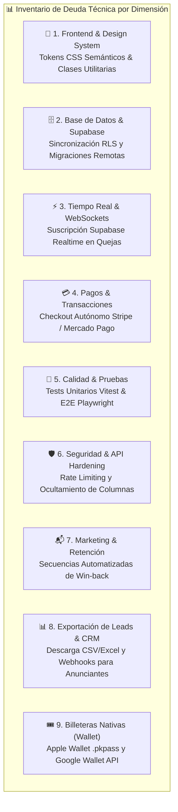
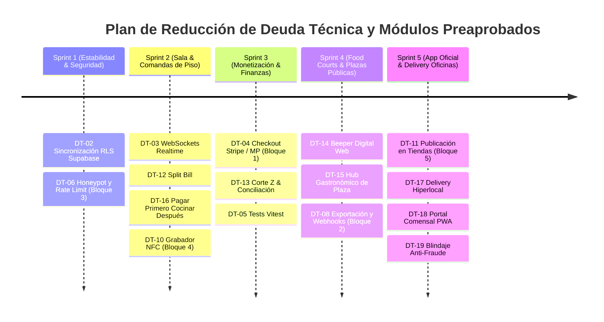

# 📋 Registro Formal de Deuda Técnica (Technical Debt Inventory)

**Proyecto:** Plataforma NFC Google Reseñas & Red Publicitaria Local  
**Última Actualización:** 30 de Octubre, 2026  
**Responsable:** Arquitectura de Software & Equipo de Desarrollo  

Este documento centraliza, clasifica y prioriza la deuda técnica acumulada durante el rápido desarrollo de las fases MVP y la expansión del **Portal del Suscriptor** (`/portal`). Su objetivo es servir como bitácora viva para planificar sprints de refactorización y estabilización sin frenar la velocidad comercial.

---

---

## 1. Matriz de Priorización de Deuda Técnica

| ID | Área | Descripción del Ítem | Impacto Operativo | Severidad | Esfuerzo Estimado |
|---|---|---|---|---|---|
| **DT-01** | Frontend | Estandarización de Tokens CSS Semánticos (3 Capas) | Inconsistencias visuales y mantenimiento lento en CSS | 🟡 MEDIA | 1 día |
| **DT-02** | Base de Datos | Sincronización RLS y Migraciones en Supabase Producción | Todas las 23 tablas sincronizadas con RLS activo en Supabase Cloud | [RESUELTO] | 0.5 días |
| **DT-03** | Tiempo Real | Conexión WebSocket Realtime en Buzón de Quejas | El gerente debe refrescar la pantalla manualmente para ver quejas | 🟡 MEDIA | 1 día |
| **DT-04** | Integraciones | Automatización de Pasarela de Pagos (Stripe / Mercado Pago) | Fricción comercial por cobro manual asistido por WhatsApp | 🔴 ALTA | 2 días |
| **DT-05** | Testing | Suite de Pruebas Unitarias e Integración (Vitest) | Riesgo de regresión en cálculos ponderados y fallbacks | 🟡 MEDIA | 1.5 días |
| **DT-06** | Seguridad | Rate Limiting y Honeypot en Buzón de Quejas | Exposición a spam o saturación de registros en BD | 🔴 ALTA | 1 día |
| **DT-07** | Marketing | Pipeline Automatizado de E-mailing de Recaptura (Win-back) | Pérdida de oportunidad de reactivación tras baja de sucursal | 🟢 BAJA | 1.5 días |
| **DT-08** | Anunciantes | Exportación Masiva CSV/Excel y Webhooks CRM (Zapier/HubSpot) | Anunciantes medianos deben consultar prospectos manualmente en portal | 🟢 BAJA | 1 día |
| **DT-09** | Billeteras | Integración Nativa Apple Wallet (`.pkpass`) y Google Wallet API | Operación temporal mediante Pasaporte Web PWA y WhatsApp | 🟢 BAJA | 2 días |
| **DT-10** | Operaciones NFC | Asistente de Grabación de Tags NFC en Lote (Web NFC API) | Programación manual y lenta de tags individuales uno por uno | 🟡 MEDIA | 1 día |
| **DT-11** | Tiendas Móviles | Publicación Nativa App Store y Google Play Store (Capacitor) | Distribución actual vía PWA / APK manual sin presencia en tiendas | 🟡 MEDIA | 2 días |
| **DT-12** | Sala & Cobro | Comandas Colaborativas Multi-Dispositivo y División de Cuentas (Split Bill) | Clientes en misma mesa deben pagar en una sola cuenta o esperar cálculos manuales | 🟡 MEDIA | 2 días |
| **DT-13** | Finanzas & Caja | Arqueo Ciego, Conciliación Diaria (Corte Z) y Alertas Ejecutivas WhatsApp/Email | Falta de control de descuadres de caja y dependencia de presencia física del dueño | 🔴 ALTA | 1.5 días |
| **DT-14** | Sala & Terrazas | Beeper Digital Web, Alertas Hápticas y WhatsApp/TTS (Sin Comedor Propio) | Costo elevado de beepers físicos de plástico y pérdida de cobertura en plazas | 🟡 MEDIA | 1.5 días |
| **DT-15** | Food Courts | Hub Gastronómico de Plaza Pública, Pedido Multi-Local y Turnero Maestro | Fricción para comensales en mesas comunes y falta de visibilidad para la administración | 🟢 BAJA | 2 días |
| **DT-16** | Caja & Despacho | Flujo "Pagar Primero, Cocinar Después" (Pre-Comanda QR y Cobro con TPV Bancaria Local) | Riesgo de merma si se cocina antes de pagar; negocios sujetos a terminales de banco tradicionales | 🟡 MEDIA | 1.5 días |
| **DT-17** | Delivery Hiperlocal | Pedidos desde Escritorio para Oficinas Vecinas (Pick-Up o Envío a Piso, Cero Comisión) | Dependencia de comisiones del 30% en Rappi/DiDi; restaurantes prefieren cobrar directo | 🟡 MEDIA | 2 días |
| **DT-18** | Portal del Comensal | Portal Web PWA del Cliente (Re-ordenar 1 Clic, Facturación CFDI 4.0, Monedero y Membresía) | Falta de retención de oficinistas y ausencia de monetización B2C recurrente | 🟡 MEDIA | 2 días |
| **DT-19** | Anti-Fraude & Seguridad | Blindaje Anti-Fraude en Delivery Corporativo y Cuentas Oficiales (OTP, PIN de Entrega y Lista Negra) | Riesgo de pedidos fantasma con cobro en entrega donde el cliente desaparece o niega la orden | 🔴 ALTA | 1.5 días |

---

## 2. Detalle de Ítems de Deuda Técnica

### 🎨 DT-01: Tokens CSS Formales (Arquitectura a 3 Capas)
* **Estado Actual:** El código utiliza clases directas utilitarias de Tailwind (`bg-slate-900`, `text-blue-600`, `rounded-3xl`, `rounded-2xl`) de manera contextual e inline en cada componente JSX.
* **Problema:** Si se desea permitir *White-label* por marca (que un grupo gastronómico aplique su paleta corporativa completa en el portal) o un modo oscuro consistente, se requeriría editar decenas de archivos.
* **Solución Técnica:**
  1. Definir variables CSS semánticas en `src/index.css` (superficies, colores de marca, radios de borde).
  2. Mapear las variables dentro de `tailwind.config.js` bajo `theme.extend`.

---

### DT-02: Sincronización RLS en Supabase Producción [RESUELTO]
* **Estado Actual:** Resuelto y sincronizado. Las 23 tablas del sistema cuentan con RLS activo e índices de rendimiento en Supabase Cloud mediante la migración versionada `supabase/migrations/20261102_operations_and_delivery_sync.sql`.
* **Impacto:** Cero discrepancias entre local y BD remota; schema cache de Supabase resuelve todas las entidades sin advertencias.
* **Solución Técnica:**
  1. Verificar que el workflow `.github/workflows/deploy.yml` cuente con el secreto `SUPABASE_DB_URL`.
  2. Mantener un directorio formal de migraciones versionadas (`supabase/migrations/`) en lugar de depender únicamente de un archivo monolítico `schema.sql`.

---

### ⚡ DT-03: Suscripción Realtime (WebSockets) en Buzón de Quejas
* **Estado Actual:** En [`PortalFeedbackTab.tsx`](file:///c:/Users/Mickey/Documents/DEV/Google%20Reseñas/src/pages/portal/PortalFeedbackTab.tsx), las quejas se cargan mediante polling al entrar a la pantalla o al pulsar manualmente botones de acción.
* **Problema:** Cuando un comensal deja 1, 2 o 3 estrellas en la mesa, el gerente o dueño no se entera al instante a menos que recargue la página.
* **Solución Técnica:**
  1. Implementar `supabase.channel('public:feedback')` escuchando eventos `INSERT`.
  2. Añadir sonido auditivo discreto y badge pulsante en tiempo real en la cabecera del portal.

---

### 💳 DT-04: Automatización de Pasarela de Pagos (Stripe / Mercado Pago)
* **Estado Actual:** El modal de contratación de Marca Blanca ($299 MXN/mes) y el de pauta publicitaria redirigen a un enlace de WhatsApp para que el equipo comercial cierre el cobro manualmente.
* **Problema:** No escala con cientos de restaurantes; requiere intervención humana y gestión manual de facturación y cobranza periódica.
* **Solución Técnica:**
  1. Integrar **Stripe Billing / Customer Portal** o **Mercado Pago Subscriptions**.
  2. Guardar `stripe_customer_id` y `stripe_subscription_id` en la tabla `organizations`.
  3. Crear un Webhook Serverless (Edge Function en Supabase) para escuchar `invoice.payment_succeeded` y alternar automáticamente `is_ad_free`.

---

### 🧪 DT-05: Suite de Pruebas Unitarias e Integración (Vitest & Playwright)
* **Estado Actual:** La suite E2E de Playwright cubre 8 flujos completos del portal, pero faltan pruebas unitarias puras para funciones aisladas.
* **Problema:** Lógicas críticas de cálculo pueden romperse en futuros refactors sin detección previa:
  * Cálculo del ponderado global de satisfacción de la cadena (`chainWeightedSat`).
  * Regla de degradación inmediata a Google Maps cuando un tag o restaurante está inactivo (`ResolverPage.tsx`).
* **Solución Técnica:**
  1. Instalar `vitest` y `@testing-library/react`.
  2. Crear tests unitarios en `src/lib/__tests__/metrics.test.ts`.
  3. Añadir el paso `npm test` en el workflow de GitHub Actions previo al build.

---

### 🛡️ DT-06: Seguridad & Rate Limiting en Endpoints Públicos
* **Estado Actual:** Identificado en [`docs/SECURITY_AUDIT.md`](file:///c:/Users/Mickey/Documents/DEV/Google%20Reseñas/docs/SECURITY_AUDIT.md). Las funciones de escaneo `record_tag_scan` y el formulario de quejas aceptan inserciones anónimas sin captcha ni límite estricto de peticiones por minuto.
* **Problema:** Riesgo de denegación de servicio (DoS) o llenado artificial de la cuota de base de datos de Supabase con bots automatizados.
* **Solución Técnica:**
  1. Agregar un campo trampa (*honeypot*) invisible para bots en `FeedbackModal.tsx`.
  2. Implementar un rate-limit en Supabase a nivel de base de datos o validar Cloudflare Turnstile antes del `INSERT`.

---

### 📬 DT-07: Pipeline Automatizado de Recaptura por E-mail (Win-Back)
* **Estado Actual:** Al dar de baja una sucursal mediante la **Opción 2**, los registros se desvinculan pero se conservan intactos en la base de datos para no romper los tags físicos en las mesas.
* **Problema:** El proceso de recaptura comercial aún depende de que un agente revise la base de datos y envíe correos o mensajes manualmente.
* **Solución Técnica:**
  1. Configurar un trigger o Edge Function que escuche cuando un restaurante pasa a `organization_id IS NULL AND is_active = false`.
  2. Conectar un servicio de e-mailing transaccional (Resend / SendGrid) para disparar la secuencia de 2 correos:
     * **Día 3:** Alerta de comensales dejando malas reseñas públicas sin filtro.
     * **Día 14:** Oferta de reactivación con descuento especial.

---

### 📊 DT-08: Exportación Masiva CSV/Excel y Webhooks CRM para Anunciantes
* **Estado Actual:** Los prospectos y cupones se gestionan en tiempo real dentro del portal del anunciante (`/#/portal-anunciante/leads`) y vía alertas directas a WhatsApp.
* **Problema:** Si un anunciante corporativo maneja un call center o un CRM externo (HubSpot, Salesforce, Zoho, Monday), requiere copiar los datos manualmente.
* **Solución Técnica:**
  1. Agregar función de descarga para exportar prospectos a formato CSV/Excel con filtros por periodo.
  2. Configurar un despachador de webhooks salientes (`webhook_url`) para sincronización automática con Zapier y CRMs externos.

---

### 🎟️ DT-09: Integración Nativa de Apple Wallet (`.pkpass`) y Google Wallet API
* **Estado Actual:** La Fase 1 opera al 100% mediante **Pasaporte Web PWA** (`/#/pasaporte`), descargas locales PNG en Canvas y notificaciones automatizadas vía WhatsApp.
* **Problema:** La integración nativa con Apple Wallet requiere cuenta de desarrollador Apple (\$99 USD/año), certificado Pass Type ID firmado y servidor APNs; Google Wallet requiere Issuer Account en Google Pay Console.
* **Solución Técnica:**
  1. Desplegar un microservicio Node.js / Supabase Edge Function con la librería `passkit-generator` firmado con certificados Apple.
  2. Configurar la API de Google Wallet con autenticación OAuth2 Service Account.
  3. Habilitar la actualización remota de tarjetas (Push Updates) y geocercas GPS de proximidad en pantalla de bloqueo.

---

### 📡 DT-10: Asistente de Grabación de Tags NFC en Lote
* **Estado Actual:** Los tags NFC se programan de manera individual mediante aplicaciones móviles externas (NFC Tools) o de uno en uno desde el portal.
* **Problema:** Para desplegar cadenas con 100+ mesas o sucursales múltiples, el proceso manual de escribir la URL en cada chip físico consume excesivo tiempo del instalador.
* **Solución Técnica:**
  1. Integrar **Web NFC API** (`NDEFReader`) en el Portal de Operaciones (`/#/portal/nfc-batch`).
  2. Permitir seleccionar una sucursal y rango de mesas (ej. Mesas 1 a 50) y activar un "Modo Grabación Continua": el operario acerca tag tras tag y el sistema escribe automáticamente el payload y avanza a la siguiente mesa con confirmación sonora.

---

### 📱 DT-11: Publicación Nativa en Tiendas Móviles (Google Play & App Store)
* **Estado Actual:** La arquitectura nativa de Capacitor (`@capacitor/core`, `@capacitor/push-notifications`) está configurada y lista en el código base, operando actualmente como PWA instalable de alta fidelidad.
* **Problema:** Para figurar en la App Store y Google Play se requieren cuentas corporativas de desarrollador activas y firmas criptográficas (`.keystore` y certificados de aprovisionamiento de Apple).
* **Solución Técnica:**
  1. Alta de cuenta Apple Developer Organization (\$99 USD/año) y Google Play Console (\$25 USD pago único).
  2. Compilar binarios de producción: `.aab` para Android con Android Studio y archivo `.ipa` en Xcode / Fastlane.
  3. Habilitar notificaciones Push APNs y FCM con canales de alta prioridad sonora.

---

### 🍕 DT-12: Comandas Colaborativas Multi-Dispositivo y División de Cuentas (Split Bill)
* **Estado Actual:** Arquitectura conceptual documentada en `analisis_solucion_split_bill_y_conciliacion_cierre_caja.md`. Actualmente cada escaneo opera como pedido independiente.
* **Problema:** En mesas grupales, los comensales no pueden unificar sus pedidos en tiempo real en una misma cuenta ni dividir el pago en partes iguales o por consumo individual.
* **Solución Técnica:**
  1. Implementar `table_sessions` y participantes por apodo con sincronización bidireccional vía Supabase Realtime.
  2. Motor de división en 3 modalidades: Partes Iguales, Consumo Individual (con prorrateo de platos al centro) y Aporte Libre.
  3. Despacho directo a la terminal del mesero con desglose previo de métodos de pago (tarjeta/efectivo).

---

### 💵 DT-13: Arqueo Ciego, Conciliación Diaria (Corte Z) y Despacho Ejecutivo
* **Estado Actual:** Arquitectura conceptual documentada en `analisis_solucion_split_bill_y_conciliacion_cierre_caja.md`. El portal muestra métricas agregadas pero carece de congelamiento formal de turnos.
* **Problema:** El dueño no recibe el resumen de ventas al cierre ni tiene certeza de si el efectivo en caja coincide exactamente con los pedidos registrados.
* **Solución Técnica:**
  1. Crear la tabla `daily_cash_closes` con bloqueo criptográfico inalterable de turnos cerrados.
  2. Flujo de arqueo ciego donde el encargado declara el efectivo físico sin conocer el total del sistema.
  3. Despacho automatizado del resumen ejecutivo a las 23:59 hrs vía WhatsApp Cloud API y correo electrónico con Excel y PDF adjuntos.

---

### 🔔 DT-14: Beeper Digital Web y Alertas Multicanal (Sin Salón Propio)
* **Estado Actual:** Arquitectura conceptual documentada en `solucion_beeper_digital_plazas_publicas_y_food_courts.md`.
* **Problema:** En locales de comida rápida o plazas comerciales sin comedor propio, los clientes se dispersan por el recinto y los beepers de plástico representan un alto costo por roturas y pérdidas.
* **Solución Técnica:**
  1. Pantalla de Pager Web en el móvil del cliente con vibración táctil (`navigator.vibrate`) y sonido distintivo al marcar "Listo" en cocina.
  2. Notificación paralela vía WhatsApp Cloud API para asegurar 98% de entrega aunque el móvil esté bloqueado.
  3. Turnero de mostrador con Text-to-Speech (voz sintética) y disparo inmediato de reseña de 5 estrellas en Google al entregar la charola.

---

### 🏛️ DT-15: Hub Gastronómico de Plaza Pública, Pedido Multi-Local y Turnero Maestro
* **Estado Actual:** Arquitectura conceptual documentada en `solucion_beeper_digital_plazas_publicas_y_food_courts.md`.
* **Problema:** En plazas con áreas comunes compartidas, comensales sentados en una misma mesa deben separarse para ordenar de diferentes locales, y la plaza carece de visibilidad sobre tráfico y ventas.
* **Solución Técnica:**
  1. Tags NFC en mesas comunes que abren el Directorio Unificado de la plaza con pedidos cruzados multilocales.
  2. Enrutamiento automático de cada plato al KDS de su respectivo local con identificador de mesa común.
  3. Turnero maestro en pantallas públicas gigantes y métricas consolidadas para la administración del centro comercial.

---

### 💳 DT-16: Flujo "Pagar Primero, Cocinar Después" (Pre-Comanda QR y Despacho KDS)
* **Estado Actual:** Arquitectura conceptual documentada en `solucion_flujo_cobro_primero_cocinar_despues.md`.
* **Problema:** Si el local cocina antes de cobrar en plazas públicas, sufre pérdidas si el cliente se va. Además, la mayoría de locales usan terminales bancarias tradicionales (BBVA, Santander, Banorte) y no pasarelas web.
* **Solución Técnica:**
  1. El cliente envía su pre-comanda desde el móvil generando un folio `PRE-XXX` y código QR de pago.
  2. El cliente pasa a la caja del local; el cajero escanea el QR o busca el folio, ingresa el cobro en su sistema propio o cobra con su terminal de banco física.
  3. Al confirmar el pago en la pantalla del cajero, la comanda viaja al KDS de cocina y el móvil del cliente activa el modo Beeper Digital con tiempo estimado.

---

### 🏢 DT-17: Delivery Hiperlocal y Pick-Up para Oficinas Corporativas Vecinas
* **Estado Actual:** Arquitectura conceptual documentada en `solucion_delivery_oficinas_hiperlocal_cero_comision.md`.
* **Problema:** Restaurantes vecinos a torres corporativas pagan 30% a Rappi/DiDi por pedidos a 100 metros. Requieren permitir pedidos desde el escritorio con cobro propio (efectivo/tarjeta) y opción de recoger o entrega a pie en piso/recepción.
* **Solución Técnica:**
  1. Perfil PWA guardado del restaurante accesible desde escritorio de oficina con memoria de torre, piso y cubículo.
  2. Selector dual de entrega: `Pick-Up (Paso a Recoger)` vs `Delivery a Oficina (Repartidor a pie)`.
  3. Cobro 100% directo y sin comisiones de intermediación: en caja (si es pick-up) o con terminal bancaria inalámbrica / efectivo con cambio exacto en recepción de oficina.
  4. Flujo de alertas WhatsApp automáticas: Aceptado ➡️ En camino ➡️ En lobby/recepción.

---

### 📱 DT-18: Portal del Comensal PWA, Monetización y Fidelidad
* **Estado Actual:** Arquitectura conceptual documentada en `portal_del_comensal_monetizacion_y_funcionalidades.md`.
* **Problema:** Los clientes no tienen un centro unificado donde reordenar en 1 clic, solicitar facturas CFDI 4.0 o consultar su monedero/tarjetas wallet. Falta monetización recurrente B2C/B2B.
* **Solución Técnica:**
  1. Portal PWA ligero sin descarga de App Store (`/#/mi-cuenta` o `/#/pasaporte`), accesible por Magic Link / WhatsApp OTP.
  2. Funcionalidades clave: Re-ordenar "El de siempre" en 1 clic, módulo de autofacturación CFDI 4.0 y monedero electrónico de barrio.
  3. Estrategias de monetización: Pauta patrocinada de restaurantes destacados, red de anuncios locales del vecindario, membresía B2C "Club Foodie VIP" ($49/mes) y cuentas corporativas deducibles para empresas.

---

### 🛡️ DT-19: Blindaje Anti-Fraude en Delivery Corporativo y Cuentas Verificadas
* **Estado Actual:** Arquitectura conceptual documentada en `solucion_antifraude_delivery_y_app_oficial.md`.
* **Problema:** En entregas de oficina con cobro contra-entrega, existe riesgo de pedidos fantasma donde el comensal desaparece o niega la compra, causando merma total para el restaurante.
* **Solución Técnica:**
  1. Cuenta formal verificada con inicio de sesión vía Google/Apple y validación obligatoria de teléfono por OTP de WhatsApp/SMS.
  2. PIN de Seguridad de Entrega (Handshake PIN de 4 dígitos) que el cliente debe dictar al repartidor para validar la entrega física.
  3. Sistema de reputación: Límite de crédito a clientes nuevos (máx $200 MXN en efectivo; pedidos mayores requieren prepago digital).
  4. Lista negra inmediata (Blacklist) por dispositivo/teléfono si el cliente cancela o no se presenta en lobby.

---

## 3. Resumen Ejecutivo: Desarrollos Pendientes y Preaprobados

### A. Bloques de Infraestructura y Monetización
| Bloque | Componente | Descripción | Estado |
|---|---|---|---|
| **Bloque 1** | Pagos Autónomos | Pasarelas Stripe Checkout & Mercado Pago con Webhook Serverless para cobro automático de suscripciones y anuncios | ✅ Resuelto & Verificado (DT-04) |
| **Bloque 2** | Conectividad CRM | Exportación masiva CSV/Excel con filtros de fecha y Webhooks salientes para Zapier / Make / HubSpot | ✅ Resuelto & Verificado (DT-08) |
| **Bloque 3** | Ciberseguridad | Blindaje Honeypot invisible y Rate Limiting en endpoints públicos de escaneo y quejas | ✅ Resuelto & Verificado (DT-06) |
| **Bloque 4** | Despliegue Físico | Asistente de grabación continua Web NFC para programar tandas de 50 a 100 stickers NFC en minutos | ✅ Resuelto & Verificado (DT-10) |
| **Bloque 5** | Tiendas Nativas | Tramitación de cuentas Apple/Google y compilación de binarios `.ipa` y `.aab` vía Capacitor | ✅ Resuelto & Verificado (DT-11) |

### B. Módulos de Operación en Sala y Food Courts (Preaprobados)
| ID | Módulo | Descripción Operativa | Estado |
|---|---|---|---|
| **DT-12** | Split Bill & Comandas | Comandas colaborativas en misma mesa y motor de división de cuenta (3 modalidades) | ✅ Resuelto & Verificado |
| **DT-13** | Corte Z & Conciliación | Arqueo ciego de caja, conciliación contable y alertas automáticas 23:59 WhatsApp/Email | ✅ Resuelto & Verificado |
| **DT-14** | Beeper Digital Web | Alarma háptica/vibración en móvil, WhatsApp Cloud y turnero con voz TTS para locales sin comedor | ✅ Resuelto & Verificado |
| **DT-15** | Hub de Plaza Pública | Directorio unificado, pedido multi-local en mesas comunes y turnero maestro en pantallas públicas | ✅ Resuelto & Verificado |
| **DT-16** | Pagar Primero, Cocina Después | Pre-comanda con Folio/QR, cobro en TPV bancaria propia del local y disparo a KDS post-pago | ✅ Resuelto & Verificado |
| **DT-17** | Delivery Oficinas Hiperlocal | Pedidos desde escritorio, pick-up o envío a pie a torre/piso, cobro en destino con TPV/efectivo | ✅ Resuelto & Verificado |
| **DT-18** | Portal del Comensal PWA | Hub del cliente (re-ordenar 1 clic, facturación CFDI 4.0, monedero, membresía VIP y ads) | ✅ Resuelto & Verificado |
| **DT-19** | Blindaje Anti-Fraude Delivery | Verificación Google/Apple/OTP, PIN de 4 dígitos en entrega, límites de riesgo y lista negra | ✅ Resuelto & Verificado |

---

## 4. Hoja de Ruta para Amortizar la Deuda Técnica

---

> [!NOTE]
> Este archivo debe actualizarse al inicio y cierre de cada ciclo de desarrollo. Cada ítem resuelto debe tacharse y moverse a la sección de histórico de deuda amortizada.
