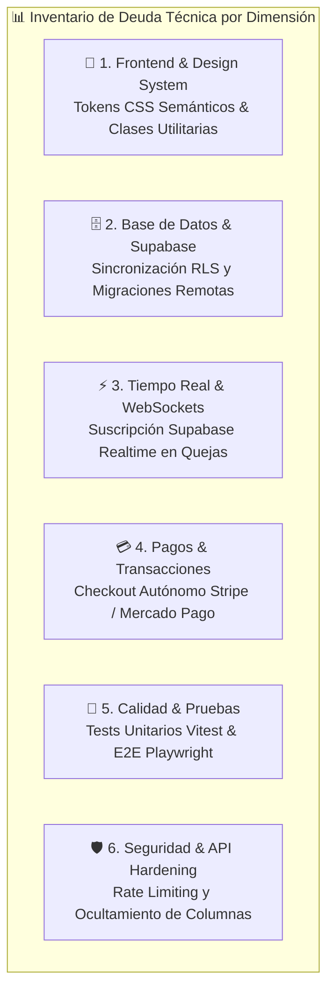
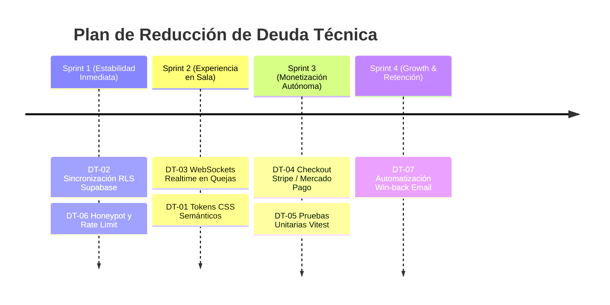

# 📋 Registro Formal de Deuda Técnica (Technical Debt Inventory)

**Proyecto:** Plataforma NFC Google Reseñas & Red Publicitaria Local  
**Última Actualización:** 29 de Octubre, 2026  
**Responsable:** Arquitectura de Software & Equipo de Desarrollo  

Este documento centraliza, clasifica y prioriza la deuda técnica acumulada durante el rápido desarrollo de las fases MVP y la expansión del **Portal del Suscriptor** (`/portal`). Su objetivo es servir como bitácora viva para planificar sprints de refactorización y estabilización sin frenar la velocidad comercial.

---



---

## 1. Matriz de Priorización de Deuda Técnica

| ID | Área | Descripción del Ítem | Impacto Operativo | Severidad | Esfuerzo Estimado |
|---|---|---|---|---|---|
| **DT-01** | Frontend | Estandarización de Tokens CSS Semánticos (3 Capas) | Inconsistencias visuales y mantenimiento lento en CSS | 🟡 MEDIA | 1 día |
| **DT-02** | Base de Datos | Sincronización RLS y Migraciones en Supabase Producción | Riesgo de desalineación entre `schema.sql` local y BD remota | 🔴 ALTA | 0.5 días |
| **DT-03** | Tiempo Real | Conexión WebSocket Realtime en Buzón de Quejas | El gerente debe refrescar la pantalla manualmente para ver quejas | 🟡 MEDIA | 1 día |
| **DT-04** | Integraciones | Automatización de Pasarela de Pagos (Stripe / Mercado Pago) | Fricción comercial por cobro manual asistido por WhatsApp | 🔴 ALTA | 2 días |
| **DT-05** | Testing | Suite de Pruebas Unitarias e Integración (Vitest) | Riesgo de regresión en cálculos ponderados y fallbacks | 🟡 MEDIA | 1.5 días |
| **DT-06** | Seguridad | Rate Limiting y Honeypot en Buzón de Quejas | Exposición a spam o saturación de registros en BD | 🔴 ALTA | 1 día |
| **DT-07** | Marketing | Pipeline Automatizado de E-mailing de Recaptura (Win-back) | Pérdida de oportunidad de reactivación tras baja de sucursal | 🟢 BAJA | 1.5 días |

---

## 2. Detalle de Ítems de Deuda Técnica

### 🎨 DT-01: Tokens CSS Formales (Arquitectura a 3 Capas)
* **Estado Actual:** El código utiliza clases directas utilitarias de Tailwind (`bg-slate-900`, `text-blue-600`, `rounded-3xl`, `rounded-2xl`) de manera contextual e inline en cada componente JSX.
* **Problema:** Si se desea permitir *White-label* por marca (que un grupo gastronómico aplique su paleta corporativa completa en el portal) o un modo oscuro consistente, se requeriría editar decenas de archivos.
* **Solución Técnica:**
  1. Definir variables CSS semánticas en `src/index.css`:
     ```css
     :root {
       --color-surface-base: #f1f5f9;
       --color-surface-card: #ffffff;
       --color-surface-input: #f8fafc;
       --color-primary: #2563eb;
       --color-primary-hover: #1d4ed8;
       --color-accent-wa: #059669;
       --color-danger: #e11d48;
       --radius-container: 1.5rem; /* rounded-3xl */
       --radius-card: 1rem;       /* rounded-2xl */
       --radius-control: 0.75rem; /* rounded-xl */
     }
     ```
  2. Mapear las variables dentro de `tailwind.config.js` bajo `theme.extend`.

---

### 🗄️ DT-02: Sincronización RLS en Supabase Producción
* **Estado Actual:** El archivo `supabase/schema.sql` contiene las tablas `organization_members`, `billing_info` en `organizations`, notas internas `internal_notes` en `feedback`, y funciones helper RLS (`get_user_organization_ids`, `is_superadmin`).
* **Problema:** El despliegue de GitHub Actions corre automáticamente para el frontend estático, pero la base de datos de producción requiere que el secreto `SUPABASE_DB_URL` esté configurado en el repositorio para aplicar cambios vía `psql`, o bien ejecutarse manualmente desde el Supabase SQL Editor.
* **Solución Técnica:**
  1. Verificar que el workflow `.github/workflows/deploy.yml` cuente con el secreto `SUPABASE_DB_URL`.
  2. Mantener un directorio formal de migraciones versionadas (`supabase/migrations/001_initial.sql`, `supabase/migrations/002_portal_subscriber.sql`) en lugar de depender únicamente de un archivo monolítico `schema.sql`.

---

### ⚡ DT-03: Suscripción Realtime (WebSockets) en Buzón de Quejas
* **Estado Actual:** En [`PortalFeedbackTab.tsx`](file:///c:/Users/Mickey/Documents/DEV/Google%20Reseñas/src/pages/portal/PortalFeedbackTab.tsx), las quejas se cargan mediante polling al entrar a la pantalla o al pulsar manualmente botones de acción.
* **Problema:** Cuando un comensal deja 1, 2 o 3 estrellas en la mesa, el gerente o dueño no se entera al instante a menos que recargue la página.
* **Solución Técnica:**
  1. Implementar `supabase.channel('public:feedback')`:
     ```ts
     useEffect(() => {
       const channel = supabase
         .channel('realtime_feedback')
         .on('postgres_changes', {
           event: 'INSERT',
           schema: 'public',
           table: 'feedback',
           filter: `restaurant_id=in.(${myRestaurantIds.join(',')})`
         }, (payload) => {
           // Reproducir sonido sutil de alerta y agregar queja al estado
           playNotificationSound();
           setFeedbacks(prev => [payload.new as Feedback, ...prev]);
         })
         .subscribe();

       return () => { supabase.removeChannel(channel); };
     }, [myRestaurantIds]);
     ```
  2. Añadir sonido y badge pulsante en tiempo real en el encabezado.

---

### 💳 DT-04: Automatización de Pasarela de Pagos (Stripe / Mercado Pago)
* **Estado Actual:** El modal de contratación de Marca Blanca ($299 MXN/mes) y el de pauta publicitaria redirigen a un enlace de WhatsApp para que el equipo comercial cierre el cobro manualmente.
* **Problema:** No escala con cientos de restaurantes; requiere intervención humana y gestión manual de facturación y cobranza periódica.
* **Solución Técnica:**
  1. Integrar **Stripe Billing / Customer Portal** o **Mercado Pago Subscriptions**.
  2. Guardar `stripe_customer_id` y `stripe_subscription_id` en la tabla `organizations`.
  3. Crear un Webhook Serverless (Edge Function en Supabase) para escuchar `invoice.payment_succeeded` y `customer.subscription.deleted`, alternando automáticamente `is_ad_free` y `is_active`.

---

### 🧪 DT-05: Suite de Pruebas Unitarias e Integración (Vitest & Playwright)
* **Estado Actual:** La validación actual se apoya exclusivamente en el tipado estricto de TypeScript (`tsc`) y la compilación de Vite (`vite build`).
* **Problema:** Lógicas críticas de cálculo financiero y reputacional pueden romperse en futuros refactors sin detección previa:
  * Cálculo del ponderado global de satisfacción de la cadena (`chainWeightedSat`).
  * Regla de degradación inmediata a Google Maps cuando un tag o restaurante está inactivo (`ResolverPage.tsx`).
  * Validación del filtro de quejas de 1 a 3 estrellas vs. 4 a 5 estrellas.
* **Solución Técnica:**
  1. Instalar `vitest` y `@testing-library/react`.
  2. Crear tests unitarios en `src/lib/__tests__/metrics.test.ts` y `src/pages/__tests__/ResolverPage.test.tsx`.
  3. Añadir el paso `npm test` en el workflow de GitHub Actions previo al build.

---

### 🛡️ DT-06: Seguridad & Rate Limiting en Endpoints Públicos
* **Estado Actual:** Identificado en [`docs/SECURITY_AUDIT.md`](file:///c:/Users/Mickey/Documents/DEV/Google%20Reseñas/docs/SECURITY_AUDIT.md). Las funciones de escaneo `record_tag_scan` y el formulario de quejas aceptan inserciones anónimas sin captcha ni límite estricto de peticiones por minuto.
* **Problema:** Riesgo de denegación de servicio (DoS) o llenado artificial de la cuota de base de datos de Supabase con bots automatizados.
* **Solución Técnica:**
  1. Agregar un campo trampa (*honeypot*) invisible para bots en `FeedbackModal.tsx`.
  2. Implementar un rate-limit en Supabase a nivel de base de datos o validar Cloudflare Turnstile antes del `INSERT`.
  3. Ocultar columnas sensibles de restaurantes (`manager_phone`, `billing_info`) a consultas anónimas mediante una vista pública SQL (`public_restaurants_view`).

---

### 📬 DT-07: Pipeline Automatizado de Recaptura por E-mail (Win-Back)
* **Estado Actual:** Al dar de baja una sucursal mediante la **Opción 2**, los registros se desvinculan pero se conservan intactos en la base de datos para no romper los tags físicos en las mesas.
* **Problema:** El proceso de recaptura comercial aún depende de que un agente revise la base de datos y envíe correos o mensajes manualmente.
* **Solución Técnica:**
  1. Configurar un trigger o Edge Function que escuche cuando un restaurante pasa a `organization_id IS NULL AND is_active = false`.
  2. Conectar un servicio de e-mailing transaccional (Resend / SendGrid) para disparar la secuencia de 2 correos:
     * **Día 3:** Alerta de comensales dejando malas reseñas públicas sin filtro.
     * **Día 14:** Oferta de reactivación con descuento especial.

---

## 3. Hoja de Ruta para Amortizar la Deuda Técnica



---

> [!NOTE]
> Este archivo debe actualizarse al inicio y cierre de cada ciclo de desarrollo. Cada ítem resuelto debe tacharse y moverse a la sección de histórico de deuda amortizada.

