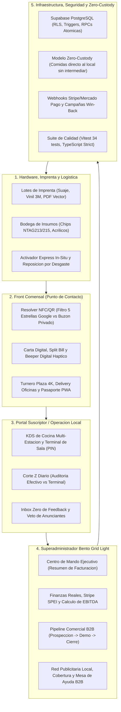
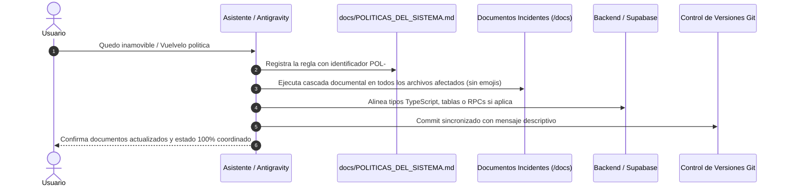
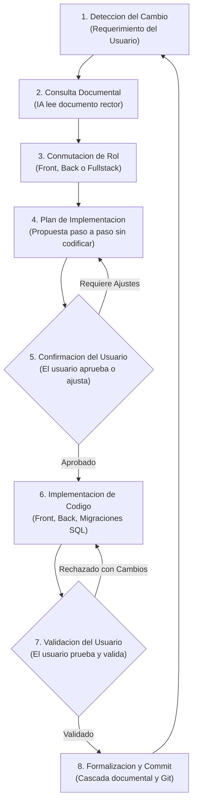

# Framework Documental Maestro (FDM v2.0)
**Sistema Coordinado de Arquitectura, Especificaciones y Operaciones**

* **Proyecto:** Plataforma Integral NFC Google Reseñas, Red Publicitaria Local & Hardware SaaS
* **Version del Framework:** 2.0.0 (Consolidada y Coordinada)
* **Fecha:** Noviembre 2026
* **Estandar:** Diátaxis Framework, Architecture Decision Records (ADR - Michael Nygard) y Docs-as-Code

---

## 1. Vision y Proposito del Framework Coordinado

Este framework garantiza que **absolutamente todos los componentes de la empresa tecnologica esten sincronizados y coordinados en una sola fuente de verdad**:
* Desde el vinil fisico cortado en la imprenta y la antena NTAG pegada en la mesa del restaurante,
* pasando por el escaneo del comensal, el beeper haptico y la comanda a cocina,
* hasta la cobranza de suscripciones en Stripe, el calculo de EBITDA y el pipeline comercial de ventas.



---

## 2. Las 5 Capas Coordinadas del Sistema

### Capa 1: Hardware, Produccion en Imprenta y Logistica de Campo
Documenta el mundo fisico de la empresa:
1. **Lotes de Imprenta (`print_batches`):**
   * Especificaciones de impresion: vinil adhesivo 3M de alto trafico, laminado mate con filtro UV, suaje circular de 6x6 cm.
   * Generacion correlativa de folios (`TAG-0101` a `TAG-0500`) con marcas de corte vectoriales en PDF/SVG para imprenta local.
2. **Control de Bodega (`hardware_inventory`):**
   * Inventario de materias primas: antenas virgenes NTAG213/215, viniles impresos, bases acrilicas de mesa.
   * Punto de reorden automatizado cuando el stock baja del umbral de seguridad.
3. **Instalacion y Campo (`activate_table_tag_in_situ`):**
   * Asistente de instalacion en 3 pasos: tecnico escanea el QR del vinil recien colocado, selecciona restaurante y mesa, y graba la antena NFC en 3 segundos. Descuenta stock atomicamente.
4. **Reposicion por Desgaste (`replace_damaged_table_tag`):**
   * Sustitucion de placas deterioradas por solventes, cloro o exposicion solar, transfiriendo la mesa al nuevo tag sin romper el historico ni los enlaces.

* **Documentos de Referencia:**
  * [`GUIA_OPERATIVA.md`](./GUIA_OPERATIVA.md): Manual de campo e induccion tecnica.
  * [`TAREAS_UI_SUPERADMIN.md`](./TAREAS_UI_SUPERADMIN.md): Tareas UI-HW-01 a UI-HW-04.
  * [`supabase/migrations/20261101_superadmin_infrastructure.sql`](../supabase/migrations/20261101_superadmin_infrastructure.sql).

---

### Capa 2: Experiencia del Comensal y PWA Publica
Documenta la interaccion directa del cliente al tocar la antena NFC o escanear el QR:
1. **Filtro Inteligente de Reseñas (Escudo Reputacional):**
   * Calificacion 4 o 5 estrellas: Redireccion instantanea a la ficha oficial de Google Maps / Reseñas.
   * Calificacion 1 a 3 estrellas: Buzon privado de quejas (`feedback`) con notificacion inmediata al dueño.
2. **Carta Digital y Pedido en Mesa (KDS):**
   * Visualizacion de platillos, seleccion de terminos y envio directo a cocina sin descargar apps.
3. **Beeper Digital Haptico (`BeeperDigitalModal.tsx`):**
   * Vibracion tactil continua y pulsante en el movil del comensal cuando su orden esta lista en barra/cocina.
4. **Turnero Maestro 4K de Plaza Publica (`TurneroPlazaPage.tsx`):**
   * Pantalla gigante para patios de comida y food halls con audio chime y sintetizador de voz (Web Speech API).
5. **Blindaje Delivery Corporativo a Oficinas (`CorporateDeliveryModal.tsx`):**
   * Captura de coordenadas de edificio, piso y numero de oficina, con PIN secreto de 4 digitos para entrega mano a mano y lista negra de telefonos fraudulentos.
6. **Pasaporte Web PWA y Cupones (`WebPassportPage.tsx` / `RedeemCouponPage.tsx`):**
   * Billetera de fidelidad, acumulacion de cashback, promociones de un solo uso y descarga de passes (Apple Wallet / Google Pay).

* **Documentos de Referencia:**
  * [`SPEC.md`](./SPEC.md): Especificacion integral de comensal.
  * [`SPEC_INFRAESTRUCTURA_CUPONES.md`](./SPEC_INFRAESTRUCTURA_CUPONES.md): Motor de cupones.

---

### Capa 3: Operacion en Local (Portal del Suscriptor)
Documenta la interfaz que operan los dueños, meseros y cocineros en el restaurante:
1. **KDS de Cocina Multi-Estacion (`PortalKitchenPage.tsx`):**
   * Filtros de comanda por estacion: Cocina Caliente, Barra de Bebidas, Postres y Salida.
2. **Terminal de Sala para Meseros (`PortalStaffPage.tsx`):**
   * Acceso por PIN rapido de 4 digitos para atender llamadas de mesa, solicitudes de cuenta y pedidos.
3. **Corte Z Diario (`DailyCashClose`):**
   * Arqueo ciego de caja, balance entre ventas en efectivo, terminal y diferencias reportadas al dueño.
4. **Inbox Zero de Reseñas Privadas:**
   * Gestion de quejas de 1-3 estrellas antes de que lleguen a redes sociales.
5. **Autonomia Publicitaria (Veto de Anunciantes):**
   * El locatario puede vetar 1 anunciante de la red por mes para proteger la imagen de su negocio.

* **Documentos de Referencia:**
  * [`SPEC_PORTAL_SUSCRIPTOR.md`](./SPEC_PORTAL_SUSCRIPTOR.md): Especificacion de roles y vistas.
  * [`MASTER_PLAN_PORTAL_SUSCRIPTOR.md`](./MASTER_PLAN_PORTAL_SUSCRIPTOR.md): Roadmap de ejecucion en local.

---

### Capa 4: Superadministrador Bento Grid (Light Theme)
Documenta el centro de mando para la direccion, ventas, marketing y soporte:
1. **Bento Box 1: Centro de Mando Ejecutivo (`AdminDashboardPage.tsx`):**
   * KPIs consolidados: facturacion real del mes, composicion de ingresos (Ads vs SaaS), stock de insumos y feed en vivo.
2. **Bento Box 2: Pipeline Comercial B2B y Marketing:**
   * Embudo de ventas para prospectar restaurantes, agendar visitas de demostracion de placas NFC y cerrar contratos.
   * Automatizacion de secuencias Win-Back para restaurantes cancelados (Dia 3 y Dia 14).
3. **Bento Box 3: Hardware, Lotes de Imprenta y Activador:**
   * Monitoreo de stock de insumos fisicos, generador de pliegos y activador in-situ.
4. **Bento Box 4: Finanzas Reales, Stripe SPEI y Reposiciones:**
   * Semaforo de cobro de suscripciones, estatus de saldo en Stripe y mesa de reposicion de tags dañados.
5. **Directorio y Cobertura Territorial:**
   * Restaurantes, Tags NFC, Red de Anuncios, Cobertura en mapa metropolitano y Mesa de Ayuda B2B.

* **Documentos de Referencia:**
  * [`TAREAS_UI_SUPERADMIN.md`](./TAREAS_UI_SUPERADMIN.md): Catalogo de tareas UI-HW, UI-VT, UI-FN y UI-RS.
  * [`SPEC_ARQUITECTURA_FINANCIERA.md`](./SPEC_ARQUITECTURA_FINANCIERA.md): Modelo de ingresos y EBITDA.

---

### Capa 5: Infraestructura Tecnica, Seguridad y Zero-Custody
Documenta el backend, bases de datos y cumplimiento regulatorio:
1. **Arquitectura Zero-Custody de Pagos:**
   * El dinero de la comida va directo de la cuenta del comensal a la cuenta de Stripe Connect / Mercado Pago del restaurante. La plataforma no custodia fondos de alimentos.
   * La plataforma solo cobra de forma autonoma: (a) Su suscripcion SaaS mensual y (b) La pauta de la red publicitaria.
2. **Seguridad y RLS Multi-Tenant (PostgreSQL):**
   * Aislamiento estricto por `organization_id` y validacion de `is_superadmin()` para administracion global.
3. **Bitacora de Webhooks y Automatizaciones:**
   * Despacho y reintentos automaticos a CRMs externos (`crm_webhook_logs`) y procesamiento de eventos Stripe (`stripe-webhook`).
4. **Suite de Verificacion Automatizada:**
   * Vitest (34 unit tests verdes), compilacion TypeScript estricta y empaquetado de produccion en Vite.

* **Documentos de Referencia:**
  * [`SECURITY_AUDIT.md`](./SECURITY_AUDIT.md): Auditoria OWASP y mitigacion de vulnerabilidades.
  * [`DEUDA_TECNICA.md`](./DEUDA_TECNICA.md): Bitacora de deuda tecnica resuelta y verificada.

---

## 3. Matriz de Trazabilidad Cruzada

| Dominio | Documento Especificacion | Migracion SQL | Componentes / Paginas Front | Suite de Pruebas |
| :--- | :--- | :--- | :--- | :--- |
| **Hardware e Imprenta** | `TAREAS_UI_SUPERADMIN.md` | `20261101_superadmin_infrastructure.sql` | `AdminTagsPage.tsx` | `nfc.test.ts` |
| **Pipeline Ventas B2B** | `TAREAS_UI_SUPERADMIN.md` | `20261101_superadmin_infrastructure.sql` | `AdminDashboardPage.tsx` | `winback.test.ts` |
| **Comandas y KDS** | `SPEC.md` | `schema.sql` (table_orders) | `PortalKitchenPage.tsx` | `orders.test.ts` |
| **Turnero Plaza 4K** | `DEUDA_TECNICA.md` (DT-15) | `schema.sql` (table_orders) | `TurneroPlazaPage.tsx` | `calculations.test.ts` |
| **Delivery Corporativo** | `DEUDA_TECNICA.md` (DT-17, 19) | `schema.sql` (corporate_orders) | `CorporateDeliveryModal.tsx` | `corporate.test.ts` |
| **Beeper Digital** | `DEUDA_TECNICA.md` (DT-16) | Local / Web Audio / Navigator | `BeeperDigitalModal.tsx` | `beeper.test.ts` |
| **Finanzas y EBITDA** | `SPEC_ARQUITECTURA_FINANCIERA.md` | `schema.sql` / `20261101_phase5...` | `AdminFinancesPage.tsx` | `payments.test.ts` |
| **Exportacion y Reportes** | `DEUDA_TECNICA.md` (DT-11) | Local (Blob / XLSX / PDF) | `src/lib/export.ts` | `export.test.ts` |

---

## 4. Convencion de Trabajo y Reglas de Oro

1. **Ningun codigo sin especificacion previa:** Todo cambio de producto o interfaz debe tener su especificacion en `/docs`.
2. **Coherencia Backend-Frontend:** Todo elemento visual que se presente en la UI debe tener su contraparte en tablas, columnas o RPCs de Supabase.
3. **Modelo Zero-Custody sagrado:** Nunca intermediar ni retener fondos provenientes de las comidas de los restaurantes.
4. **Modo Bento Light para Superadmin:** Toda la consola de direccion debe respetar el estilo Bento Grid en Light Theme (Apple/Linear) con metricas en pesos mexicanos (MXN).
5. **Verificacion continua en Git:** Todo avance debe pasar la suite de pruebas (`npm run test`) y verificacion de tipos (`npx tsc --noEmit`) antes de cada commit.
6. **Prohibicion de Emojis (POL-007):** Queda prohibido el uso de emojis en documentacion y UI; se sustituyen por un repositorio formal de iconos vectoriales (Lucide React en frontend y texto sobrio en markdown).

---

## 5. Protocolo de Cascada Documental: "Quedo inamovible" / "Vuelvelo politica"

Cuando el usuario emita cualquiera de los comandos de activacion:
> "Quedo inamovible" o "Vuelvelo politica"

Se activa de forma inmediata el **Protocolo de Gobernanza Inamovible**:



### Reglas del Protocolo de Cascada:
1. **Identificacion de Alcance:** El asistente evalua que capas del sistema (1 a 5) y que documentos especificos son impactados por la nueva politica.
2. **Registro Centralizado:** Se formaliza en [`POLITICAS_DEL_SISTEMA.md`](./POLITICAS_DEL_SISTEMA.md) con ID correlativo (`POL-###`), descripcion, justificacion tecnica y lista de documentos incidentes.
3. **Actualizacion en Cascada Obligatoria:** Se abren y editan en el mismo turno todos los documentos de `/docs` vinculados, eliminando cualquier version anterior o contradictoria para evitar ambiguedades.
4. **Coherencia con Codigo:** Si la politica afecta base de datos o logica de frontend, se actualiza el esquema (`schema.sql` / migraciones) o componentes respectivos.
5. **Commit Atomico:** Todo el paquete de documentacion sincronizada se resguarda en Git con mensaje formal `docs(politica): POL-### [descripcion]`.


---

## 6. Protocolo de Conmutacion de Tarea para IA y Ciclo Cerrado (POL-008)

De acuerdo con la politica **POL-008**, todo cambio en el sistema debe recorrer estrictamente el **Ciclo Cerrado de 8 Pasos**:



### Estructura Obligatoria en Documentos: Directiva de Conmutacion para IA
Todo documento tecnico, especificacion o PRD dentro de `/docs` debe incluir al final el siguiente bloque estandarizado de conmutacion:

```markdown
## Directiva de Conmutacion para IA (AI Task Switcher)
* **Ambito de Trabajo:** [FRONTEND | BACKEND | FULLSTACK | BASE_DE_DATOS]
* **Documento Rector:** [Ruta relativa del documento]
* **Politicas Inamovibles Aplicables:** [POL-001, POL-002, POL-007, etc.]
* **Archivos Impactados:**
  * Frontend: [src/pages/..., src/components/...]
  * Backend: [supabase/migrations/..., RPCs...]
* **Flujo Obligatorio:**
  1. No codificar sin confirmacion previa del plan por el usuario.
  2. Implementar unicamente lo confirmado.
  3. Validar con pruebas (`npm run test` y `npx tsc --noEmit`).
  4. Solicitar validacion del usuario en pantalla.
  5. Actualizar documentacion y realizar commit en Git al validar.
```
