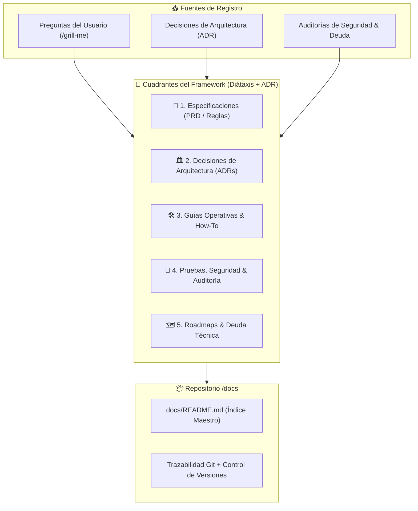
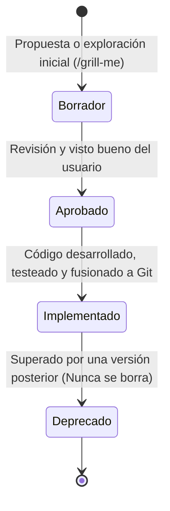

# 📚 Framework de Registro Documental (FRD)
**Estándar de Documentación Técnica & Arquitectura de Software**

**Proyecto:** Plataforma NFC Google Reseñas & Red Publicitaria Local  
**Versión del Framework:** 1.0.0  
**Fecha de Publicación:** 29 de Octubre, 2026  
**Inspiración y Fundamentos:** Diátaxis Framework, Architecture Decision Records (ADR - Michael Nygard) y Filosofía *Docs-as-Code*.

---

## 1. ¿Por qué un Framework Documental?

En proyectos ágiles con inteligencia artificial y desarrollo acelerado, la documentación suele fragmentarse, desactualizarse o perderse en chats. Este framework establece **reglas claras, carpetas y plantillas estándar** para que cualquier cambio técnico, regla de negocio o decisión arquitectónica quede registrada con rigor, trazabilidad y facilidad de consulta.



---

## 2. Taxonomía de Documentos (Los 5 Cuadrantes)

Todos los documentos que residen en `/docs` pertenecen a una de las siguientes 5 categorías:

### 📐 1. Especificaciones y Requisitos de Producto (`SPEC`)
* **Propósito:** Definir el *qué* y el *para quién* de una funcionalidad antes o durante su construcción.
* **Prefijo:** `SPEC_*.md`
* **Ejemplos en el proyecto:**
  * [`SPEC.md`](./SPEC.md) (Especificación integral del sistema).
  * [`SPEC_PORTAL_SUSCRIPTOR.md`](./SPEC_PORTAL_SUSCRIPTOR.md) (Requisitos del portal del dueño).
  * [`SPEC_RED_PUBLICITARIA.md`](./SPEC_RED_PUBLICITARIA.md) (Especificación del ad server y banners).

---

### 🏛️ 2. Registros de Decisión Arquitectónica (`ADR`)
* **Propósito:** Documentar *por qué* se tomó una decisión técnica o de negocio no trivial, qué alternativas se evaluaron y qué consecuencias conlleva.
* **Prefijo:** `ADR_###_*.md` (o sección de decisiones en Master Plan).
* **Ejemplos en el proyecto:**
  * *ADR-001:* Fallback inmediato a Google Maps en Tags de comercios inactivos (Opción 2 sin romper chips).
  * *ADR-002:* Multi-tenancy híbrido con organizaciones y roles `owner` / `manager`.
  * *ADR-003:* Almacenamiento JSONB de datos fiscales en `organizations.billing_info`.

---

### 🛠️ 3. Guías Prácticas y Procedimientos Operativos (`HOW-TO`)
* **Propósito:** Resolver una tarea concreta orientada a la acción paso a paso.
* **Prefijo:** `GUIA_*.md`
* **Ejemplos en el proyecto:**
  * [`GUIA_OPERATIVA.md`](./GUIA_OPERATIVA.md) (Cómo programar chips NFC físicos, dar de alta mesas y vincular QR).

---

### 🧪 4. Auditoría, Seguridad y Reportes de Pruebas (`AUDIT / TEST`)
* **Propósito:** Diagnóstico de calidad, cumplimiento de estándares y resultados de verificación empírica.
* **Prefijo:** `AUDIT_*.md` o `REPORTE_*.md`
* **Ejemplos en el proyecto:**
  * [`SECURITY_AUDIT.md`](./SECURITY_AUDIT.md) (Auditoría OWASP API Security Top 10).
  * [`IMPECCABLE_CRITIQUE.md`](./IMPECCABLE_CRITIQUE.md) (Revisión de diseño de interfaces).
  * *Reportes de pruebas Playwright E2E (`reporte_pruebas_webapp.md`).*

---

### 🗺️ 5. Deuda Técnica, Roadmaps y Planes Maestros (`META`)
* **Propósito:** Gestión de la evolución futura y salud del código base.
* **Ejemplos en el proyecto:**
  * [`DEUDA_TECNICA.md`](./DEUDA_TECNICA.md) (Inventario priorizado de deuda técnica).
  * [`ROADMAP.md`](./ROADMAP.md) (Iniciativas futuras estratégicas).
  * [`MASTER_PLAN_PORTAL_SUSCRIPTOR.md`](./MASTER_PLAN_PORTAL_SUSCRIPTOR.md) (Plan de fases del portal).

---

## 3. Metadatos Estándar (Frontmatter YAML)

Todo nuevo documento oficial debe iniciar con el bloque de metadatos frontmatter para garantizar indexación automática y claridad de autoría:

```yaml
---
id: SPEC-004
titulo: Gestión del Ciclo de Vida de Sucursales y Tags NFC
categoria: especificacion | decision-record | guia-operativa | auditoria | deuda-tecnica
estado: borrador | aprobado | implementado | deprecado
fecha_creacion: 2026-10-29
ultima_actualizacion: 2026-10-29
autores: [Mickey, Antigravity]
tags: [sucursales, tags-nfc, google-reviews, ciclo-de-vida]
documentos_relacionados: [SPEC_PORTAL_SUSCRIPTOR.md, DEUDA_TECNICA.md]
---
```

---

## 4. Ciclo de Vida de un Documento



1. **Borrador (`draft`):** Se redacta la idea, alternativas y especificación técnica.
2. **Aprobado (`approved`):** El usuario da su visto bueno a las soluciones propuestas.
3. **Implementado (`implemented`):** El código se construye, pasa pruebas (build + tests E2E) y se despliega.
4. **Deprecado (`deprecated`):** Si una regla cambia radicalmente, el documento histórico no se elimina; se marca como deprecado y enlaza al documento que lo sustituye.

---

## 5. Reglas de Redacción y Formato

1. **Diagramas Obligatorios para Procesos:** Todo flujo con más de 2 pasos debe incluir un diagrama Mermaid (`sequenceDiagram`, `flowchart TD` o `stateDiagram-v2`).
2. **Tablas de Decisión con Consecuencias:** Siempre documentar las opciones descartadas y la justificación de la opción ganadora.
3. **Enlaces Relativos Clickables:** Todo archivo referenciado debe contener su enlace relativo en formato Markdown: `[Título](./ARCHIVO.md)`.
4. **Integridad Histórica:** No sobrescribir decisiones tomadas en el pasado; añadir una sección de *Actualizaciones* o crear un nuevo registro de decisión.
