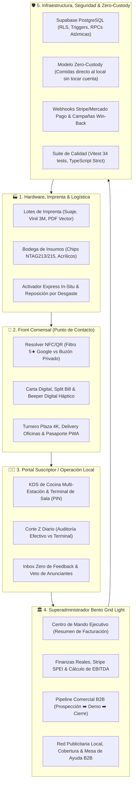

# 📚 Framework Documental Maestro (FDM v2.0)
**Sistema Coordinado de Arquitectura, Especificaciones y Operaciones**

* **Proyecto:** Plataforma Integral NFC Google Reseñas, Red Publicitaria Local & Hardware SaaS
* **Versión del Framework:** 2.0.0 (Consolidada y Coordinada)
* **Fecha:** Noviembre 2026
* **Estándar:** Diátaxis Framework, Architecture Decision Records (ADR - Michael Nygard) y Docs-as-Code

---

## 1. Visión y Propósito del Framework Coordinado

Este framework garantiza que **absolutamente todos los componentes de la empresa tecnológica estén sincronizados y coordinados en una sola fuente de verdad**:
* Desde el vinil físico cortado en la imprenta y la antena NTAG pegada en la mesa del restaurante,
* pasando por el escaneo del comensal, el beeper háptico y la comanda a cocina,
* hasta la cobranza de suscripciones en Stripe, el cálculo de EBITDA y el pipeline comercial de ventas.

---

## 2. Las 5 Capas Coordinadas del Sistema

### 🏭 Capa 1: Hardware, Producción en Imprenta & Logística de Campo
Documenta el mundo físico de la empresa:
1. **Lotes de Imprenta (`print_batches`):**
   * Especificaciones de impresión: vinil adhesivo 3M de alto tráfico, laminado mate con filtro UV, suaje circular de 6x6 cm.
   * Generación correlativa de folios (`TAG-0101` a `TAG-0500`) con marcas de corte vectoriales en PDF/SVG para imprenta local.
2. **Control de Bodega (`hardware_inventory`):**
   * Inventario de materias primas: antenas vírgenes NTAG213/215, viniles impresos, bases acrílicas de mesa.
   * Punto de reorden automatizado cuando el stock baja del umbral de seguridad.
3. **Instalación y Campo (`activate_table_tag_in_situ`):**
   * Asistente de instalación en 3 pasos: técnico escanea el QR del vinil recién colocado, selecciona restaurante y mesa, y graba la antena NFC en 3 segundos. Descuenta stock atómicamente.
4. **Reposición por Desgaste (`replace_damaged_table_tag`):**
   * Sustitución de placas deterioradas por solventes, cloro o exposición solar, transfiriendo la mesa al nuevo tag sin romper el histórico ni los enlaces.

* **Documentos de Referencia:**
  * [`GUIA_OPERATIVA.md`](./GUIA_OPERATIVA.md): Manual de campo e inducción técnica.
  * [`TAREAS_UI_SUPERADMIN.md`](./TAREAS_UI_SUPERADMIN.md): Tareas UI-HW-01 a UI-HW-04.
  * [`supabase/migrations/20261101_superadmin_infrastructure.sql`](../supabase/migrations/20261101_superadmin_infrastructure.sql).

---

### 📱 Capa 2: Experiencia del Comensal & PWA Pública
Documenta la interacción directa del cliente al tocar la antena NFC o escanear el QR:
1. **Filtro Inteligente de Reseñas (Escudo Reputacional):**
   * Calificación 4 o 5 estrellas ➡️ Redirección instantánea a la ficha oficial de Google Maps / Reseñas.
   * Calificación 1 a 3 estrellas ➡️ Buzón privado de quejas (`feedback`) con notificación inmediata al dueño.
2. **Carta Digital & Pedido en Mesa (KDS):**
   * Visualización de platillos, selección de términos y envío directo a cocina sin descargar apps.
3. **Beeper Digital Háptico (`BeeperDigitalModal.tsx`):**
   * Vibración táctil continua y pulsante en el móvil del comensal cuando su orden está lista en barra/cocina.
4. **Turnero Maestro 4K de Plaza Pública (`TurneroPlazaPage.tsx`):**
   * Pantalla gigante para patios de comida y food halls con audio chime y sintetizador de voz (Web Speech API).
5. **Blindaje Delivery Corporativo a Oficinas (`CorporateDeliveryModal.tsx`):**
   * Captura de coordenadas de edificio, piso y número de oficina, con PIN secreto de 4 dígitos para entrega mano a mano y lista negra de teléfonos fraudulentos.
6. **Pasaporte Web PWA & Cupones (`WebPassportPage.tsx` / `RedeemCouponPage.tsx`):**
   * Billetera de fidelidad, acumulación de cashback, promociones de un solo uso y descarga de passes (Apple Wallet / Google Pay).

* **Documentos de Referencia:**
  * [`SPEC.md`](./SPEC.md): Especificación integral de comensal.
  * [`SPEC_INFRAESTRUCTURA_CUPONES.md`](./SPEC_INFRAESTRUCTURA_CUPONES.md): Motor de cupones.
  * [`portal_del_comensal_monetizacion_y_funcionalidades.md`](../brain/13b937c5-a31f-49e0-8595-33b7d8cfdd0e/portal_del_comensal_monetizacion_y_funcionalidades.md).

---

### 👨‍🍳 Capa 3: Operación en Local (Portal del Suscriptor)
Documenta la interfaz que operan los dueños, meseros y cocineros en el restaurante:
1. **KDS de Cocina Multi-Estación (`PortalKitchenPage.tsx`):**
   * Filtros de comanda por estación: Cocina Caliente, Barra de Bebidas, Postres y Salida.
2. **Terminal de Sala para Meseros (`PortalStaffPage.tsx`):**
   * Acceso por PIN rápido de 4 dígitos para atender llamadas de mesa, solicitudes de cuenta y pedidos.
3. **Corte Z Diario (`DailyCashClose`):**
   * Arqueo ciego de caja, balance entre ventas en efectivo, terminal y diferencias reportadas al dueño.
4. **Inbox Zero de Reseñas Privadas:**
   * Gestión de quejas de 1-3 estrellas antes de que lleguen a redes sociales.
5. **Autonomía Publicitaria (Veto de Anunciantes):**
   * El locatario puede vetar 1 anunciante de la red por mes para proteger la imagen de su negocio.

* **Documentos de Referencia:**
  * [`SPEC_PORTAL_SUSCRIPTOR.md`](./SPEC_PORTAL_SUSCRIPTOR.md): Especificación de roles y vistas.
  * [`MASTER_PLAN_PORTAL_SUSCRIPTOR.md`](./MASTER_PLAN_PORTAL_SUSCRIPTOR.md): Roadmap de ejecución en local.

---

### 🏛️ Capa 4: Superadministrador Bento Grid (Light Theme)
Documenta el centro de mando para la dirección, ventas, marketing y soporte:
1. **Bento Box 1: Centro de Mando Ejecutivo (`AdminDashboardPage.tsx`):**
   * KPIs consolidados: facturación real del mes, composición de ingresos (Ads vs SaaS), stock de insumos y feed en vivo.
2. **Bento Box 2: Pipeline Comercial B2B & Marketing:**
   * Embudo de ventas para prospectar restaurantes, agendar visitas de demostración de placas NFC y cerrar contratos.
   * Automatización de secuencias Win-Back para restaurantes cancelados (Día 3 y Día 14).
3. **Bento Box 3: Hardware, Lotes de Imprenta & Activador:**
   * Monitoreo de stock de insumos físicos, generador de pliegos y activador in-situ.
4. **Bento Box 4: Finanzas Reales, Stripe SPEI & Reposiciones:**
   * Semáforo de cobro de suscripciones, estatus de saldo en Stripe y mesa de reposición de tags dañados.
5. **Directorio y Cobertura Territorial:**
   * Restaurantes, Tags NFC, Red de Anuncios, Cobertura en mapa metropolitano y Mesa de Ayuda B2B.

* **Documentos de Referencia:**
  * [`plan_redisenio_superadmin_ui_ux_pro_max.md`](../brain/13b937c5-a31f-49e0-8595-33b7d8cfdd0e/plan_redisenio_superadmin_ui_ux_pro_max.md): Plan maestro Bento Grid.
  * [`TAREAS_UI_SUPERADMIN.md`](./TAREAS_UI_SUPERADMIN.md): Catálogo de tareas UI-HW, UI-VT, UI-FN y UI-RS.
  * [`SPEC_ARQUITECTURA_FINANCIERA.md`](./SPEC_ARQUITECTURA_FINANCIERA.md): Modelo de ingresos y EBITDA.

---

### 🛡️ Capa 5: Infraestructura Técnica, Seguridad & Zero-Custody
Documenta el backend, bases de datos y cumplimiento regulatorio:
1. **Arquitectura Zero-Custody de Pagos:**
   * El dinero de la comida va directo de la cuenta del comensal a la cuenta de Stripe Connect / Mercado Pago del restaurante. La plataforma no custodia fondos de alimentos.
   * La plataforma solo cobra de forma autónoma: (a) Su suscripción SaaS mensual y (b) La pauta de la red publicitaria.
2. **Seguridad y RLS Multi-Tenant (PostgreSQL):**
   * Aislamiento estricto por `organization_id` y validación de `is_superadmin()` para administración global.
3. **Bitácora de Webhooks y Automatizaciones:**
   * Despacho y reintentos automáticos a CRMs externos (`crm_webhook_logs`) y procesamiento de eventos Stripe (`stripe-webhook`).
4. **Suite de Verificación Automatizada:**
   * Vitest (34 unit tests verdes), compilación TypeScript estricta y empaquetado de producción en Vite.

* **Documentos de Referencia:**
  * [`SECURITY_AUDIT.md`](./SECURITY_AUDIT.md): Auditoría OWASP y mitigación de vulnerabilidades.
  * [`DEUDA_TECNICA.md`](./DEUDA_TECNICA.md): Bitácora de deuda técnica resuelta y verificada.

---

## 3. Matriz de Trazabilidad Cruzada

| Dominio | Documento Especificación | Migración SQL | Componentes / Páginas Front | Suite de Pruebas |
| :--- | :--- | :--- | :--- | :--- |
| **Hardware & Imprenta** | `TAREAS_UI_SUPERADMIN.md` | `20261101_superadmin_infrastructure.sql` | `AdminTagsPage.tsx` | `nfc.test.ts` |
| **Pipeline Ventas B2B** | `plan_redisenio_superadmin_ui_ux_pro_max.md` | `20261101_superadmin_infrastructure.sql` | `AdminDashboardPage.tsx` | `winback.test.ts` |
| **Comandas & KDS** | `SPEC.md` | `schema.sql` (table_orders) | `PortalKitchenPage.tsx` | `orders.test.ts` |
| **Turnero Plaza 4K** | `DEUDA_TECNICA.md` (DT-15) | `schema.sql` (table_orders) | `TurneroPlazaPage.tsx` | `calculations.test.ts` |
| **Delivery Corporativo** | `DEUDA_TECNICA.md` (DT-17, 19) | `schema.sql` (corporate_orders) | `CorporateDeliveryModal.tsx` | `corporate.test.ts` |
| **Beeper Digital** | `DEUDA_TECNICA.md` (DT-16) | Local / Web Audio / Navigator | `BeeperDigitalModal.tsx` | `beeper.test.ts` |
| **Finanzas & EBITDA** | `SPEC_ARQUITECTURA_FINANCIERA.md` | `schema.sql` / `20261101_phase5...` | `AdminFinancesPage.tsx` | `payments.test.ts` |
| **Exportación & Reportes** | `DEUDA_TECNICA.md` (DT-11) | Local (Blob / XLSX / PDF) | `src/lib/export.ts` | `export.test.ts` |

---

## 4. Convención de Trabajo y Reglas de Oro

1. **Ningún código sin especificación previa:** Todo cambio de producto o interfaz debe tener su especificación en `/docs`.
2. **Coherencia Backend-Frontend:** Todo elemento visual que se presente en la UI debe tener su contraparte en tablas, columnas o RPCs de Supabase.
3. **Modelo Zero-Custody sagrado:** Nunca intermediar ni retener fondos provenientes de las comidas de los restaurantes.
4. **Modo Bento Light para Superadmin:** Toda la consola de dirección debe respetar el estilo Bento Grid en Light Theme (Apple/Linear) con métricas en pesos mexicanos (MXN).
5. **Verificación continua en Git:** Todo avance debe pasar la suite de pruebas (`npm run test`) y verificación de tipos (`npx tsc --noEmit`) antes de cada commit.

---

## 5. 🏛️ Protocolo de Cascada Documental: "Quedó inamovible" / "Vuélvelo política"

Cuando el usuario emita cualquiera de los comandos de activación:
> 🗣️ **"Quedó inamovible"** o **"Vuélvelo política"**

Se activa de forma inmediata el **Protocolo de Gobernanza Inamovible**:

### Reglas del Protocolo de Cascada:
1. **Identificación de Alcance:** El asistente evalúa qué capas del sistema (1 a 5) y qué documentos específicos son impactados por la nueva política.
2. **Registro Centralizado:** Se formaliza en [`POLITICAS_DEL_SISTEMA.md`](./POLITICAS_DEL_SISTEMA.md) con ID correlativo (`POL-###`), descripción, justificación técnica y lista de documentos incidentes.
3. **Actualización en Cascada Obligatoria:** Se abren y editan en el mismo turno todos los documentos de `/docs` vinculados, eliminando cualquier versión anterior o contradictoria para evitar ambigüedades.
4. **Coherencia con Código:** Si la política afecta base de datos o lógica de frontend, se actualiza el esquema (`schema.sql` / migraciones) o componentes respectivos.
5. **Commit Atómico:** Todo el paquete de documentación sincronizada se resguarda en Git con mensaje formal `docs(politica): POL-### [descripcion]`.
