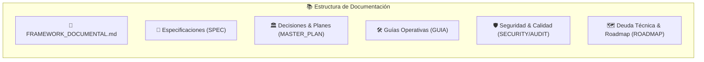

# 🧭 Índice Maestro de Documentación (`/docs`)

Bienvenido al repositorio central de conocimiento y arquitectura de la plataforma **Google Reseñas NFC & Red Publicitaria Local**. Toda la documentación sigue el estándar formal definido en el [**Framework de Registro Documental (FRD)**](./FRAMEWORK_DOCUMENTAL.md).

---

---

## 📚 Directorio de Documentos por Categoría

### 📘 0. Estándar y Metodología
* [**`FRAMEWORK_DOCUMENTAL.md`**](./FRAMEWORK_DOCUMENTAL.md): Taxonomía de 5 cuadrantes, ciclo de vida de documentos, metadatos YAML y reglas de redacción inspiradas en *Diátaxis* y *ADRs*.

---

### 📐 1. Especificaciones de Producto & Negocio (`SPEC`)
* [**`SPEC.md`**](./SPEC.md): Especificación integral de la plataforma (Arquitectura general, Tiers 1-4, flujo de comensal en mesa, panel de control).
* [**`SPEC_PORTAL_SUSCRIPTOR.md`**](./SPEC_PORTAL_SUSCRIPTOR.md): Especificación funcional del Portal del Dueño/Gerente (`/portal`), gestión de quejas en Inbox Zero, Linktree y datos de negocio.
* [**`SPEC_GESTION_ORGANIZACIONES.md`**](./SPEC_GESTION_ORGANIZACIONES.md): `[PREAPROBADO]` Onboarding y gestión de organizaciones/clientes en Superadmin, creación al vuelo de empresas y asignación de credenciales.
* [**`SPEC_RED_PUBLICITARIA.md`**](./SPEC_RED_PUBLICITARIA.md): Arquitectura de la red local de anuncios, segmentación no competidora, especificaciones técnicas de banners (1200x628 px) y métricas de ROI.

---

### 🏛️ 2. Decisiones de Arquitectura & Planes Maestros (`ARCH / ADR`)
* [**`MASTER_PLAN_PORTAL_SUSCRIPTOR.md`**](./MASTER_PLAN_PORTAL_SUSCRIPTOR.md): Plan de ejecución de 4 fases (Fase A: Mi Cuenta, Fase B: Fallback inmediato a Maps, Fase C: Métricas ponderadas de cadena, Fase D: Alta y pedido de sucursales).
* [**`IMPLEMENTATION_PLAN_PORTAL.md`**](./IMPLEMENTATION_PLAN_PORTAL.md): Plan de implementación y componentes iniciales del portal del suscriptor.

---

### 🛠️ 3. Guías Operativas & Procedimientos en Sala (`HOW-TO`)
* [**`GUIA_OPERATIVA.md`**](./GUIA_OPERATIVA.md): Manual operativo paso a paso para programar chips NFC físicos con la app NFC Tools, vincular códigos QR, asignar sucursales y etiquetar mesas de restaurante.

---

### 🛡️ 4. Auditoría, Seguridad & Aseguramiento de Calidad (`AUDIT / TEST`)
* [**`SECURITY_AUDIT.md`**](./SECURITY_AUDIT.md): Evaluación de vulnerabilidades bajo el estándar OWASP API Security Top 10 (2023), análisis de Row Level Security (RLS) y hardening de endpoints públicos.
* [**`IMPECCABLE_CRITIQUE.md`**](./IMPECCABLE_CRITIQUE.md): Diagnóstico exhaustivo de consistencia visual, diseño de interfaz y usabilidad táctil.

---

### 🗺️ 5. Deuda Técnica, Salud del Código & Roadmap (`ROADMAP / META`)
* [**`DEUDA_TECNICA.md`**](./DEUDA_TECNICA.md): Inventario formalizado de deuda técnica en 6 dimensiones (Tokens CSS, WebSockets Realtime, Pasarela Stripe, Testing Vitest, Rate Limiting y Recaptura por email).
* [**`ROADMAP.md`**](./ROADMAP.md): Hoja de ruta estratégica de producto con iniciativas futuras (Menú digital interactivo, rol de mesero validador, mapa de calor en tiempo real).

---

## 🔄 ¿Cómo registrar un nuevo documento?

1. Consulta [**`FRAMEWORK_DOCUMENTAL.md`**](./FRAMEWORK_DOCUMENTAL.md) para seleccionar la categoría adecuada.
2. Agrega el encabezado YAML estandarizado al inicio del archivo.
3. Añade el nuevo archivo a esta tabla de contenidos en su sección correspondiente.
