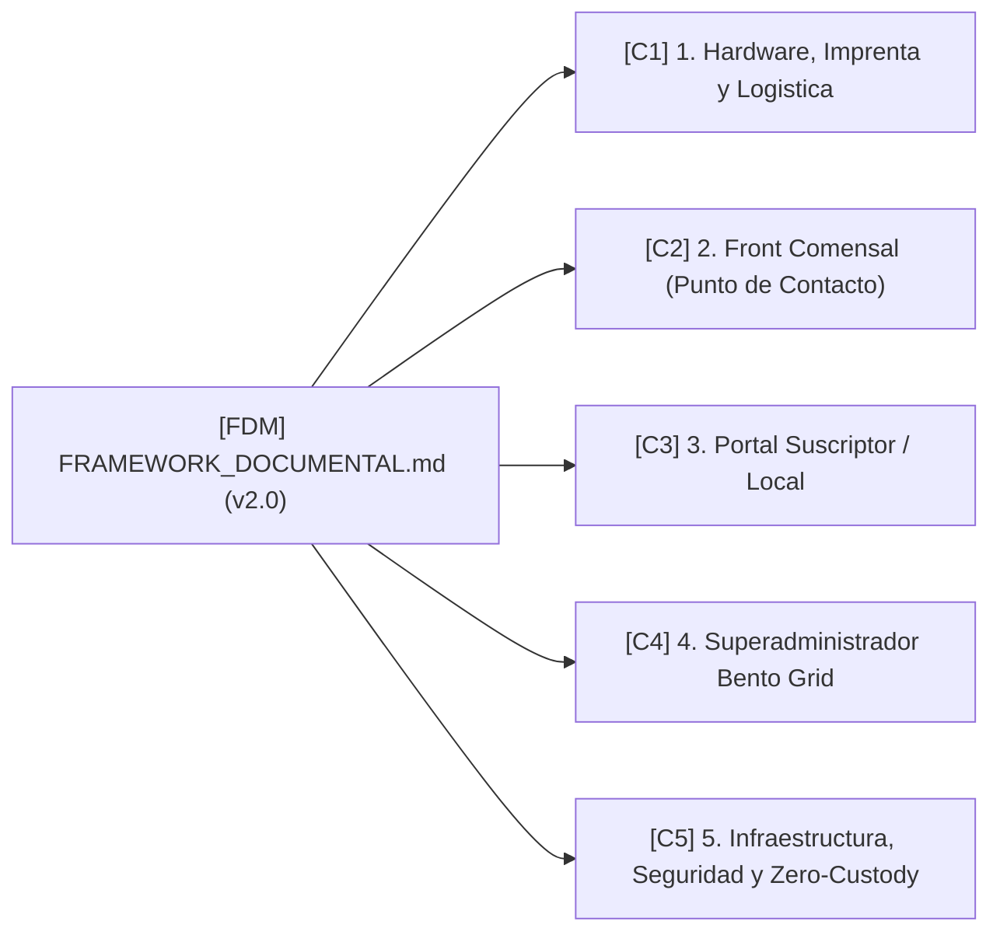

# Indice Maestro de Documentacion Coordinada (`/docs`)

Bienvenido al repositorio central de conocimiento, arquitectura y especificaciones de la plataforma **Google Reseñas NFC, Red Publicitaria Local & Hardware SaaS**. 

Toda la documentacion esta organizada de acuerdo con el [**Framework Documental Maestro v2.0 (FDM)**](./FRAMEWORK_DOCUMENTAL.md), estructurada en **5 Capas Sistemicas Coordinadas**:

---

---

## Directorio de Documentos por Capa Sistemica

### 0. Metodologia y Gobernanza
* [**`FRAMEWORK_DOCUMENTAL.md`**](./FRAMEWORK_DOCUMENTAL.md): Estandar FDM v2.0 que unifica las 5 capas del sistema (hardware, comensal, portal, superadmin e infraestructura), matrices de trazabilidad y el protocolo de cascada documental.
* [**`POLITICAS_DEL_SISTEMA.md`**](./POLITICAS_DEL_SISTEMA.md): Registro oficial de directrices irrevocables activadas por el comando *Quedo inamovible / Vuelvelo politica* (Zero-Custody, Bento Light, Trazabilidad de Hardware, Prohibicion de Emojis POL-007, etc.).

---

### Capa 1: Hardware, Produccion en Imprenta y Logistica de Campo
* [**`TAREAS_UI_SUPERADMIN.md`**](./TAREAS_UI_SUPERADMIN.md): Registro de componentes de stock de bodega, generador de pliegos de vinil para imprenta y activador express in-situ.
* [**`GUIA_OPERATIVA.md`**](./GUIA_OPERATIVA.md): Manual de campo e induccion operativa para programar chips NFC fisicos con NFC Tools, vincular codigos QR y colocar viniles en mesas.
* [**`supabase/migrations/20261101_superadmin_infrastructure.sql`**](../supabase/migrations/20261101_superadmin_infrastructure.sql): Esquema de base de datos para `hardware_inventory`, `print_batches`, trazabilidad de desgaste y RPC de activacion in-situ.

---

### Capa 2: Punto de Contacto Comensal (Front Publico PWA)
* [**`SPEC.md`**](./SPEC.md): Especificacion integral de la plataforma (Filtro 5 Estrellas de Google vs buzon de quejas 1-3 Estrellas, carta digital y flujo en mesa).
* [**`SPEC_INFRAESTRUCTURA_CUPONES.md`**](./SPEC_INFRAESTRUCTURA_CUPONES.md): Motor de cupones de descuento digitales de un solo uso, entrega al comensal y validacion en mostrador.
* [**`SPEC_UTILIDAD_MULTIGIRO.md`**](./SPEC_UTILIDAD_MULTIGIRO.md): Modulos multi-giro (WiFi zero-password, pre-orden, rachas de visita) para gimnasios, consultorios y spas.

---

### Capa 3: Operacion en Local (Portal del Suscriptor)
* [**`SPEC_PORTAL_SUSCRIPTOR.md`**](./SPEC_PORTAL_SUSCRIPTOR.md): Especificacion funcional del Portal del Dueño/Gerente (`/portal`), gestion de quejas en Inbox Zero y personalizacion de enlaces.
* [**`MASTER_PLAN_PORTAL_SUSCRIPTOR.md`**](./MASTER_PLAN_PORTAL_SUSCRIPTOR.md): Plan de ejecucion de fases del portal (Mi Cuenta, Fallback inmediato a Maps y metricas ponderadas).
* [**`SPEC_MESA_AYUDA_Y_ANUNCIOS_ADMIN.md`**](./SPEC_MESA_AYUDA_Y_ANUNCIOS_ADMIN.md): Mesa de ayuda B2B para que los locatarios soliciten soporte o mas placas NFC.

---

### Capa 4: Superadministrador Bento Grid (Light Theme) y Negocio
* [**`TAREAS_UI_SUPERADMIN.md`**](./TAREAS_UI_SUPERADMIN.md): Catalogo de tareas de interfaz Bento Grid Light preaprobadas para Direccion, Ventas, Hardware y Finanzas.
* [**`SPEC_ARQUITECTURA_FINANCIERA.md`**](./SPEC_ARQUITECTURA_FINANCIERA.md): Modelo financiero de MRR, costos de operacion (COGS hardware, servidores, WhatsApp) y calculo de EBITDA.
* [**`SPEC_ESQUEMA_OFERTA_Y_ESCALERA_VALOR.md`**](./SPEC_ESQUEMA_OFERTA_Y_ESCALERA_VALOR.md): Estructura de oferta comercial, kits de placas NFC a $100 MXN y 3 niveles de suscripcion de software.
* [**`SPEC_GTM_ESTRATEGIA_ADOPCION_3_ETAPAS.md`**](./SPEC_GTM_ESTRATEGIA_ADOPCION_3_ETAPAS.md): Estrategia de despliegue Go-To-Market en 3 etapas para conquistar polos gastronomicos.
* [**`SPEC_RED_PUBLICITARIA.md`**](./SPEC_RED_PUBLICITARIA.md): Red de anuncios patrocinados locales, modelo CPM/CPC y atribucion cerrada (closed-loop).
* [**`SPEC_GESTION_ORGANIZACIONES.md`**](./SPEC_GESTION_ORGANIZACIONES.md): Onboarding y administracion multi-sucursal de clientes en el panel general.

---

### Capa 5: Infraestructura Tecnica, Seguridad y Deuda Resuelta
* [**`DEUDA_TECNICA.md`**](./DEUDA_TECNICA.md): Inventario de deuda tecnica y nuevas capacidades (19 items verificados y resueltos: seguridad RLS, comandas KDS, turnero 4K, delivery corporativo, pasarelas y CRM).
* [**`SECURITY_AUDIT.md`**](./SECURITY_AUDIT.md): Evaluacion de vulnerabilidades OWASP API Security Top 10, politicas RLS de Supabase y prevencion de mass-assignment.
* [**`ROADMAP.md`**](./ROADMAP.md): Hoja de ruta estrategica de producto e iniciativas futuras.

---

## Reglas de Coordinacion y Mantenimiento

1. **Sincronizacion Continua:** Cualquier cambio que afecte el flujo fisico (imprenta/hardware), el portal o el Superadmin debe registrarse primero en el documento de especificacion correspondiente antes de programar.
2. **Coherencia Backend:** Ningun componente front debe mostrar datos que no tengan persistencia o calculo en Supabase (`schema.sql` y migraciones).
3. **Control de Versiones:** Los avances se documentan y verifican con pruebas automatizadas (`npm run test`) antes de realizar commits en Git.
4. **Politica POL-007 (Sin Emojis):** No se utilizan emojis en documentacion ni en interfaces; se emplean iconos vectoriales sobrios (`lucide-react`) o texto estructurado.
