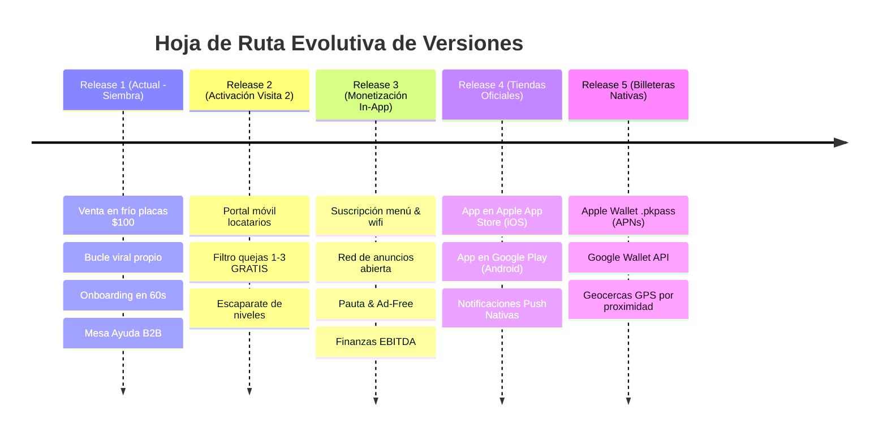

# 🗺️ Hoja de Ruta Evolutiva de Producto (Master Roadmap)

**Proyecto:** Plataforma NFC Google Reseñas & Red Publicitaria Local  
**Última Actualización:** 30 de Octubre, 2026  
**Responsable:** Arquitectura de Software & Mickey  

Este documento establece la secuencia cronológica de **5 Grandes Actualizaciones (Releases)** de la plataforma, desde la siembra territorial inicial en calle hasta las aplicaciones nativas en tiendas y billeteras digitales.

---

---

## 🚀 Fase 1 a 3: El Embudo de Adopción Progresiva (PWA Web)

### 📦 Release 1: MVP de Siembra Territorial & Bucle Viral (Actual)
* **Objetivo:** Sembrar los primeros **100 locales** en la zona (foco inicial: restaurantes).
* **Venta en Calle (Visita 1):** Placas físicas a **$100 MXN c/u** con enlace directo a Google Reviews. Sin suscripciones ni ataduras.
* **Bucle de Auto-Promoción Viral:** Cero anuncios de terceros. Cada mesa sembrada promueve exclusivamente la compra de placas NFC de Mickey (*"¿Tienes negocio? Pide tus placas por $100"*), atrayendo clientes inbound por WhatsApp.
* **Superadmin:** Onboarding express para dar de alta un local y sus tags en 60 segundos + Mesa de Ayuda B2B.

---

### 📦 Release 2: Activación Digital con Filtro Gratuito (Visita 2)
* **Objetivo:** Convertir el hardware físico en usuarios activos del portal móvil (`/#/portal`).
* **La Oferta Fundador:** En la segunda visita, se le entrega su acceso al portal y se le activa el **Filtro Inteligente de Quejas (1-3 estrellas en privado) 100% GRATIS**.
* **El Escaparate In-App:** El dueño ve sus quejas contenidas y descubre los siguientes niveles disponibles dentro de la aplicación.

---

### 📦 Release 3: Monetización Autónoma In-App (Cero Visita 3)
* **Objetivo:** Cobro recurrente mensual y encendido de la Red de Publicidad de Patrocinadores.
* **Sin Tercera Visita:** Todo ocurre de forma autogestiva dentro de la app:
  * **Upgrades de Software:** Desbloqueo de **Menú Digital, Linktree y WiFi Zero-Password** por una micro-suscripción con tarjeta (Stripe / Mercado Pago).
  * **Apertura de la Red Publicitaria:**  
    * Patrocinadores locales (gimnasios, clínicas, marcas) pautan anuncios en las mesas.
    * Los locatarios pueden contratar **Marca Blanca (Ad-Free)** o pautar su propio negocio en los otros 99 restaurantes.
  * **Consola Financiera Superadmin:** Métricas de MRR, pauta facturada y cálculo en tiempo real de **EBITDA Operativo**.

---

## 📱 Fase 4 y 5: Escala Nativa & Billeteras Digitales

### 📦 Release 4: Aplicaciones Nativas en App Store y Google Play
* **Objetivo:** Presencia oficial en las dos tiendas de aplicaciones más importantes del mundo:
  * 🍏 **Apple App Store (iOS)**
  * 🤖 **Google Play Store (Android)**
* **Beneficios Operativos:**
  * Empaquetado nativo (mediante Capacitor / React Native) manteniendo la misma base de código React.
  * **Notificaciones Push Nativas al Teléfono del Dueño:** Cuando un comensal deja 1-3 estrellas, el teléfono del gerente o dueño vibra y suena al instante, permitiéndole atender la mesa en segundos sin depender de WhatsApp.
  * Mayor estatus corporativo y confianza de marca para negociar con cadenas grandes y franquicias.

---

### 📦 Release 5: Infraestructura de Billeteras Nativas (Apple & Google Wallet)
* **Objetivo:** Convertir el Pasaporte Web PWA en una tarjeta nativa de billetera digital instalada en el sistema operativo del comensal.
* **Capacidades Técnicas:**
  * Generación y firmado de pases `.pkpass` para Apple Wallet con push updates silenciosos (APNs).
  * Integración con Google Wallet API (JWT Service Account).
  * **Geocercas GPS de Proximidad Física:** La tarjeta se enciende automáticamente en la pantalla de bloqueo del comensal cuando camina o maneja a menos de 200 metros de un restaurante o comercio patrocinador aliado.

---

## 🔮 Funcionalidades Futuras de Ecosistema

1. **Gestión de Comandas Automatizadas en Mesa:**  
   Evolución del Menú Digital hacia un sistema donde el comensal pide platillos desde el tag NFC y la comanda cae directamente a la impresora de cocina o pantalla de meseros.
2. **Rol de Mesero (App de Sala):**  
   Interfaz rápida para validar comandas de mesa, llamar al gerente ante quejas y gestionar propinas.
3. **Mapa de Calor en Tiempo Real (Superadmin):**  
   Monitoreo visual geográfico de qué colonias y mesas registran mayor volumen de escaneos hora por hora.

---

## 6. Estado de Aprobación & Registro

* **Estado:** `PREAPROBADO` (Aprobado formalmente por Mickey como la visión y hoja de ruta tecnológica integral del proyecto).
