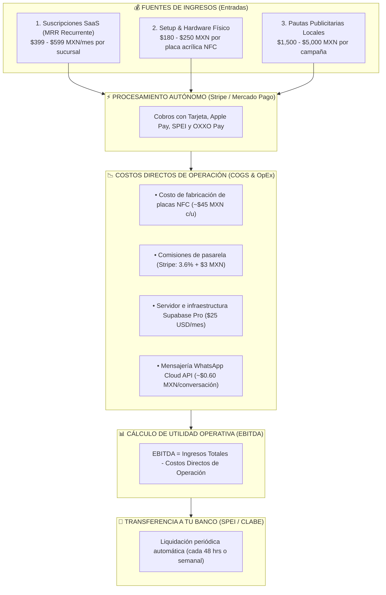

# 💰 SPEC-009: Arquitectura Financiera, MRR, Cobranza Autónoma, EBITDA y Facturación

## 1. Resumen Ejecutivo & Modelo de Flujo de Efectivo

Este documento formaliza la arquitectura financiera centralizada para el Superadministrador (`/admin/finanzas`), definiendo las fuentes de ingresos, costos operativos, automatización de cobro y el cálculo de métricas financieras estándar de la industria (MRR, Margen Operativo y EBITDA).



---

## 2. Métricas Financieras Clave en el Panel (`/admin/finanzas`)

### 2.1. MRR (Monthly Recurring Revenue - Ingresos Recurrentes Mensuales)
* Suma de todas las suscripciones activas de locales afiliados (`Tiers 1, 2, 3 y 4`).
* No incluye pautas publicitarias ni venta de hardware (es la métrica de valuación pura del software).

### 2.2. EBITDA Operativo (Earnings Before Interest, Taxes, Depreciation & Amortization)
* **¿Qué representa?:** La utilidad operativa pura generada por la plataforma antes de pagar impuestos al SAT y depreciaciones de equipo.
* **Fórmula calculada en tiempo real por el sistema:**
  $$\text{EBITDA} = \text{Ingresos Brutos Totales} - (\text{Costo Placas Físicas} + \text{Comisiones Pasarela} + \text{Costos Cloud / WhatsApp})$$
* **Margen EBITDA (%):** El porcentaje de cada peso cobrado que se convierte en ganancia neta en tu bolsillo. En este modelo SaaS/Ad-Network, el margen estimado oscila entre **75% y 85%**.

---

## 3. Módulos de la Consola Financiera Superadmin (`/admin/finanzas`)

```text
========================================================================================
💰 CONSOLA FINANCIERA & FACTURACIÓN (/admin/finanzas)
========================================================================================

[ 📈 MRR ACTUAL ]        [ 📊 EBITDA DEL MES ]     [ 💰 MARGEN EBITDA ]    [ 🏦 SALDO EN STRIPE ]
$14,200 MXN / mes        $26,450 MXN               78.5%                   $18,920 MXN
(+18% vs mes anterior)   (Utilidad Operativa Neta) (Alto rendimiento SaaS) (Transferencia el lunes)

----------------------------------------------------------------------------------------
💳 MONITOR DE COBRANZA RECURRENTE (SUSCRIPCIONES DE LOCALES)
----------------------------------------------------------------------------------------
• Locales al corriente: 17 de 18 locales (94.4%)
• Cobros reintentando (Dunning automático): 1 local con tarjeta vencida

----------------------------------------------------------------------------------------
📢 INVENTARIO DE FACTURACIÓN PUBLICITARIA (ANUNCIANTES)
----------------------------------------------------------------------------------------
• Campañas facturadas este mes: $18,500 MXN
• Campañas al 80% con checkout de renovación activo: 1 ($2,500 MXN en espera de cobro)
========================================================================================
```

---

## 4. Automatización de Cobro & Protocolo Antirretención (Dunning)

1. **Suscripción Autónoma:** Los datos de pago del locatario se resguardan de forma segura bajo estándar bancario PCI-DSS en la bóveda de Stripe.
2. **Reintentos Inteligentes (Dunning):** Si un cobro mensual es rechazado por fondos insuficientes o tarjeta expirada:
   * **Día 1:** Reintento silencioso.
   * **Día 3:** Notificación automática vía WhatsApp al dueño del local con enlace para actualizar tarjeta.
   * **Día 7:** Si no se regulariza, el sistema pasa la sucursal a estado `pausada` (sus tags redirigen directamente a Google Reviews para no romper el servicio en sala, pero el portal queda bloqueado hasta el pago).

---

## 5. Facturación Fiscal Mexicana (CFDI 4.0 - Opcional)

* Integración mediante API con PAC autorizado (Facturapi / Facturama).
* Al procesarse cada cobro exitoso, el sistema consulta los datos en `organizations.billing_info` (RFC, Razón Social, Régimen Fiscal, Código Postal y Uso de CFDI) y emite automáticamente la factura timbrada con el SAT, enviando el PDF y XML al correo del cliente.

---

## 6. Estado del Documento & Aprobación

* **Estado:** `PREAPROBADO` (Aprobado formalmente por Mickey).
* **Vinculación con Deuda Técnica:** Resuelve conceptualmente la amortización de `DT-04` (Automatización de pasarela de pago).
