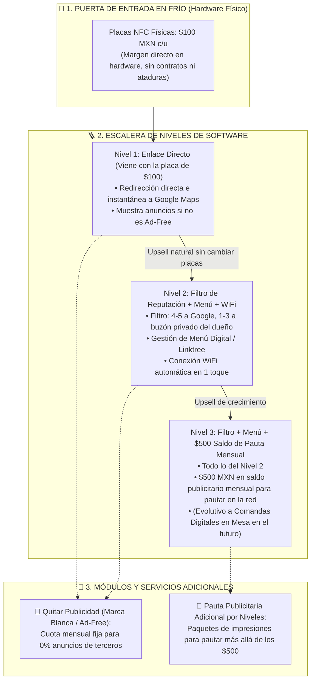

# 🚀 SPEC-010: Esquema de Oferta Comercial, Escalera de Valor y Puerta de Entrada en Frío

## 1. Resumen Ejecutivo & Tesis Comercial

La adopción de la plataforma no se apoya en la venta de suscripciones intangibles en frío. Se basa en una **Escalera de Valor Progresiva (Ascension Ladder)** cuya puerta de entrada es un **activo físico tangible de $100 MXN** que resuelve un dolor inmediato (reseñas en Google), seguido de mejoras de software remotas sin cambiar las placas instaladas.

---

## 2. Los 3 Niveles de la Escalera de Valor

### 2.1. Puerta de Entrada: Venta en Frío del Hardware ($100 MXN c/u)
* **Pitch en Calle:** *"Te vendo la placa NFC para tu mesa o mostrador a $100 pesos. El comensal acerca su teléfono y se abre de inmediato tu ficha de Google Maps para calificarte."*
* **Economía Unitaria:** Costo de fabricación de placa acrílica UV con chip NTAG213: ~$35 - $45 MXN.
* **Margen Inmediato:** Genera entre $55 y $65 MXN de utilidad neta por placa desde el primer día.
* **Objetivo Estratégico:** Penetración física sin resistencia ni objeciones de contratos. Los chips quedan instalados físicamente en las mesas.

### 2.2. Nivel 1: Enlace Directo (Incluido con la Placa)
* **Funcionalidad:** Redirección automática inmediata al enlace oficial de reseñas de Google Maps (`google_review_url`).
* **Condición de Monetización:** Muestra anuncios patrocinados de la red local al pie o en transición si el local no ha contratado el módulo *Ad-Free*.

### 2.3. Nivel 2: Filtro de Reputación + Menú Digital + WiFi en 1 Toque
* **Upsell en Software:** A las 2-3 semanas de uso del Nivel 1, se le ofrece al locatario activar la capa inteligente de software:
  * **Filtro Inteligente de Reputación:** Comensales satisfechos (4-5 estrellas) van a Google Maps; clientes inconformes (1-3 estrellas) van al buzón privado del dueño antes de dañar su calificación pública.
  * **Menú Digital / Linktree:** Acceso al menú, redes sociales y promociones.
  * **Conexión WiFi Zero-Password:** Conexión a la red del local sin teclear contraseñas.
* **Transición Cero Fricción:** No requiere cambiar ni una sola placa física; se activa de forma remota en base de datos.

### 2.4. Nivel 3: Filtro + Menú + Saldo Publicitario Mensual ($500 MXN)
* **Propuesta de Alto Rendimiento:**
  * Incluye todos los beneficios del Nivel 2.
  * **Incentivo Irresistible:** Se le asigna una bolsa de **$500 MXN mensuales en pauta publicitaria** para proyectar el anuncio de su propio negocio en los otros comercios de la red local.
* **Efecto Red:** El locatario percibe que su suscripción se paga sola porque le atrae nuevos clientes de comercios cercanos.
* **Evolución Futura del Nivel 3 (Comandas Digitales en Mesa):**
  * Con la madurez de la red, el Nivel 3 podrá expandirse o reemplazarse por el servicio premium de **Gestión de Comandas Automatizadas en Mesa** (pedidos desde el celular del comensal directo a cocina o caja), convirtiendo a la plataforma en el sistema operativo central del restaurante.

---

## 3. Módulos Adicionales e Independientes

### 3.1. Quitar Anuncios (Marca Blanca / Ad-Free)
* Si el locatario de Nivel 1, 2 o 3 no desea mostrar publicidad de terceros ni de patrocinadores locales en sus mesas, contrata el módulo **Ad-Free** con una cuota mensual fija independiente.
* Sus mesas quedan 100% limpias (0% anuncios de terceros).

### 3.2. Pauta Publicitaria Adicional por Niveles
* Si un locatario o anunciante externo desea mayor alcance que los $500 MXN base del Nivel 3, puede contratar paquetes de pauta gestionados por niveles de volumen:
  * **Paquete Bronce:** 2,500 impresiones locales.
  * **Paquete Plata:** 5,000 impresiones locales.
  * **Paquete Oro:** 10,000 impresiones con prioridad de entrega y segmentación contextual.

---

## 4. Estado de Aprobación & Registro

* **Estado:** `PREAPROBADO` (Aprobado formalmente por Mickey).
* **Alineación con la Base de Datos:** Los Tiers existentes en `src/lib/constants.ts` y `supabase/schema.sql` mapean directamente a esta escalera comercial.
