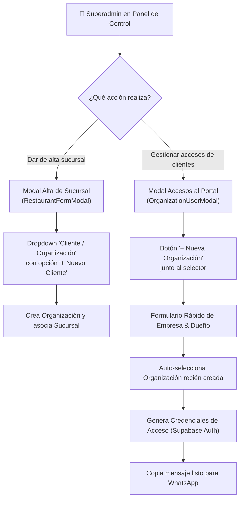

# 🏢 SPEC-005: Gestión de Organizaciones y Onboarding de Clientes en Superadmin

## 1. Resumen Ejecutivo & Contexto

En la versión inicial de la plataforma, la tabla `organizations` funcionaba como el ancla multi-tenant del sistema, pero su registro dependía exclusivamente de inserciones directas por base de datos (`supabase/seed.sql`) o datos de prueba en memoria (`Carlos Mendoza - Grupo Gastronómico Gourmet`). 

Este documento formaliza la especificación técnica y de experiencia de usuario (UX) para permitir al **Superadministrador** crear, asignar y gestionar organizaciones y cuentas de clientes directamente desde la interfaz gráfica de usuario (UI), eliminando cualquier dependencia de datos mock o intervención manual en base de datos.



---

## 2. Diagnóstico del Vacío Funcional Actual

| Componente | Comportamiento Actual (Limitación) | Comportamiento Especificado (Solución) |
| :--- | :--- | :--- |
| **`src/lib/api.ts`** | Solo existen `getOrganizations()` y `updateOrganization()`. No hay método de creación. | Implementar `createOrganization(data)` con soporte para Supabase y fallback en `localStorage`. |
| **`RestaurantFormModal.tsx`** | Asigna silenciosamente `organizations[0]` al crear un restaurante. El campo no es visible. | Exponer selector visible de Organización con botón integrado para registrar un nuevo grupo gastronómico al vuelo. |
| **`OrganizationUserModal.tsx`** | Selector dropdown estático con datos demo; si no hay organizaciones en BD, solo muestra a Carlos Mendoza. | Agregar botón **`+ Nueva Organización`** que abre sub-modal de creación y auto-selecciona el nuevo registro. |
| **Navegación Admin** | No hay vista centralizada de clientes/empresas en el menú lateral. | Incorporar vista **`/admin/clientes`** con métricas de sucursales activas, tags y contacto directo. |

---

## 3. Modelo de Datos & Requisitos de API

### 3.1. Esquema de la Entidad `Organization`
La entidad en PostgreSQL (`supabase/schema.sql`) se gestionará con la siguiente interfaz TypeScript:

```typescript
export interface Organization {
  id: string;
  name: string;                         // Ej: "Grupo Gastronómico Sonora"
  owner_name: string;                   // Ej: "Alberto Gómez"
  owner_email: string;                  // Ej: "alberto@sonoragrill.com"
  owner_phone?: string | null;          // Ej: "+525512345678"
  notify_negative_feedback: boolean;   // Notificación inmediata de 1-3 estrellas
  billing_info?: Record<string, any>;   // JSONB: Razón social, RFC, régimen, plan
  created_at: string;
}
```

### 3.2. Contrato de API Requerido (`api.createOrganization`)
```typescript
async createOrganization(
  data: Omit<Organization, 'id' | 'created_at'>
): Promise<{ success: boolean; data?: Organization; error?: string }>
```

* **Flujo con Supabase Conectado:**
  1. Ejecuta `INSERT INTO organizations (...) VALUES (...) RETURNING *`.
  2. Valida RLS: Requiere rol `superadmin` mediante la función `is_superadmin()`.
  3. Devuelve el objeto `Organization` creado con su `id` UUID asignado.
* **Flujo Modo Demo / Local:**
  1. Genera un ID con prefijo `org-` + timestamp.
  2. Inserta el registro al inicio del array en `localStorage.getItem('nfc_demo_organizations')`.
  3. Retorna inmediatamente para permitir pruebas en vivo sin conexión.

---

## 4. Especificación de Pantallas y Componentes

### 4.1. Modal de Creación Rápida (`NewOrganizationModal.tsx`)
Un modal limpio, enfocado y accesible que solicita los datos fundamentales del cliente:

* **Campos del Formulario:**
  * **Nombre de la Empresa / Grupo:** (Obligatorio, ej: *Taquerías El Pastorcito*).
  * **Nombre del Dueño / Representante:** (Obligatorio, ej: *Mauricio Arteaga*).
  * **Correo Electrónico:** (Obligatorio, validación de sintaxis email).
  * **Teléfono WhatsApp:** (Opcional, formato internacional `+52...` para notificaciones y envío de accesos).
* **Comportamiento post-guardado:**
  * Cierra el modal de creación.
  * Dispara evento `onCreated(newOrg)` para actualizar la lista del componente padre.
  * Selecciona automáticamente la nueva organización en el dropdown activo.

### 4.2. Mejoras al Modal de Accesos (`OrganizationUserModal.tsx`)
1. **Cabecera de Selección:**
   * La etiqueta pasa a ser: `CLIENTE / ORGANIZACIÓN`.
   * A la derecha de la etiqueta se añade un botón secundario compacto: `+ Nueva Empresa`.
2. **Generador de Credenciales:**
   * Permite asociar múltiples usuarios (con rol `owner` o `manager`) a la misma organización.
   * El botón "Copiar WhatsApp" incluye variables dinámicas con el nombre real del dueño:
     ```text
     ¡Hola [owner_name]! 👋
     Ya tienes acceso a tu Portal de Negocio para gestionar tus sucursales y quejas:
     
     🔗 Entra aquí: https://[dominio]/#/portal/login
     ✉️ Correo: [email]
     🔑 Contraseña temporal: [password]
     ```

### 4.3. Selector en Alta de Sucursal (`RestaurantFormModal.tsx`)
* En la primera sección de datos generales, se añade:
  * Etiqueta: `Asignar a Grupo Gastronómico / Cliente *`.
  * Control: Select que lista todas las organizaciones existentes ordenadas alfabéticamente.
  * Acción rápida: Botón inline para crear una nueva organización si el cliente aún no existe en el sistema.

---

## 5. Próxima Etapa: Vista de Gestión Centralizada (`/admin/clientes`)

Para escalar la administración cuando existan más de 10 clientes registrados, se implementará la ruta `/admin/clientes` con las siguientes capacidades:
* **Métricas por Cliente:** Total de sucursales, total de placas NFC asignadas, promedio de satisfacción (estrellas Google).
* **Acciones Rápidas:** Botón directo para "Generar Accesos", "Ver Sucursales del Grupo" y "Editar Datos de Contacto/Facturación".

---

## 6. Estado de Aprobación & Próximos Pasos

* **Estado:** `PREAPROBADO` (Aprobado formalmente por Mickey con retroalimentación continua abierta).
* **Siguiente paso:** Proceder a la implementación en código una vez que el usuario dé luz verde para iniciar la codificación.

