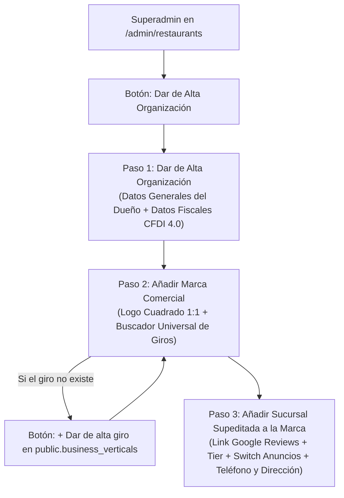

# SPEC-005: Gestión de Organizaciones, Marcas Multigiro y Sucursales en Superadmin

## 1. Resumen Ejecutivo & Arquitectura de 3 Niveles de Alta

El sistema estructura las cuentas de clientes bajo una jerarquía corporativa de 3 entidades encadenadas que permite que una misma organización opere múltiples marcas comerciales de distintos giros y múltiples sucursales supeditadas a cada marca:

1. **Organización (`public.organizations`)**: Base legal, fiscal (`billing_info` CFDI 4.0) y datos del dueño titular (`owner_name`, `owner_email`, `owner_phone`).
2. **Marca Comercial (`public.organization_brands`)**: Cada organización cuenta con su propio catálogo de marcas comerciales. Cada marca almacena su logotipo en formato cuadrado predeterminado (`256×256 px` 1:1) y se vincula al catálogo universal de giros comerciales (`public.business_verticals`).
3. **Sucursal Física (`public.restaurants`)**: Toda sucursal está supeditada a una marca comercial (`brand_id`), heredando su identidad visual y su giro operativo, y definiendo su enlace de reseñas de Google, paquete contratado (`Tier 1` a `4`), switch de modalidad de anuncios (`Marca Blanca Ad-Free` vs `Red de Anuncios`), teléfono de sucursal y dirección física.

---

## 2. Tablas de Base de Datos (Supabase PostgreSQL)

### 2.1. Catálogo Universal de Giros (`public.business_verticals`)
Funciona de forma universal en todo el sistema y se sincroniza en tiempo real con todos los desplegables de marcas y sucursales:
* `id` (`UUID PRIMARY KEY`)
* `slug` (`TEXT UNIQUE NOT NULL`)
* `name` (`TEXT NOT NULL`) — Ej. `Gastronomía / Restaurante`, `Barbería & Peluquería`, `Clínica / Consultorio Dental`
* `unit_label` / `unit_plural` (`TEXT`) — Ej. `Mesa / Mesas`, `Sillón / Sillones`, `Consultorio / Consultorios`
* `show_kds` (`BOOLEAN`), `show_floor_staff` (`BOOLEAN`), `show_hostess` (`BOOLEAN`)

### 2.2. Tabla de Marcas por Organización (`public.organization_brands`)
* `id` (`UUID PRIMARY KEY`)
* `organization_id` (`UUID REFERENCES public.organizations(id) ON DELETE CASCADE`)
* `name` (`TEXT NOT NULL`)
* `vertical_id` (`UUID REFERENCES public.business_verticals(id)`)
* `vertical_slug` (`TEXT NOT NULL`)
* `logo_url` (`TEXT`) — Imagen normalizada en formato cuadrado estándar `256×256 px`
* `brand_color` (`TEXT DEFAULT '#2563eb'`)

### 2.3. Supeditación de Sucursales a Marcas (`public.restaurants`)
* `brand_id` (`UUID REFERENCES public.organization_brands(id) ON DELETE SET NULL`)
* `business_type` (`TEXT NOT NULL DEFAULT 'restaurant'`)

---

## 3. Componentes Implementados

* [`NewOrganizationModal.tsx`](file:///c:/Users/Mickey/Documents/DEV/Google%20Rese%C3%B1as/src/components/admin/NewOrganizationModal.tsx): Asistente guiado de 3 pasos (`1. Organización & Fiscal` -> `2. Añadir Marca & Giro` -> `3. Añadir Sucursal`) con recorte automático de logo en `<canvas>` `256×256 px` y desplegable de giros con buscador y botón **`+ Dar de alta giro`**.
* [`RestaurantFormModal.tsx`](file:///c:/Users/Mickey/Documents/DEV/Google%20Rese%C3%B1as/src/components/admin/RestaurantFormModal.tsx): Selector de organización y marca registrada, buscador universal de giros y switch interactivo para la modalidad de anuncios.
* [`AdminRestaurantsPage.tsx`](file:///c:/Users/Mickey/Documents/DEV/Google%20Rese%C3%B1as/src/pages/AdminRestaurantsPage.tsx) y [`restaurants_bento.ts`](file:///c:/Users/Mickey/Documents/DEV/Google%20Rese%C3%B1as/src/lib/restaurants_bento.ts): Botón superior **`Dar de Alta Organización`** y tabla jerárquica en árbol con niveles `Organización Matriz -> Marca Comercial -> Sucursal Física -> Panel de Control Operativo`.
* [`PortalHostessPage.tsx`](file:///c:/Users/Mickey/Documents/DEV/Google%20Rese%C3%B1as/src/pages/portal/PortalHostessPage.tsx): Pantalla operativa de Hostess (`#/portal/hostess`) con creación de mesas por sucursal (`public.restaurant_tables`), control de capacidad total de comensales, cambio de estado (`libre`, `ocupada`, `en_limpieza`, `desactivada`) y botón **`Solicitar Limpieza`** que envía una alerta en tiempo real (`call_type: 'cleaning'`) a la terminal del mesero ([`PortalStaffPage.tsx`](file:///c:/Users/Mickey/Documents/DEV/Google%20Rese%C3%B1as/src/pages/portal/PortalStaffPage.tsx)).
* [`PortalKitchenPage.tsx`](file:///c:/Users/Mickey/Documents/DEV/Google%20Rese%C3%B1as/src/pages/portal/PortalKitchenPage.tsx): Estaciones KDS diferenciadas para **Jefe de Cocina** (`cocina`) y **Barista** (`barista`: Barra, Coctelería, Repostería y Café).
* [`PortalManagerPage.tsx`](file:///c:/Users/Mickey/Documents/DEV/Google%20Rese%C3%B1as/src/pages/portal/PortalManagerPage.tsx): Consola Operativa del Gerente de Tienda (`#/portal/gerente`) con 4 módulos:
  1. **Personal & Estaciones KDS**: Alta de empleados con sus roles (`waiter`, `kitchen`, `barista`, `hostess`, `manager`) y selección de sobre qué pantalla incide cada uno (`allowed_stations`).
  2. **Programador de Turnos (Hasta 2 Meses / 60 Días)**: Calendario de turnos (`public.staff_shifts`) con validación estricta de ventana máxima de 60 días de anticipación.
  3. **Cortes de Caja por Turno & Envío al Dueño**: Generación de cortes por turno de mesero (`public.manager_shift_reports`) y envío automático de métricas por mesa y por empleado a la pantalla general del dueño ([`PortalMetricsTab.tsx`](file:///c:/Users/Mickey/Documents/DEV/Google%20Rese%C3%B1as/src/pages/portal/PortalMetricsTab.tsx)).
  4. **Quejas, Descuentos y Cupones con Límite Mensual**: Bandeja de quejas en tiempo real (`rating <= 3`), autorización de descuentos por incidencia y creación de cupones propios del gerente con tope mensual (`public.manager_retention_coupons`).
* **Tabla de Gerentes por Organización (`public.organization_managers`)**: Tanto el Superadministrador ([`AdminRestaurantsPage.tsx`](file:///c:/Users/Mickey/Documents/DEV/Google%20Rese%C3%B1as/src/pages/AdminRestaurantsPage.tsx)) como el Dueño del Local ([`PortalAccountTab.tsx`](file:///c:/Users/Mickey/Documents/DEV/Google%20Rese%C3%B1as/src/pages/portal/PortalAccountTab.tsx)) pueden dar de alta gerentes en la organización y asignar su rol específico en cada sucursal (`gerente_tienda` vs `capitan_piso`).
