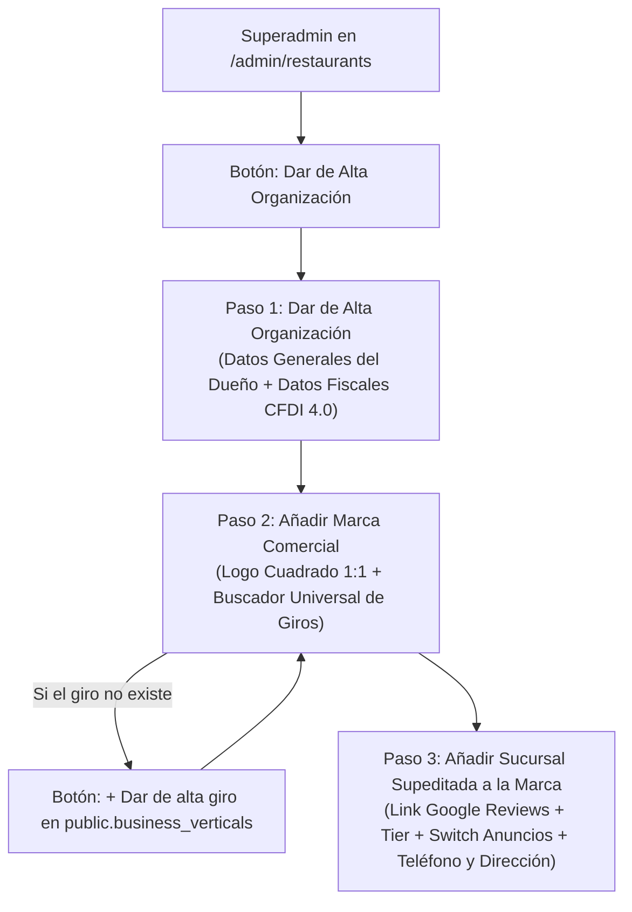

# SPEC-005: Gestión de Organizaciones, Marcas Multigiro y Sucursales en Superadmin

## 1. Resumen Ejecutivo & Arquitectura de 3 Niveles de Alta

El sistema estructura las cuentas de clientes bajo una jerarquía corporativa de 3 entidades encadenadas que permite que una misma organización opere múltiples marcas comerciales de distintos giros y múltiples sucursales supeditadas a cada marca:

1. **Organización (`public.organizations`)**: Base legal, fiscal (`billing_info` CFDI 4.0) y datos del dueño titular (`owner_name`, `owner_email`, `owner_phone`).
2. **Marca Comercial (`public.organization_brands`)**: Cada organización cuenta con su propio catálogo de marcas comerciales. Cada marca almacena su logotipo en formato cuadrado predeterminado (`256×256 px` 1:1) y se vincula al catálogo universal de giros comerciales (`public.business_verticals`).
3. **Sucursal Física (`public.restaurants`)**: Toda sucursal está supeditada a una marca comercial (`brand_id`), heredando su identidad visual y su giro operativo, y definiendo su enlace de reseñas de Google, paquete contratado (`Tier 1` a `4`), switch de modalidad de anuncios (`Marca Blanca Ad-Free` vs `Red de Anuncios`), teléfono de sucursal y dirección física.

---

## 2. Tablas de Base de Datos (Supabase PostgreSQL)

### 2.1. Catálogo Universal de Giros (`public.business_verticals`)
Funciona de forma universal en todo el sistema y se sincroniza en tiempo real con todos los desplegables de marcas y sucursales:
* `id` (`UUID PRIMARY KEY`)
* `slug` (`TEXT UNIQUE NOT NULL`)
* `name` (`TEXT NOT NULL`) — Ej. `Gastronomía / Restaurante`, `Barbería & Peluquería`, `Clínica / Consultorio Dental`
* `unit_label` / `unit_plural` (`TEXT`) — Ej. `Mesa / Mesas`, `Sillón / Sillones`, `Consultorio / Consultorios`
* `show_kds` (`BOOLEAN`), `show_floor_staff` (`BOOLEAN`), `show_hostess` (`BOOLEAN`)

### 2.2. Tabla de Marcas por Organización (`public.organization_brands`)
* `id` (`UUID PRIMARY KEY`)
* `organization_id` (`UUID REFERENCES public.organizations(id) ON DELETE CASCADE`)
* `name` (`TEXT NOT NULL`)
* `vertical_id` (`UUID REFERENCES public.business_verticals(id)`)
* `vertical_slug` (`TEXT NOT NULL`)
* `logo_url` (`TEXT`) — Imagen normalizada en formato cuadrado estándar `256×256 px`
* `brand_color` (`TEXT DEFAULT '#2563eb'`)

### 2.3. Supeditación de Sucursales a Marcas (`public.restaurants`)
* `brand_id` (`UUID REFERENCES public.organization_brands(id) ON DELETE SET NULL`)
* `business_type` (`TEXT NOT NULL DEFAULT 'restaurant'`)

---

## 3. Componentes Implementados

* [`NewOrganizationModal.tsx`](file:///c:/Users/Mickey/Documents/DEV/Google%20Rese%C3%B1as/src/components/admin/NewOrganizationModal.tsx): Asistente guiado de 3 pasos (`1. Organización & Fiscal` -> `2. Añadir Marca & Giro` -> `3. Añadir Sucursal`) con recorte automático de logo en `<canvas>` `256×256 px` y desplegable de giros con buscador y botón **`+ Dar de alta giro`**.
* [`RestaurantFormModal.tsx`](file:///c:/Users/Mickey/Documents/DEV/Google%20Rese%C3%B1as/src/components/admin/RestaurantFormModal.tsx): Selector de organización y marca registrada, buscador universal de giros y switch interactivo para la modalidad de anuncios.
* [`AdminRestaurantsPage.tsx`](file:///c:/Users/Mickey/Documents/DEV/Google%20Rese%C3%B1as/src/pages/AdminRestaurantsPage.tsx) y [`restaurants_bento.ts`](file:///c:/Users/Mickey/Documents/DEV/Google%20Rese%C3%B1as/src/lib/restaurants_bento.ts): Botón superior **`Dar de Alta Organización`** y tabla jerárquica en árbol con niveles `Organización Matriz -> Marca Comercial -> Sucursal Física -> Panel de Control Operativo` dividido en 5 categorías en vivo:
  1. **Categoría 1 (Funcionalidades por Nivel Contratado & Cupones de Quejas):** Switches de `Tier 1` a `4` + `Ad-Free` y visualización en vivo de los cupones creados por el gerente con su progreso de límite mensual (`used_this_month / monthly_limit`).
  2. **Categoría 2 (Hardware NFC, Mesas de Hostess & Capacidad de Comensales):** Aforo total de la sucursal, capacidad de comensales por mesa, selector de estado en vivo (`Libre`, `Ocupada`, `En Limpieza` con notificación al mesero, `Desactivada`) y métricas de venta por mesa.
  3. **Categoría 3 (Pantallas Operativas Activas & Estaciones por Rol):** Agrupa en un solo bloque todas las pantallas operativas de la sucursal (`Consola de Gerente de Tienda & Capitán de Piso`, `Pantalla de Hostess & Recepción`, `Terminal Móvil de Sala`, `Monitor Maestro KDS`, `Estación Cocina Caliente`, `Estación Barra & Coctelería`, `Estación Repostería & Café`, `Turnero Público 4K`), cada una con su insignia de `Rol Exclusivo`, lista de `Operadores asignados`, switch `PRENDIDO / APAGADO` y botón directo para abrir la pantalla.
  4. **Categoría 4 (Plantilla de Personal Operativo con PIN, Roles, Pantallas KDS, Turnos a 60 Días & Métricas):** Dedicada exclusivamente a los empleados con selector de puesto en vivo, conmutadores de pantallas sobre las que incide cada empleado (`Cocina KDS` / `Barra & Café`), próximo turno agendado hasta 60 días y métricas de corte de turno.
  5. **Categoría 5 (Tabla de Gerentes de la Organización, Acceso a Sucursal & Cortes de Turno):** Alta rápida de gerentes en la organización, selector de rol por sucursal (`Gerente de Tienda`, `Capitán / Gerente de Piso`, `Sin Acceso`) y resumen de los últimos cortes de caja enviados al dueño.
* [`PortalHostessPage.tsx`](file:///c:/Users/Mickey/Documents/DEV/Google%20Rese%C3%B1as/src/pages/portal/PortalHostessPage.tsx): Pantalla operativa de Hostess (`#/portal/hostess`) con creación de mesas por sucursal (`public.restaurant_tables`), control de capacidad total de comensales, cambio de estado (`libre`, `ocupada`, `en_limpieza`, `desactivada`) y botón **`Solicitar Limpieza`** que envía una alerta en tiempo real (`call_type: 'cleaning'`) a la terminal del mesero ([`PortalStaffPage.tsx`](file:///c:/Users/Mickey/Documents/DEV/Google%20Rese%C3%B1as/src/pages/portal/PortalStaffPage.tsx)).
* [`PortalKitchenPage.tsx`](file:///c:/Users/Mickey/Documents/DEV/Google%20Rese%C3%B1as/src/pages/portal/PortalKitchenPage.tsx): Estaciones KDS diferenciadas para **Jefe de Cocina** (`cocina`) y **Barista** (`barista`: Barra, Coctelería, Repostería y Café).
* [`PortalManagerPage.tsx`](file:///c:/Users/Mickey/Documents/DEV/Google%20Rese%C3%B1as/src/pages/portal/PortalManagerPage.tsx): Consola Operativa del Gerente de Tienda (`#/portal/gerente`) con 4 módulos:
  1. **Personal & Estaciones KDS**: Alta de empleados con sus roles (`waiter`, `kitchen`, `barista`, `hostess`, `manager`) y selección de sobre qué pantalla incide cada uno (`allowed_stations`).
  2. **Programador de Turnos (Hasta 2 Meses / 60 Días)**: Calendario de turnos (`public.staff_shifts`) con validación estricta de ventana máxima de 60 días de anticipación.
  3. **Cortes de Caja por Turno & Envío al Dueño**: Generación de cortes por turno de mesero (`public.manager_shift_reports`) y envío automático de métricas por mesa y por empleado a la pantalla general del dueño ([`PortalMetricsTab.tsx`](file:///c:/Users/Mickey/Documents/DEV/Google%20Rese%C3%B1as/src/pages/portal/PortalMetricsTab.tsx)).
  4. **Quejas, Descuentos y Cupones con Límite Mensual**: Bandeja de quejas en tiempo real (`rating <= 3`), autorización de descuentos por incidencia y creación de cupones propios del gerente con tope mensual (`public.manager_retention_coupons`).
* **Tabla de Gerentes por Organización (`public.organization_managers`)**: Tanto el Superadministrador ([`AdminRestaurantsPage.tsx`](file:///c:/Users/Mickey/Documents/DEV/Google%20Rese%C3%B1as/src/pages/AdminRestaurantsPage.tsx)) como el Dueño del Local ([`PortalAccountTab.tsx`](file:///c:/Users/Mickey/Documents/DEV/Google%20Rese%C3%B1as/src/pages/portal/PortalAccountTab.tsx)) pueden dar de alta gerentes en la organización y asignar su rol específico en cada sucursal (`gerente_tienda` vs `capitan_piso`).

---

## 9. Política de Aislamiento Multi-Organización, Movilidad Inter-Sucursal y Estándares de Interfaz (`POL-009`)

### 9.1 Reglas de Aislamiento y Movilidad Operativa (`POL-009`)
1. **Aislamiento entre Organizaciones**: Una organización jamás tiene acceso a los datos, métricas, personal ni configuraciones de otras organizaciones (`isSameOrganizationAccessAllowed`).
2. **Aislamiento de Sucursales**: Una sucursal jamás tiene acceso a los datos ni configuraciones de otras organizaciones (`filterBranchesBySameOrganization`).
3. **Movilidad de Personal Operativo en Turno**: Todo el personal operativo (`waiter`, `kitchen`, `barista`, `hostess`, `manager`) puede iniciar sesión con su PIN de 4 dígitos en otras sucursales **de su misma organización** para cubrir ahí su turno (`ordersApi.loginStaffWithPin`), rechazando estrictamente cualquier intento de acceso de personal perteneciente a otra organización.
4. **Movimientos de Personal entre Sucursales por Gerentes**: Entre gerentes pueden realizar movimientos de personal entre sucursales de su misma organización y dejarlo asentado en la planeación de turnos de hasta 60 días (`ordersApi.scheduleInterBranchStaffShift` en [`PortalManagerPage.tsx`](file:///c:/Users/Mickey/Documents/DEV/Google%20Rese%C3%B1as/src/pages/portal/PortalManagerPage.tsx)), registrando la etiqueta `[Movimiento Inter-Sucursal]`.

### 9.2 Estándares de Interfaz en Administración y Formularios
* **Truncado a 25 Caracteres con Tooltip y Edición Directa**: En [`AdminRestaurantsPage.tsx`](file:///c:/Users/Mickey/Documents/DEV/Google%20Rese%C3%B1as/src/pages/AdminRestaurantsPage.tsx), tanto la dirección física como el teléfono muestran únicamente los primeros 25 caracteres (`formatTextMax25`), desplegando el valor íntegro en un tooltip al pasar el cursor y ofreciendo un botón de edición directa in-situ.
* **Componente Universal de Teléfono con Lada y WhatsApp**: Todos los campos telefónicos del proyecto utilizan [`PhoneInputWithCountry.tsx`](file:///c:/Users/Mickey/Documents/DEV/Google%20Rese%C3%B1as/src/components/common/PhoneInputWithCountry.tsx), que integra selector de código de área internacional (`+52`, `+1`, `+34`, `+57`, `+54`, `+56`, `+51`, `+502`, `+506`), campo numérico local y casilla de verificación **Cuenta con WhatsApp**.
* **Barra Lateral Fija Reactiva al Hover**: En [`AdminLayout.tsx`](file:///c:/Users/Mickey/Documents/DEV/Google%20Rese%C3%B1as/src/components/admin/AdminLayout.tsx), la barra lateral izquierda permanece fija (`h-screen sticky top-0 overflow-hidden`) sin desplazarse con el contenido, manteniendo fijos en la parte inferior los botones `Ver pantalla de cliente` y `Cerrar Sesión`, y contrayéndose/expandiéndose reactivamente al pasar el cursor (`hover`).

### 9.3 Horarios Operativos de Sucursal, Baja Permanente y Categorías Colapsables
* **Horarios Operativos en Sucursal y Planeación de Turnos**: Se incorporaron las propiedades `opening_time`, `closing_time` y `operating_days` en la entidad `Restaurant`, disponibles en el alta de organizaciones (`NewOrganizationModal.tsx`), alta de sucursales (`NewBranchModal.tsx`) y edición de sucursal (`RestaurantFormModal.tsx`). En la consola del Gerente de Tienda (`PortalManagerPage.tsx`), se muestra la tarjeta informativa **Horario Oficial de la Sucursal** y la selección del tipo de turno (matutino, vespertino, nocturno_cierre, completo) precalcula automáticamente las horas de entrada y salida basadas en la apertura y cierre oficial del local.
* **Baja Permanente y Purga de Sucursales/Marcas Huérfanas**: `deleteRestaurant` en `restaurantsApi` ahora soporta baja definitiva (`hardDelete = true`), eliminando completamente la sucursal de la base de datos tanto en Supabase como en modo local, previniendo que se convierta en local independiente fantasma (`is_active: false`). Se agregaron botones de eliminación definitiva (`Trash2`) tanto en las filas de sucursales independientes como en las marcas comerciales que cuenten con 0 sucursales activas (`deleteOrganizationBrand`).
* **Categorías Colapsables y Desplegables en el Panel de Sucursal**: En `AdminRestaurantsPage.tsx`, cada una de las 5 categorías del Panel de Control de Sucursal es interactiva y permite colapsar o expandir su contenido de forma individual mediante clic en su cabecera con indicador de chevron y estado (`Expandir` / `Colapsar`). Además, la cabecera general del panel incluye botones de acción rápida **Desplegar Todo** y **Colapsar Todo**.

### 9.4 Ancho Completo (Full Width), Títulos de 1 Línea, Edición/Baja de Organizaciones y Filtros Avanzados
* **Layout Fluido al 100%**: Se eliminó la restricción `max-w-7xl mx-auto` de [`AdminLayout.tsx`](file:///c:/Users/Mickey/Documents/DEV/Google%20Rese%C3%B1as/src/components/admin/AdminLayout.tsx), permitiendo que los tableros y tablas ocupen el 100% útil del ancho de pantalla en cualquier monitor panorámico.
* **Títulos de Categoría en 1 Línea Sin Saltos**: Los encabezados de las 5 categorías del panel de sucursal fueron sintetizados (`Cat 1: Nivel de Servicio & Cupones`, `Cat 2: Hardware NFC & Mesas`, `Cat 3: Pantallas Operativas KDS`, `Cat 4: Personal Operativo & Turnos`, `Cat 5: Gerencia & Cortes de Turno`), forzando `whitespace-nowrap overflow-x-auto` para garantizar cero saltos de línea feos.
* **Edición y Eliminación de Organizaciones Matrices**: Se implementó [`OrganizationEditModal.tsx`](file:///c:/Users/Mickey/Documents/DEV/Google%20Rese%C3%B1as/src/components/admin/OrganizationEditModal.tsx) para actualizar datos del dueño, contacto y facturación CFDI 4.0; y se agregó el método `deleteOrganization` en [`organizationsApi`](file:///c:/Users/Mickey/Documents/DEV/Google%20Rese%C3%B1as/src/lib/api/organizations.ts) con botones de acción directa (`Edit2` y `Trash2`) en la fila de la organización matriz.
* **Barra de Filtros y Segmentación Multigiro**: Nueva barra ergonómica con buscador flexible (`flex-1`), selectores de Empresa, Giro Comercial universal y Nivel/Modalidad, chips de estado rápido (`Todas`, `Prendidas`, `Apagadas`, `Con Quejas`), resumen en vivo de coincidencias y botón de restauración `Limpiar Filtros`.

### 9.5 Modelador Maestro de Tiers, Periodos de Prueba (7, 14, 28 Días), Pick Up & Collect y Rol de Cajero
* **Módulo Dedicado de Modelado de Tiers (`/admin/tiers`)**: Implementado en [`AdminTiersPage.tsx`](file:///c:/Users/Mickey/Documents/DEV/Google%20Rese%C3%B1as/src/pages/AdminTiersPage.tsx) y enlazado en la navegación del superadministrador ([`AdminLayout.tsx`](file:///c:/Users/Mickey/Documents/DEV/Google%20Rese%C3%B1as/src/components/admin/AdminLayout.tsx)). Permite a los superadministradores configurar mediante checkboxes los servicios que componen cada paquete (`Tier 1`, `Tier 2`, `Tier 3`, `Tier 4` y `Add-on Marca Blanca`), desglosando funcionalidades previamente agrupadas (`Menú Digital Interactivo`, `Botonera Linktree` y `Conexión Wi-Fi 1-Toque`).
* **Integración de Pantallas Operativas en la Escalera Comercial (Categoría 3)**: Las pantallas y estaciones operativas (`KDS Cocina`, `KDS Barra`, `KDS Repostería`, `Monitor Maestro`, `Turnero 4K`, `Hostess`, `Terminal Móvil`, `Consola Gerente` y `Pick Up & Collect`) ahora forman parte de la matriz de checkboxes configurables por Tier.
* **Sincronización en Tiempo Real con la Categoría 1 y 3 del Panel de Sucursal (Política 2)**: Toda modificación o guardado en el módulo de Tiers impacta de inmediato en la Categoría 1 y en las pantallas habilitadas de la Categoría 3 de todas las sucursales del sistema sin requerir recargar la aplicación.
* **Periodos de Prueba de 7, 14 y 28 Días para Organizaciones y Sucursales (Políticas 3, 3.1 y 5)**:
  - Botón **`+ Periodo de Prueba`** en la fila de la Organización Matriz para activar pruebas simultáneas a todas sus sucursales supeditadas.
  - Botón **`Prueba`** en cada sucursal física e independiente, así como botones directos dentro de cada bloque de Tier en la Categoría 1 ([`TrialPeriodModal.tsx`](file:///c:/Users/Mickey/Documents/DEV/Google%20Rese%C3%B1as/src/components/admin/TrialPeriodModal.tsx)).
  - Insignias interactivas (`Prueba Tier X Activa · Quedan Y días`) con conteo dinámico de horas/días restantes y reversión automática al plan base contratado al expirar.
* **Nueva Pantalla Operativa: Pick Up & Collect (`#/portal/pickup`)**: Implementada en [`PortalPickupPage.tsx`](file:///c:/Users/Mickey/Documents/DEV/Google%20Rese%C3%B1as/src/pages/portal/PortalPickupPage.tsx) para despacho y entrega de pedidos de mostrador, para llevar y plataformas (Uber, Didi, Rappi), con vista de tickets, alerta sonora configurable, confirmación de entrega en 1 toque y vista previa de impresión.
* **Nuevo Rol Operativo: Cajero / Despachador (`cashier`)**: Incorporado al catálogo de roles operativos (`StaffRole`) con PIN de 4 dígitos, turnos programables en la consola de gerencia a 60 días, asignación de estación (`pickup`), accesos directos y compatibilidad con las políticas de movilidad multi-tenant entre sucursales de la misma organización (`POL-009`).
### 9.6 Nomenclatura Comercial de Tiers, Switches Operativos, Edición y Baja Definitiva de Gerentes, Categoría 6 y Métricas Consolidadas de Empresa
* **Edición de Nombres y Descripciones de Marketing en Tiers (`/admin/tiers`)**: Permite cambiar los nombres públicos comerciales (`tierDef.name`) y subtítulos de propuesta de valor (`tierDef.description`) de cada nivel contratado directamente desde [`AdminTiersPage.tsx`](file:///c:/Users/Mickey/Documents/DEV/Google%20Rese%C3%B1as/src/pages/AdminTiersPage.tsx), sincronizándose en tiempo real con la información visible para los dueños de local.
* **Switches de Prendido/Apagado y Visibilidad para Clientes**: En el catálogo maestro de Tiers se reemplazaron los checkboxes simples por interruptores interactivos (`PRENDIDO` / `APAGADO`) tanto para funcionalidades desglosadas como para pantallas KDS y categorías maestras. Cada elemento cuenta además con una casilla de verificación **Mostrar a Dueño** (`client_visible_features`, `client_visible_stations`, `client_visible_categories`), permitiendo ocultar funcionalidades técnicas internas de la vista de los dueños. Si un switch se apaga, la visibilidad se desmarca y deshabilita automáticamente.
* **Interruptor Maestro en Cabeceras de Categorías (Cat 3, 4, 5 y 6)**: Las categorías 3 (KDS), 4 (Personal & Turnos), 5 (Gerencia & Cortes) y 6 (Métricas) incorporan interruptores maestros de prendido y apagado en sus encabezados. Su activación está vinculada a la autorización mandatoria de la tabla de Tiers (`allowed_categories`).
* **Edición y Eliminación Permanente de Gerentes en Categoría 5**: En la tabla de gerentes de la Categoría 5 se incorporaron botones de acción: **Editar** (`Edit2`), que abre [`ManagerEditModal.tsx`](file:///c:/Users/Mickey/Documents/DEV/Google%20Rese%C3%B1as/src/components/admin/ManagerEditModal.tsx) para modificar credenciales; y **Eliminar** (`Trash2`), que elimina las credenciales y previene la reaparición del gerente en memoria mediante la lista negra persistente `DELETED_MANAGER_IDS` (`nfc_deleted_manager_ids`).
* **Categoría 6: Métricas & Analítica de Sucursal (POL-008 / POL-009)**: Categoría obligatoria en el panel de control de sucursal con selector de ventana temporal (`Hoy`, `Últimos 7 Días`, `Este Mes (30 Días)` e `Histórico Completo`), fila ejecutiva Bento de 4 tarjetas primarias y Suite Completa de 28 Métricas operativas organizadas en 6 sub-módulos interactivos (Módulo A: Reputación Google & NFC, Módulo B: Ventas & Métodos de Pago, Módulo C: Eficiencia KDS & Tiempos, Módulo D: Personal & Turnos, Módulo E: Red Publicitaria Local y Subsidio SaaS exclusivo Tier 4, Módulo F: Turnero Público 4K & Despacho Pick Up exclusivo Tier 4). Los módulos exclusivos de Tier 4 se desbloquean dinámicamente cuando la sucursal cuenta con Tier 4 activo o periodo de prueba correspondiente.
* **Métricas Consolidadas de Organización (Botón Desplegable en Fila Matriz)**: En la fila de cada Organización Matriz se incorporó el botón **`Métricas de Empresa`** (`BarChart3`), que despliega un panel ejecutivo con filtros temporales y por sucursal, KPIs acumulados de facturación en turnos, calificación promedio corporativa, escudo total de quejas, comensales y tabla comparativa de rendimiento entre sucursales.

### 9.7 Menú Digital Dinámico por Tier, Disponibilidad Operativa de Platillos (86) y Permisos por Rol
* **Modal de Gestión de Menú Operativo**: Implementado en [`MenuManagementModal.tsx`](file:///c:/Users/Mickey/Documents/DEV/Google%20Rese%C3%B1as/src/components/admin/MenuManagementModal.tsx) para gestionar categorías de menú y platillos con precio, foto, descripción y tiempo de preparación estimado.
* **Apagado Rápido de Platillos Agotados (86)**: Permite desactivar platillos temporalmente (`is_available: false`) con un solo clic para reflejar faltantes en cocina o barra sin eliminarlos de la base de datos.
* **Permisos Operativos**: El Gerente de Tienda, Capitán de Piso y Jefe de Cocina cuentan con permisos para editar la carta y alternar la disponibilidad de platillos en tiempo real.
* **Activación por Tier Mandatorio**: El botón `[Gestionar Carta & Menú]` en la Categoría 3 sólo se muestra si el Tier contratado por la sucursal incluye la funcionalidad `tier_3_digital_menu` en la tabla maestra de Tiers (`tierDef.included_features`).

### 9.8 Paneles Colapsados por Defecto, Orden Estricto de Cabeceras y Agente Creador de Cupones por Gerente
* **Paneles Colapsados por Defecto**: Todas las categorías (1 a 6) de cada panel de sucursal y las secciones de submenús de Tiers inician colapsadas por defecto, permitiendo al usuario abrirlas bajo demanda para un acceso rápido y limpio.
* **Orden Estricto de Controles en Encabezados de Categorías**:
  1. `(resumen de items prendidos)`
  2. `(botones de funcionalidad)`
  3. `(links de pantallas o consolas)`
  4. `(badge de estado de la categoría)`
  5. `(switch de la categoría)`
  6. `(botón expandir y contraer)`
* **Insignia Universal de ID de Usuario (POL-010)**: Cada usuario registrado en el sistema (personal operativo en Categoría 4, gerentes en Categoría 5 y usuarios en el directorio de credenciales) cuenta con una insignia visible con su identificador único universal (`ID: {id}`).
* **Agente Creador de Cupones por Gerente**: Implementado en [`ManagerCouponModal.tsx`](file:///c:/Users/Mickey/Documents/DEV/Google%20Rese%C3%B1as/src/components/admin/ManagerCouponModal.tsx) y accesible mediante el botón `[Agente de Cupones ({total})]` en cada fila de gerente de Categoría 5. Permite consultar el límite mensual autorizado, barra de porcentaje de uso, conmutar estado activo/pausado de cada cupón y emitir nuevos cupones de retención con código y porcentaje personalizado.

### 9.9 Animaciones Suaves de Expansión, Micro-Comentarios de KPIs y Filtros Colapsables
* **Animaciones Suaves mediante CSS Grid**: Se eliminó el renderizado condicional abrupto en el despliegue de las Categorías 1 a 6, los submenús de Tiers y los paneles superiores. Ahora se implementa un contenedor con transición CSS Grid a 60 FPS (`grid-rows-[1fr] opacity-100` / `grid-rows-[0fr] opacity-0` con `overflow-hidden`), brindando una apertura y cierre elásticos y visualmente placenteros sin desbordamientos.
* **Micro-Comentarios Coloridos de KPIs en Cabecera**: Debajo del título y subtítulo del módulo se incorporaron píldoras/badges compactos de métricas clave (Empresas y Sucursales en Azul, Placas NFC en Púrpura, Ad-Free en Ámbar y Escudo Reputacional en Esmeralda), permitiendo consultar los indicadores vitales de un vistazo sin necesidad de tener desplegadas las tarjetas grandes.
* **Colapso Automático de Tarjetas Bento Superiores**: Las 4 tarjetas Bento grandes de KPIs se contraen automáticamente cuando el usuario expande el directorio (al abrir una organización, sucursal o pulsar *Expandir Todo*), despejando el área de visualización para enfocarse en el árbol tabular. Se incluye además el botón `Ver KPIs Detallados` / `Ocultar KPIs Detallados` para conmutarlas a demanda.
* **Módulo Colapsable de Filtros y Búsqueda**: La barra de filtros fue refactorizada en un módulo con botón de conmutación `[Filtros y Búsqueda]` con insignia de filtros activos. Al estar contraída, muestra un resumen textual con botones de limpieza rápida; al pulsarla, se despliega suavemente el buscador interactivo, selectores y pastillas de estado.
* **Botón de Filtros Compacto en Cabecera**: Se integró un botón compacto `[Filtros]` ubicado al lado de `[Ver KPIs Detallados]` en la fila de micro-comentarios superiores, compartiendo el estado `isFiltersExpanded` y el contador de filtros activos en tiempo real con la barra tabular del directorio.

### 9.10 Cupones de Uso Único, Horarios por Día y CRUD de Personal en Categoría 4
* **Cupones de Retención de 1 Solo Uso Estricto**: Todo cupón emitido por el gerente en [`ManagerCouponModal.tsx`](file:///c:/Users/Mickey/Documents/DEV/Google%20Rese%C3%B1as/src/components/admin/ManagerCouponModal.tsx) cuenta con `monthly_limit: 1`. Tras su primer canje en mesa o autorización de queja, pasa a estado `Canjeado (1/1 Usado)` y no puede volver a aplicarse. Incluye además botón para eliminar cupones quemados mediante `api.deleteManagerRetentionCoupon`.
* **Horarios Operativos de Sucursal por Día**: [`RestaurantFormModal.tsx`](file:///c:/Users/Mickey/Documents/DEV/Google%20Rese%C3%B1as/src/components/admin/RestaurantFormModal.tsx) incorpora un editor semanal desglosado día por día (Lunes a Domingo), permitiendo fijar horas de apertura y cierre individuales, descansos y botón `[Copiar Lunes a toda la semana]`. Además, en la cabecera de la Categoría 4 de [`AdminRestaurantsPage.tsx`](file:///c:/Users/Mickey/Documents/DEV/Google%20Rese%C3%B1as/src/pages/AdminRestaurantsPage.tsx) se despliega la tira informativa del horario semanal de la sucursal para la planeación de turnos.
* **Gestión Completa de Personal desde Categoría 4**:
  - **Alta**: Botón `[+ Añadir Empleado]` en la cabecera de Categoría 4 con modal [`StaffMemberModal.tsx`](file:///c:/Users/Mickey/Documents/DEV/Google%20Rese%C3%B1as/src/components/admin/StaffMemberModal.tsx), autogenerador de PIN de 4 dígitos, selector de rol y estaciones KDS autorizadas.
  - **Edición**: Cada fila de empleado en Categoría 4 incluye botón `[Editar]` para modificar sus datos, puesto o PIN directamente.
  - **Eliminación**: Botón `[Eliminar]` con confirmación previa y eliminación persistida mediante `api.deleteStaffMember`.

### 9.11 Permeación Automática de Tiers sobre Estaciones KDS, Paridad en Categoría 3 y Reactividad de Menú Digital
* **Permeación Automática de Tiers a Cada Sucursal (POL-008)**: Toda configuración guardada en la matriz de Tiers (`/admin/tiers`) permea de forma automática, reactiva y obligatoria a los paneles de control de todas las sucursales del sistema sin requerir recargar la página.
* **Gobierno Estricto de Pantallas KDS (Categoría 3)**:
  - En Tier 2 (Filtro de Reputación), la matriz define únicamente 1 de 9 pantallas autorizadas (`station_manager` - Consola Operativa de Gerente).
  - Las 8 pantallas restantes (`Hostess`, `Terminal Móvil Mesero`, `Monitor Maestro KDS`, `Cocina Caliente`, `Barra & Coctelería`, `Repostería & Café`, `Turnero 4K` y `Pick Up & Collect`) nacen apagadas por defecto.
  - Los interruptores de pantallas no autorizadas por el Tier contratado se muestran en estado **APAGADO** y bloqueados (`disabled={true}`) con tooltip explicativo (*"Pantalla no incluida en el Tier X. Requiere upgrade de Tier o Periodo de Prueba"*), y sus enlaces de apertura quedan inhabilitados (`pointer-events-none`).
  - La cabecera de Categoría 3 refleja fielmente el aforo autorizado (ej. `1 de 9 prendidas` en Tier 2).
* **Limpieza Reactiva al Conmutar de Tier en Sucursal**: Al cambiar de Tier a una sucursal desde el selector del directorio, se purgan de inmediato las sobreescrituras locales en memoria y en `localStorage` (`kds_state_by_branch` y `waiter_term_state_by_branch`), garantizando que la sucursal herede limpiamente la matriz de pantallas del nuevo Tier sin residuos.
* **Reactividad y Acceso al Menú Digital desde Tier 2**: La funcionalidad de Menú Digital Interactivo con Carrito a Cocina (`feat_digital_menu`) permea como activa desde Tier 2 según la regla comercial del sistema, mostrando el botón de acceso directo `[Gestionar Carta & Menú]` en la cabecera del panel de sucursal, en la Categoría 3 y en la fila del directorio.
* **Paridad de Datos con Supabase**: Se integró la tabla `public.tier_definitions` con RLS y columnas en `restaurants` (`has_digital_menu`, `trial_tier`, `trial_start_date`, `trial_end_date`, `trial_days`) garantizando persistencia bidireccional y paridad total entre la nube y la interfaz.

### 5. Catálogo Maestro de Tiers Multivertical & CRUD Integral (POL-008 & POL-010)

* **Estructura Multivertical**: La tabla `public.tier_definitions` fue actualizada con `id UUID PRIMARY KEY`, `vertical_slug TEXT NOT NULL DEFAULT 'all'`, `vertical_id UUID REFERENCES public.business_verticals(id)` y `is_archived BOOLEAN NOT NULL DEFAULT false`. Esto permite modelar planes específicos para Restaurantes, Consultorios Médicos/Dentales, Barberías, Gimnasios o planes Universales.
* **Restauración y Mapeo de Tier 5**: Se restauró Tier 5 ("Escudo Marca Blanca / Ad-Free • 0% Anuncios") con tarifa de $299 MXN/mes, funcionalidad `feat_ad_free` y badge distintivo dark (`bg-slate-900 text-white`).
* **Operaciones CRUD Completas**:
  - **Crear**: Interfaz modal interactiva `TierFormModal` con selección de nivel numérico, giro objetivo, precio MXN, funcionalidades y pantallas operativas.
  - **Editar**: Modificación tanto inline en la vista maestro como modal para ajustes estructurales.
  - **Archivar / Desarchivar**: Oculta planes obsoletos de nuevas contrataciones sin romper el histórico de sucursales ya suscritas.
  - **Eliminar**: Purga definitiva de tiers no utilizados con confirmación preventiva.
* **Filtrado Dinámico en Sucursales**: Los selectores de nivel contratado en el expediente de cada sucursal (`AdminRestaurantsPage.tsx`) ahora filtran y presentan exclusivamente los tiers aplicables al giro comercial de la sucursal (`business_type`) y los universales (`vertical_slug === 'all'`).

### 9.12 Inicialización Estricta en Cero para Nuevas Sucursales (POL-011)
* **Aislamiento de Sucursal Semilla**: La sucursal semilla (`res-1`) es la única autorizada a contener datos de demostración predeterminados. Cualquier nueva sucursal registrada o dada de alta nace con contadores y métricas estrictamente en CERO (`0`).
* **Insignias y Cabeceras en Cero**:
  - En la fila del directorio: `0 Tags`, `Quejas (0)`.
  - En Categoría 2 (Hardware NFC & Mesas): `0 de 0 placas`.
  - En Categoría 4 (Personal Operativo & Turnos): `0 de 0 operadores (7 vacantes)`. Los 7 roles operativos estándar se muestran vacantes y listos para ocuparse.
  - En Categoría 6 (Métricas & Analítica): `0 cortes · 0 reseñas · 28 métricas`.
* **Tarjetas Bento y Submódulos en Cero**:
  - Reputación Google: `0.00 ★ Google`, 0 opiniones registradas en el periodo.
  - Escudo Reputacional: `0 quejas retenidas`, 0 cupones activos.
  - Ventas en Cortes: `$0 MXN`, 0 cortes de caja registrados.
  - Aforo & Placas NFC: `0 placas en mesa`, 0 lecturas, 0 mesas (Capacidad: 0 comensales).
  - Los 6 submódulos operativos (A al F) no proyectan números globales ni utilizan estimaciones hardcodeadas: calculan `0%`, `0 min` o muestran etiquetas sobrias como `'Sin turnos'` o `'Sin pedidos para llevar'`.

