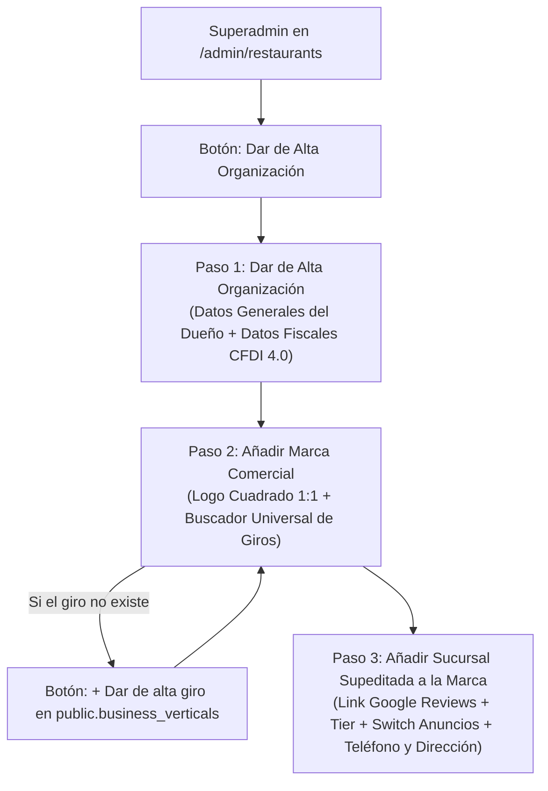

# SPEC-005: Gestión de Organizaciones, Marcas Multigiro y Sucursales en Superadmin

## 1. Resumen Ejecutivo & Arquitectura de 3 Niveles de Alta

El sistema estructura las cuentas de clientes bajo una jerarquía corporativa de 3 entidades encadenadas que permite que una misma organización opere múltiples marcas comerciales de distintos giros y múltiples sucursales supeditadas a cada marca:

1. **Organización (`public.organizations`)**: Base legal, fiscal (`billing_info` CFDI 4.0) y datos del dueño titular (`owner_name`, `owner_email`, `owner_phone`).
2. **Marca Comercial (`public.organization_brands`)**: Cada organización cuenta con su propio catálogo de marcas comerciales. Cada marca almacena su logotipo en formato cuadrado predeterminado (`256×256 px` 1:1) y se vincula al catálogo universal de giros comerciales (`public.business_verticals`).
3. **Sucursal Física (`public.restaurants`)**: Toda sucursal está supeditada a una marca comercial (`brand_id`), heredando su identidad visual y su giro operativo, y definiendo su enlace de reseñas de Google, paquete contratado (`Tier 1` a `4`), switch de modalidad de anuncios (`Marca Blanca Ad-Free` vs `Red de Anuncios`), teléfono de sucursal y dirección física.

---

## 2. Tablas de Base de Datos (Supabase PostgreSQL)

### 2.1. Catálogo Universal de Giros (`public.business_verticals`)
Funciona de forma universal en todo el sistema y se sincroniza en tiempo real con todos los desplegables de marcas y sucursales:
* `id` (`UUID PRIMARY KEY`)
* `slug` (`TEXT UNIQUE NOT NULL`)
* `name` (`TEXT NOT NULL`) — Ej. `Gastronomía / Restaurante`, `Barbería & Peluquería`, `Clínica / Consultorio Dental`
* `unit_label` / `unit_plural` (`TEXT`) — Ej. `Mesa / Mesas`, `Sillón / Sillones`, `Consultorio / Consultorios`
* `show_kds` (`BOOLEAN`), `show_floor_staff` (`BOOLEAN`), `show_hostess` (`BOOLEAN`)

### 2.2. Tabla de Marcas por Organización (`public.organization_brands`)
* `id` (`UUID PRIMARY KEY`)
* `organization_id` (`UUID REFERENCES public.organizations(id) ON DELETE CASCADE`)
* `name` (`TEXT NOT NULL`)
* `vertical_id` (`UUID REFERENCES public.business_verticals(id)`)
* `vertical_slug` (`TEXT NOT NULL`)
* `logo_url` (`TEXT`) — Imagen normalizada en formato cuadrado estándar `256×256 px`
* `brand_color` (`TEXT DEFAULT '#2563eb'`)

### 2.3. Supeditación de Sucursales a Marcas (`public.restaurants`)
* `brand_id` (`UUID REFERENCES public.organization_brands(id) ON DELETE SET NULL`)
* `business_type` (`TEXT NOT NULL DEFAULT 'restaurant'`)

---

## 3. Componentes Implementados

* [`NewOrganizationModal.tsx`](file:///c:/Users/Mickey/Documents/DEV/Google%20Rese%C3%B1as/src/components/admin/NewOrganizationModal.tsx): Asistente guiado de 3 pasos (`1. Organización & Fiscal` -> `2. Añadir Marca & Giro` -> `3. Añadir Sucursal`) con recorte automático de logo en `<canvas>` `256×256 px` y desplegable de giros con buscador y botón **`+ Dar de alta giro`**.
* [`RestaurantFormModal.tsx`](file:///c:/Users/Mickey/Documents/DEV/Google%20Rese%C3%B1as/src/components/admin/RestaurantFormModal.tsx): Selector de organización y marca registrada, buscador universal de giros y switch interactivo para la modalidad de anuncios.
* [`AdminRestaurantsPage.tsx`](file:///c:/Users/Mickey/Documents/DEV/Google%20Rese%C3%B1as/src/pages/AdminRestaurantsPage.tsx) y [`restaurants_bento.ts`](file:///c:/Users/Mickey/Documents/DEV/Google%20Rese%C3%B1as/src/lib/restaurants_bento.ts): Botón superior **`Dar de Alta Organización`** y tabla jerárquica en árbol con niveles `Organización Matriz -> Marca Comercial -> Sucursal Física -> Panel de Control Operativo` dividido en 5 categorías en vivo:
  1. **Categoría 1 (Funcionalidades por Nivel Contratado & Cupones de Quejas):** Switches de `Tier 1` a `4` + `Ad-Free` y visualización en vivo de los cupones creados por el gerente con su progreso de límite mensual (`used_this_month / monthly_limit`).
  2. **Categoría 2 (Hardware NFC, Mesas de Hostess & Capacidad de Comensales):** Aforo total de la sucursal, capacidad de comensales por mesa, selector de estado en vivo (`Libre`, `Ocupada`, `En Limpieza` con notificación al mesero, `Desactivada`) y métricas de venta por mesa.
  3. **Categoría 3 (Pantallas Operativas Activas & Estaciones por Rol):** Agrupa en un solo bloque todas las pantallas operativas de la sucursal (`Consola de Gerente de Tienda & Capitán de Piso`, `Pantalla de Hostess & Recepción`, `Terminal Móvil de Sala`, `Monitor Maestro KDS`, `Estación Cocina Caliente`, `Estación Barra & Coctelería`, `Estación Repostería & Café`, `Turnero Público 4K`), cada una con su insignia de `Rol Exclusivo`, lista de `Operadores asignados`, switch `PRENDIDO / APAGADO` y botón directo para abrir la pantalla.
  4. **Categoría 4 (Plantilla de Personal Operativo con PIN, Roles, Pantallas KDS, Turnos a 60 Días & Métricas):** Dedicada exclusivamente a los empleados con selector de puesto en vivo, conmutadores de pantallas sobre las que incide cada empleado (`Cocina KDS` / `Barra & Café`), próximo turno agendado hasta 60 días y métricas de corte de turno.
  5. **Categoría 5 (Tabla de Gerentes de la Organización, Acceso a Sucursal & Cortes de Turno):** Alta rápida de gerentes en la organización, selector de rol por sucursal (`Gerente de Tienda`, `Capitán / Gerente de Piso`, `Sin Acceso`) y resumen de los últimos cortes de caja enviados al dueño.
* [`PortalHostessPage.tsx`](file:///c:/Users/Mickey/Documents/DEV/Google%20Rese%C3%B1as/src/pages/portal/PortalHostessPage.tsx): Pantalla operativa de Hostess (`#/portal/hostess`) con creación de mesas por sucursal (`public.restaurant_tables`), control de capacidad total de comensales, cambio de estado (`libre`, `ocupada`, `en_limpieza`, `desactivada`) y botón **`Solicitar Limpieza`** que envía una alerta en tiempo real (`call_type: 'cleaning'`) a la terminal del mesero ([`PortalStaffPage.tsx`](file:///c:/Users/Mickey/Documents/DEV/Google%20Rese%C3%B1as/src/pages/portal/PortalStaffPage.tsx)).
* [`PortalKitchenPage.tsx`](file:///c:/Users/Mickey/Documents/DEV/Google%20Rese%C3%B1as/src/pages/portal/PortalKitchenPage.tsx): Estaciones KDS diferenciadas para **Jefe de Cocina** (`cocina`) y **Barista** (`barista`: Barra, Coctelería, Repostería y Café).
* [`PortalManagerPage.tsx`](file:///c:/Users/Mickey/Documents/DEV/Google%20Rese%C3%B1as/src/pages/portal/PortalManagerPage.tsx): Consola Operativa del Gerente de Tienda (`#/portal/gerente`) con 4 módulos:
  1. **Personal & Estaciones KDS**: Alta de empleados con sus roles (`waiter`, `kitchen`, `barista`, `hostess`, `manager`) y selección de sobre qué pantalla incide cada uno (`allowed_stations`).
  2. **Programador de Turnos (Hasta 2 Meses / 60 Días)**: Calendario de turnos (`public.staff_shifts`) con validación estricta de ventana máxima de 60 días de anticipación.
  3. **Cortes de Caja por Turno & Envío al Dueño**: Generación de cortes por turno de mesero (`public.manager_shift_reports`) y envío automático de métricas por mesa y por empleado a la pantalla general del dueño ([`PortalMetricsTab.tsx`](file:///c:/Users/Mickey/Documents/DEV/Google%20Rese%C3%B1as/src/pages/portal/PortalMetricsTab.tsx)).
  4. **Quejas, Descuentos y Cupones con Límite Mensual**: Bandeja de quejas en tiempo real (`rating <= 3`), autorización de descuentos por incidencia y creación de cupones propios del gerente con tope mensual (`public.manager_retention_coupons`).
* **Tabla de Gerentes por Organización (`public.organization_managers`)**: Tanto el Superadministrador ([`AdminRestaurantsPage.tsx`](file:///c:/Users/Mickey/Documents/DEV/Google%20Rese%C3%B1as/src/pages/AdminRestaurantsPage.tsx)) como el Dueño del Local ([`PortalAccountTab.tsx`](file:///c:/Users/Mickey/Documents/DEV/Google%20Rese%C3%B1as/src/pages/portal/PortalAccountTab.tsx)) pueden dar de alta gerentes en la organización y asignar su rol específico en cada sucursal (`gerente_tienda` vs `capitan_piso`).

---

## 9. Política de Aislamiento Multi-Organización, Movilidad Inter-Sucursal y Estándares de Interfaz (`POL-009`)

### 9.1 Reglas de Aislamiento y Movilidad Operativa (`POL-009`)
1. **Aislamiento entre Organizaciones**: Una organización jamás tiene acceso a los datos, métricas, personal ni configuraciones de otras organizaciones (`isSameOrganizationAccessAllowed`).
2. **Aislamiento de Sucursales**: Una sucursal jamás tiene acceso a los datos ni configuraciones de otras organizaciones (`filterBranchesBySameOrganization`).
3. **Movilidad de Personal Operativo en Turno**: Todo el personal operativo (`waiter`, `kitchen`, `barista`, `hostess`, `manager`) puede iniciar sesión con su PIN de 4 dígitos en otras sucursales **de su misma organización** para cubrir ahí su turno (`ordersApi.loginStaffWithPin`), rechazando estrictamente cualquier intento de acceso de personal perteneciente a otra organización.
4. **Movimientos de Personal entre Sucursales por Gerentes**: Entre gerentes pueden realizar movimientos de personal entre sucursales de su misma organización y dejarlo asentado en la planeación de turnos de hasta 60 días (`ordersApi.scheduleInterBranchStaffShift` en [`PortalManagerPage.tsx`](file:///c:/Users/Mickey/Documents/DEV/Google%20Rese%C3%B1as/src/pages/portal/PortalManagerPage.tsx)), registrando la etiqueta `[Movimiento Inter-Sucursal]`.

### 9.2 Estándares de Interfaz en Administración y Formularios
* **Truncado a 25 Caracteres con Tooltip y Edición Directa**: En [`AdminRestaurantsPage.tsx`](file:///c:/Users/Mickey/Documents/DEV/Google%20Rese%C3%B1as/src/pages/AdminRestaurantsPage.tsx), tanto la dirección física como el teléfono muestran únicamente los primeros 25 caracteres (`formatTextMax25`), desplegando el valor íntegro en un tooltip al pasar el cursor y ofreciendo un botón de edición directa in-situ.
* **Componente Universal de Teléfono con Lada y WhatsApp**: Todos los campos telefónicos del proyecto utilizan [`PhoneInputWithCountry.tsx`](file:///c:/Users/Mickey/Documents/DEV/Google%20Rese%C3%B1as/src/components/common/PhoneInputWithCountry.tsx), que integra selector de código de área internacional (`+52`, `+1`, `+34`, `+57`, `+54`, `+56`, `+51`, `+502`, `+506`), campo numérico local y casilla de verificación **Cuenta con WhatsApp**.
* **Barra Lateral Fija Reactiva al Hover**: En [`AdminLayout.tsx`](file:///c:/Users/Mickey/Documents/DEV/Google%20Rese%C3%B1as/src/components/admin/AdminLayout.tsx), la barra lateral izquierda permanece fija (`h-screen sticky top-0 overflow-hidden`) sin desplazarse con el contenido, manteniendo fijos en la parte inferior los botones `Ver pantalla de cliente` y `Cerrar Sesión`, y contrayéndose/expandiéndose reactivamente al pasar el cursor (`hover`).

### 9.3 Horarios Operativos de Sucursal, Baja Permanente y Categorías Colapsables
* **Horarios Operativos en Sucursal y Planeación de Turnos**: Se incorporaron las propiedades `opening_time`, `closing_time` y `operating_days` en la entidad `Restaurant`, disponibles en el alta de organizaciones (`NewOrganizationModal.tsx`), alta de sucursales (`NewBranchModal.tsx`) y edición de sucursal (`RestaurantFormModal.tsx`). En la consola del Gerente de Tienda (`PortalManagerPage.tsx`), se muestra la tarjeta informativa **Horario Oficial de la Sucursal** y la selección del tipo de turno (matutino, vespertino, nocturno_cierre, completo) precalcula automáticamente las horas de entrada y salida basadas en la apertura y cierre oficial del local.
* **Baja Permanente y Purga de Sucursales/Marcas Huérfanas**: `deleteRestaurant` en `restaurantsApi` ahora soporta baja definitiva (`hardDelete = true`), eliminando completamente la sucursal de la base de datos tanto en Supabase como en modo local, previniendo que se convierta en local independiente fantasma (`is_active: false`). Se agregaron botones de eliminación definitiva (`Trash2`) tanto en las filas de sucursales independientes como en las marcas comerciales que cuenten con 0 sucursales activas (`deleteOrganizationBrand`).
* **Categorías Colapsables y Desplegables en el Panel de Sucursal**: En `AdminRestaurantsPage.tsx`, cada una de las 5 categorías del Panel de Control de Sucursal es interactiva y permite colapsar o expandir su contenido de forma individual mediante clic en su cabecera con indicador de chevron y estado (`Expandir` / `Colapsar`). Además, la cabecera general del panel incluye botones de acción rápida **Desplegar Todo** y **Colapsar Todo**.

