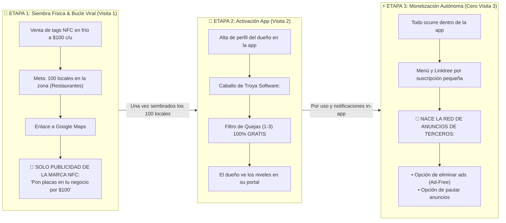

# 🎯 SPEC-011: Estrategia de Despliegue GTM en 3 Etapas

## 1. Resumen Ejecutivo & Filosofía de Siembra

El éxito de la plataforma depende de una **ejecución comercial por fases estrictas**. No se intenta vender un sistema complejo el primer día. Se utiliza una estrategia de siembra en 3 etapas diseñada para capturar territorio físico, generar confianza y monetizar de forma 100% autónoma desde la aplicación.

---

## 2. Detalle Operativo de las 3 Etapas

### 📍 Etapa 1: "Siembra Física & Bucle de Crecimiento Viral" (Visita 1)
* **Objetivo:** Adueñarse de las mesas físicas de la zona geográfica hasta alcanzar **100 locales afiliados** (enfocado 100% en restaurantes inicialmente).
* **Acción en Calle (Visita 1):**  
  * Venta en frío de las placas NFC a **$100 MXN cada una**.
  * Cero contratos, cero suscripciones, cero contraseñas en esta visita.
  * *Argumento:* *"Tu cliente acerca el celular y se abre de inmediato tu Google Maps para dejarte 5 estrellas"*.
* **Captura de Inteligencia de Mickey:**  
  * Nombre del restaurante, sucursal, WhatsApp del dueño/encargado y enlace de Google Reviews.
* **Regla de Pauta en Etapa 1 (Bucle Viral Propio):**  
  * **Cero Publicidad de Terceros:** No se muestran gimnasios, clínicas ni marcas ajenas.
  * **Auto-Promoción Exclusiva de la Marca NFC:**  
    El espacio publicitario inferior se reserva **exclusivamente para promocionar el propio servicio de placas NFC de Mickey**:
    > *"⚡ Tecnología NFC Google Reseñas — ¿Tienes un negocio o restaurante? Consigue tus placas de mesa por solo **$100 MXN**. Toca aquí para pedir las tuyas por WhatsApp."*
  * **El Efecto Viral:** Muchos comensales sentados a comer son dueños de negocios, comerciantes o emprendedores. Cada mesa sembrada se convierte en un espectacular publicitario que te atrae nuevos clientes de forma automática para llegar a la meta de los 100 locales mucho más rápido.

---

### 📱 Etapa 2: "Activación Digital en Segunda Visita" (El Segundo Caballo de Troya)
* **Objetivo:** Convertir el hardware físico instalado en usuarios activos del portal móvil (`/#/portal`).
* **Acción en Calle (Visita 2):**  
  * Se visita nuevamente al locatario que ya vio comensales tocando la placa.
  * Se le entrega su acceso al portal: *"Te dimos de alta tu perfil en la app para que veas tus métricas"*.
* **El Gancho Irresistible (Caballo de Troya de Software):**  
  * Se le activa el **Filtro Inteligente de Reseñas 100% GRATIS**:  
    *"Como cliente fundador, te regalamos el filtro: si alguien califica con 1 a 3 estrellas, no va a Google; te llega directo a tu celular para que no te quemen públicamente"*.
* **El Semillero de Upgrades:**  
  * Al ingresar a su portal, el dueño descubre visualmente los niveles superiores que la plataforma ofrece.

---

### ⚡ Etapa 3: "Monetización Autónoma In-App" (Cero Tercera Visita)
* **Objetivo:** Cobro recurrente mensual y encendido oficial de la Red de Publicidad de Terceros.
* **Regla Invariante:** **YA NO EXISTE TERCERA VISITA PRESENCIAL.** Mickey no vuelve a gastar tiempo en la calle con ese cliente. Todo el ciclo comercial se gestiona autónomamente por medio de la app:
  * **Upgrades de Software:** Notificaciones dentro del portal para desbloquear la gestión de **Menú Digital / Linktree y WiFi Zero-Password** mediante una suscripción mensual pequeña.
  * **Encendido de la Red de Anuncios de Patrocinadores:**  
    * Una vez alcanzada la masa crítica de 100 locales, se abre la red a patrocinadores locales (gimnasios, clínicas, marcas).
    * **Opción Ad-Free:** El locatario puede pagar su cuota para eliminar los anuncios de patrocinadores en sus mesas.
    * **Opción de Pauta:** El locatario puede comprar pauta para anunciarse en los otros 99 restaurantes de la zona.

---

## 3. Impacto en la Arquitectura de Software

1. **Campaña Default de Auto-Promoción en Etapa 1:**
   * El sistema incluye un banner predeterminado y no editable por terceros:
     * Título: *"Placas NFC para Google Reseñas en tu Negocio"*.
     * Call-to-Action: *"Pedir placas por $100 MXN en WhatsApp"*.
     * Destino: Enlace directo al WhatsApp comercial de Mickey.
2. **Onboarding Rápido en Superadmin:**
   * Capacidad de registrar un restaurante y sus 10 placas en menos de 60 segundos durante la Visita 1.
3. **Invitación de 1-Clic para la Visita 2:**
   * Mensaje de WhatsApp pre-configurado para enviarle sus accesos y activar su filtro gratuito.

---

## 4. Estado de Aprobación & Registro

* **Estado:** `PREAPROBADO` (Aprobado formalmente por Mickey como la hoja de ruta oficial del proyecto).
