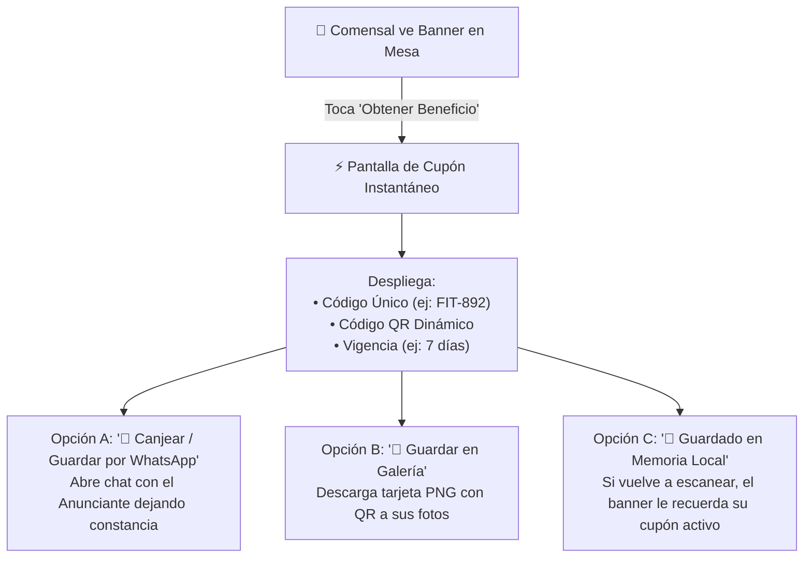

# 🎟️ SPEC-006: Infraestructura de Cupones, Entrega al Comensal y Validación de ROI

## 1. Resumen Ejecutivo & Propósito

Para cerrar el ciclo de la Red Publicitaria y garantizar que cada peso invertido por el anunciante demuestre un retorno financiero real, este documento especifica:
1. El mecanismo de **emisión y entrega** del cupón digital al comensal en mesa.
2. El candado de **un solo uso (Single-Use)** para evitar fraudes en punto de venta.
3. El módulo de **validación y canje** para el personal de recepción o caja del anunciante.
4. La configuración de **privacidad de ingresos** (campo opcional de ticket de venta con cálculo de ROI).

---

## 2. ¿Cómo recibe el comensal su cupón en mesa? (Cero Fricción)

El comensal está en su teléfono tras haber tocado el tag NFC en mesa. Para no matar la conversión, **no se le obliga a llenar formularios largos ni a crear contraseñas**.



### Canales de Entrega y Respaldo:
1. **Generación Instantánea:** Al tocar el banner, el código único de 6 caracteres (ej. `FIT-892`) y su código QR se generan en milisegundos en la pantalla.
2. **Respaldo en WhatsApp (Canal Principal):**  
   Un botón prominente: **`[ 📲 Canjear / Guardar en WhatsApp ]`**.  
   Abre inmediatamente una conversación con la cuenta oficial del anunciante con el mensaje:
   > *"¡Hola Smart Fit! 👋 Acabo de generar mi cupón **FIT-892** en La Parrilla Argentina para mi 1er mes gratis. ¿Cómo lo hago válido?"*  
   *Resultado:* El comensal tiene el cupón respaldado en su historial de WhatsApp y el anunciante ya capturó el teléfono del prospecto (Lead calificado).
3. **Descarga a Galería de Fotos:**  
   Un botón secundario: **`[ 📸 Guardar en mis Fotos ]`** genera y descarga un gráfico PNG con el logotipo de la marca, el QR y el código para mostrarlo físicamente en mostrador sin conexión a internet.

---

## 3. Modelo de Datos & Candado Antifraude (Un solo uso)

### 3.1. Tabla en PostgreSQL (`coupons`)
```sql
CREATE TABLE IF NOT EXISTS coupons (
    id UUID PRIMARY KEY DEFAULT gen_random_uuid(),
    ad_id UUID NOT NULL REFERENCES ads(id) ON DELETE CASCADE,
    restaurant_id UUID REFERENCES restaurants(id) ON DELETE SET NULL,
    tag_code TEXT,
    coupon_code TEXT UNIQUE NOT NULL,                  -- Ej: "FIT-892" (Clave única)
    status TEXT NOT NULL DEFAULT 'active' CHECK (status IN ('active', 'redeemed', 'expired')),
    ticket_amount NUMERIC(10, 2) DEFAULT NULL,         -- Monto cobrado en venta (opcional según ajustes)
    redeemed_at TIMESTAMPTZ DEFAULT NULL,
    redeemed_by UUID DEFAULT NULL,
    expires_at TIMESTAMPTZ NOT NULL,
    created_at TIMESTAMPTZ NOT NULL DEFAULT now()
);

CREATE INDEX IF NOT EXISTS idx_coupons_code ON coupons(coupon_code);
CREATE INDEX IF NOT EXISTS idx_coupons_ad ON coupons(ad_id);
```

### 3.2. Función Transaccional de Canje Único (`redeem_coupon`)
Para evitar que una captura de pantalla se comparta entre varios clientes, el canje se procesa con un bloqueo atómico (`FOR UPDATE`):
* Si el cupón ya tiene `status = 'redeemed'`, la base de datos aborta la transacción y devuelve:
  `{ success: false, error: 'CUPON_YA_CANJEADO', redeemed_at: '2026-10-30T15:20:00Z' }`.
* **Garantía matemática:** El cupón solo puede pasar de `active` a `redeemed` exactamente una vez en toda su vida útil.

---

## 4. Portal de Validación del Anunciante (`/#/portal-anunciante/canjear`)

La interfaz del anunciante está optimizada para que un recepcionista, cajero o dependiente valide un cupón en menos de **3 segundos**:

1. **Lector QR por Cámara:** Toca *"Escanear QR"* y apunta al teléfono del comensal.
2. **Entrada Manual por Teclado:** Escribe los 6 caracteres (`FIT-892`) si el cliente se los dicta.
3. **Validación Visual Instantánea:**
   * 🟢 **Verde (Válido):** Muestra el nombre de la promoción y el restaurante de procedencia.
   * 🔴 **Rojo (Inválido / Ya Canjeado):** Muestra alerta de rechazo con fecha del canje previo.

---

## 5. Ajustes de Privacidad del Anunciante: Control de Registro de Ventas (ROI)

En los ajustes de perfil del cliente anunciante (`Ajustes de Campaña / Privacidad`), existirá un interruptor de configuración:

```text
[X] Registrar monto de venta al canjear cupón (Cálculo de ROI exacto)
    Si activas esta opción, tu personal de caja deberá ingresar el monto
    cobrado al validar cada cupón para calcular tu retorno de inversión
    en dinero. Si la desactivas, protegemos la confidencialidad de tus 
    ventas y solo mediremos cupones canjeados.
```

### Comportamiento Dinámico en Pantalla de Canje:
* **Si la opción está ACTIVADA (`track_ticket_revenue = true`):**
  * Al validar el cupón, el formulario despliega un campo **obligatorio**:  
    `[ Monto de la Venta ($ MXN): $ _______ ]`
  * El botón *"Confirmar y Quemar Cupón"* permanece deshabilitado hasta que el cajero escribe el monto.
  * El panel del anunciante genera la métrica de **Retorno de Inversión (ROI en $)**:  
    `ROI = (Ventas Totales Registradas - Inversión en Publicidad) / Inversión`.
* **Si la opción está DESACTIVADA (`track_ticket_revenue = false`):**
  * El campo de monto **desaparece por completo** de la pantalla de la recepcionista.
  * El canje se realiza con un solo clic: **`[ Quemar Cupón ]`**.
  * El reporte del anunciante protege su privacidad financiera y se enfoca en métricas de volumen: *Comensales que llegaron a mostrador, Tasa de Canje y Costo por Adquisición de Cliente (CPA)*.

---

## 6. Estado del Documento & Aprobación

* **Estado:** `PREAPROBADO` (Incorporado formalmente con los ajustes de privacidad solicitados por Mickey).
* **Dependencias técnicas:** Requiere migración SQL para tabla `coupons` y función `redeem_coupon`.
