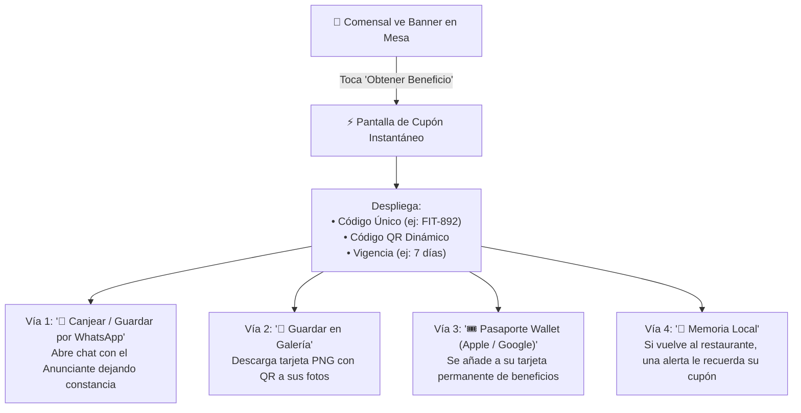
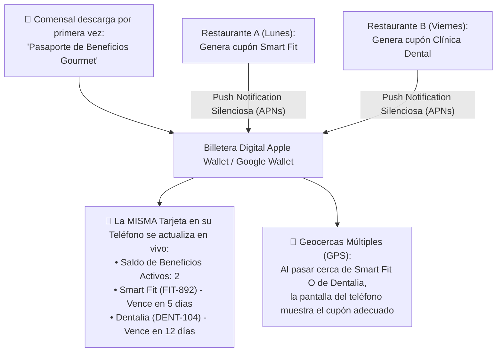

# 🎟️ SPEC-006: Infraestructura de Cupones, Entrega de Leads y Pasaporte Multi-Cupón Wallet

## 1. Resumen Ejecutivo & Propósito

Para cerrar el ciclo de la Red Publicitaria y garantizar que cada peso invertido por el anunciante demuestre un retorno financiero real, este documento especifica:
1. El mecanismo de **emisión y entrega** del cupón digital al comensal en mesa (cero fricción).
2. El candado de **un solo uso (Single-Use)** para evitar fraudes en punto de venta.
3. El módulo de **validación y canje** para el personal de recepción o caja del anunciante (`/#/canjear`).
4. La configuración de **privacidad de ingresos** (campo opcional de ticket de venta con cálculo de ROI).
5. Los canales de **traspaso de leads en tiempo real** al anunciante (Vía 1 y Vía 2 preaprobadas; Vía 3 delegada a Deuda Técnica DT-08).
6. El **Pasaporte Multi-Cupón Dinámico para Apple Wallet y Google Wallet** (una sola tarjeta permanente que centraliza y actualiza todos los cupones activos del comensal).

---

## 2. ¿Cómo recibe el comensal su cupón en mesa? (Cero Fricción)

El comensal está en su teléfono tras haber tocado el tag NFC en mesa. Para no matar la conversión, **no se le obliga a llenar formularios largos ni a crear contraseñas**.



---

## 3. Modelo de Datos & Candado Antifraude (Un solo uso)

### 3.1. Tabla en PostgreSQL (`coupons`)
```sql
CREATE TABLE IF NOT EXISTS coupons (
    id UUID PRIMARY KEY DEFAULT gen_random_uuid(),
    ad_id UUID NOT NULL REFERENCES ads(id) ON DELETE CASCADE,
    restaurant_id UUID REFERENCES restaurants(id) ON DELETE SET NULL,
    tag_code TEXT,
    customer_phone TEXT,                               -- Teléfono si usó WhatsApp (Lead)
    coupon_code TEXT UNIQUE NOT NULL,                  -- Ej: "FIT-892" (Clave única)
    status TEXT NOT NULL DEFAULT 'active' CHECK (status IN ('active', 'redeemed', 'expired')),
    ticket_amount NUMERIC(10, 2) DEFAULT NULL,         -- Monto cobrado en venta (opcional según ajustes)
    redeemed_at TIMESTAMPTZ DEFAULT NULL,
    redeemed_by UUID DEFAULT NULL,
    expires_at TIMESTAMPTZ NOT NULL,
    created_at TIMESTAMPTZ NOT NULL DEFAULT now()
);

CREATE INDEX IF NOT EXISTS idx_coupons_code ON coupons(coupon_code);
CREATE INDEX IF NOT EXISTS idx_coupons_ad ON coupons(ad_id);
```

### 3.2. Función Transaccional de Canje Único (`redeem_coupon`)
Para evitar que una captura de pantalla se comparta entre varios clientes, el canje se procesa con un bloqueo atómico (`FOR UPDATE`):
* Si el cupón ya tiene `status = 'redeemed'`, la base de datos aborta la transacción y devuelve:
  `{ success: false, error: 'CUPON_YA_CANJEADO', redeemed_at: '2026-10-30T15:20:00Z' }`.
* **Garantía matemática:** El cupón solo puede pasar de `active` a `redeemed` exactamente una vez en toda su vida útil.

---

## 4. Ajustes de Privacidad del Anunciante: Control de Registro de Ventas (ROI)

En los ajustes de perfil del cliente anunciante (`Ajustes de Campaña / Privacidad`), existirá un interruptor de configuración:

```text
[X] Registrar monto de venta al canjear cupón (Cálculo de ROI exacto)
    Si activas esta opción, tu personal de caja deberá ingresar el monto
    cobrado al validar cada cupón para calcular tu retorno de inversión
    en dinero. Si la desactivas, protegemos la confidencialidad de tus 
    ventas y solo mediremos cupones canjeados.
```

* **Si está ACTIVADA (`track_ticket_revenue = true`):** El campo `Monto de la Venta ($ MXN)` es obligatorio en la pantalla de canje y se genera la métrica de **ROI financiero**.
* **Si está DESACTIVADA (`track_ticket_revenue = false`):** El campo **desaparece por completo** de la pantalla de la recepcionista y el canje se realiza con un solo toque (`[ Quemar Cupón ]`), protegiendo la confidencialidad de ingresos del negocio.

---

## 5. Canales de Traspaso de Leads al Anunciante (Preaprobados)

Para que el negocio patrocinador pueda convertir comensales en clientes de pago, se habilitan dos canales directos:

### 🟢 Vía 1: Bandeja de Leads en su Portal (`/#/portal-anunciante/leads`)
* **CRM Ligero Integrado:** Tabla en tiempo real con fecha, teléfono del comensal, sucursal de procedencia, código de cupón y vigencia.
* **Botón 1-Clic de WhatsApp:** Al tocar `[ 💬 Contactar ]`, se abre WhatsApp Web o móvil con mensaje pre-redactado para agendar al prospecto de inmediato.

### 🟢 Vía 2: Alerta Instantánea al Celular del Vendedor (Venta en Caliente)
* En cuanto el comensal solicita el beneficio en mesa, el sistema dispara un mensaje de WhatsApp directo al encargado de ventas del anunciante con los datos del prospecto para cerrar la venta en los primeros 15 minutos.

> [!NOTE]
> **Vía 3 (Descarga Masiva CSV/Excel y Webhooks CRM):** Se desprioriza de la primera fase y se cataloga formalmente en el inventario de **Deuda Técnica (`DT-08`)** para su amortización futura.

---

## 6. Estrategias de Reactivación de Cupones (Preaprobadas)

Para asegurar que el comensal no olvide su cupón tras salir del restaurante:

1. **Recordatorio Automatizado por WhatsApp (Estrategia 1):**  
   Disparo programado 48 horas antes de expirar con la dirección en Google Maps del anunciante y su código de canje.
2. **Alertas Nativas por Proximidad y Vencimiento (Estrategia 2):**  
   Notificación en pantalla de bloqueo 24 horas antes de vencer o al pasar físicamente cerca del establecimiento del anunciante.

---

## 7. Arquitectura Innovadora: El Pasaporte Multi-Cupón Wallet (Club Pass)

En lugar de que el comensal descargue un pase individual por cada cupón (lo que saturaría su Apple Wallet / Google Wallet con tarjetas dispersas), el sistema implementa una **Tarjeta Única Dinámica de Beneficios**:



### Ventajas Estratégicas del Pasaporte Multi-Cupón:
1. **Un Solo Pase Permanente:** El comensal solo agrega la tarjeta una vez a su billetera. Nunca la borra porque se convierte en su membresía de descuentos en todos los restaurantes de la red.
2. **Actualización Remota en Tiempo Real:**  
   * En **Apple Wallet (`.pkpass`)**, la tarjeta se actualiza silenciosamente vía APNs (*Apple Push Notification Service*).
   * En **Google Wallet**, el objeto de pase se actualiza mediante la API de Google Wallet.
3. **Múltiples Geocercas GPS:**  
   Apple Wallet permite registrar hasta 10 coordenadas geográficas en un mismo pase. Si el comensal tiene 3 cupones activos de 3 negocios distintos, la tarjeta encenderá una notificación en su pantalla cuando camine cerca de cualquiera de ellos.
4. **Al Quemar un Cupón:**  
   Cuando la recepcionista redime el cupón en `/#/canjear`, la tarjeta del cliente se actualiza automáticamente: el cupón canjeado se tacha y se mueve al historial de la tarjeta.

---

## 8. Estado del Documento & Aprobación

* **Estado:** `PREAPROBADO` (Aprobado formalmente por Mickey).
* **Deuda Técnica Vinculada:** `DT-08` (Exportación CSV y Webhooks CRM).
