# 📢 SPEC-008: Mesa de Ayuda B2B, Automatización de Pauta y Consola de Anuncios

## 1. Separación de Quejas y Veto Autónomo

### 1.1. Quejas de Comensales (100% del Locatario)
* Las quejas y calificaciones de 1 a 3 estrellas dejadas por los comensales van **directa y exclusivamente al Portal del Suscriptor (`/#/portal` ➔ Pestaña Quejas)** de cada establecimiento.
* **Invariante:** Cero saturación en el panel Superadmin con temas de cocina o servicio en sala de terceros.

### 1.2. Veto de Anunciante 100% Autónomo
* **Cero Intervención Humana:** El locatario no levanta tickets de soporte para vetar un anuncio. Lo ejecuta con un solo clic directamente desde su propio portal de suscriptor.
* El sistema aplica el bloqueo de 30 días de forma inmediata en base de datos y descuenta su cupo mensual gratuito.

### 1.3. Mesa de Ayuda B2B en Superadmin (`/admin/soporte`)
* El ítem del menú lateral *"Buzón de Quejas"* se transforma en **Mesa de Ayuda / Soporte B2B**.
* Gestiona exclusivamente incidencias técnicas o contractuales de los locatarios hacia Mickey:
  * Placas físicas NFC dañadas, despegadas o solicitud de repuestos.
  * Cambios fiscales o dudas de facturación.
  * Ampliación de sucursales o placas adicionales.

---

## 2. Automatización Total de la Red Publicitaria (Cero Operación Manual)

```mermaid
flowchart TD
    subgraph A80 ["1. Renovación al 80% (Cero Fricción Comercial)"]
        R1["Consumo al 80% de impresiones"] -->|"Trigger Automatizado"| R2["Genera Checkout Link (Stripe/MP)"]
        R2 -->|"Disparo autónomo por WhatsApp/Email"| R3["Anunciante paga en 1 clic"]
        R3 -->|"Webhook activa pago"| R4["Bolsa de impresiones se amplía sola"]
    end

    subgraph ResumenKPI ["2. KPIs en Pantalla de Resumen (/admin)"]
        K1["Panel General de Mando integra:"]
        K1 --> K2["• Ingresos de Pauta ($ MXN)"]
        K1 --> K3["• Ocupación de Red (% Mesas Monetizables)"]
        K1 --> K4["• Cupones y Leads Generados"]
    end

    subgraph PortalReport ["3. Reporte Nativo en Portal del Cliente"]
        P1["El anunciante/locatario entra a su portal"]
        P1 --> P2["Pestaña 'Mis Campañas'"]
        P2 --> P3["Gráficas de Vistas, Clics, Cupones y ROI en vivo 24/7"]
    end

    subgraph Gatekeeper ["4. Validador Automático de Formato"]
        G1["Locatario sube imagen"] --> G2{"¿Cumple 1200x628 px y <2MB?"}
        G2 -->|"NO"| G3["⛔ Rechazo Inmediato con Guía Visual"]
        G2 -->|"SÍ"| G4["✅ Mockup Móvil Auto-renderizado en su pantalla"]
    end
```

Las 4 resoluciones clave para eliminar trabajo manual y maximizar la escala de la plataforma:

---

### 2.1. Renovación Autónoma al 80% con Checkout Instantáneo
* **Mecanismo:** Cuando una campaña alcanza el 80% de su cuota de impresiones o faltan 3 días para su vigencia, el sistema **no requiere intervención de Mickey**.
* **Flujo Automatizado:**
  1. Un cron o webhook de Supabase detecta el umbral del 80%.
  2. Genera una sesión de pago dinámico con **Stripe Checkout / Mercado Pago**.
  3. Dispara un mensaje automático al WhatsApp/Email del anunciante:
     > *"Tu campaña en la red de mesas lleva el 80% de vistas consumidas. Para evitar que tu anuncio se pause al llegar al 100%, renueva aquí tu siguiente paquete con 1 clic: `[Enlace de Pago Autónomo]`"*.
  4. En cuanto el anunciante paga con su tarjeta, el webhook recibe la confirmación y suma automáticamente las nuevas impresiones a su campaña sin que nadie mueva un dedo.

---

### 2.2. Métricas de la Red Publicitaria Centralizadas en "Resumen" (`AdminDashboardPage.tsx`)
La pantalla de inicio del Superadministrador (`/admin`) pasa a ser el **Centro Integral de Mando**, fusionando métricas de software y de publicidad:
* **Bloque 1 (Suscripciones & Locales):** Total de locales, tags físicos activos, volumen de escaneos, quejas blindadas internamente.
* **Bloque 2 (Red Publicitaria & Monetización):**
  * 💰 **Ingresos del Mes:** Total facturado en suscripciones + pautas publicitarias.
  * 🪑 **Tasa de Ocupación de Inventario:** % de mesas monetizables ocupadas con anuncios activos.
  * 👁️ **Impresiones Servidas:** Vistas totales entregadas a los patrocinadores en el periodo.
  * 🎟️ **Leads & Cupones Generados:** Comensales convertidos en prospectos comerciales.

---

### 2.3. Reporte Nativo en el Portal del Anunciante / Locatario
Mickey **no** copia ni envía enlaces manualmente por WhatsApp:
* Tanto el locatario que pauta en otros comercios como el anunciante externo cuentan con su propio acceso al portal.
* En su panel tienen la pestaña **`Mis Campañas / Publicidad`**, donde consultan en tiempo real:
  * Gráficas de impresiones por día y por local.
  * Clics hacia su WhatsApp o sitio web.
  * Cupones emitidos y canjeados en mostrador.
  * Cálculo dinámico de Retorno de Inversión (ROI).

---

### 2.4. Validador Automático de Creativos (Formato y Calidad)
Mickey **no** toma capturas de pantalla en marcos de iPhone para pedir aprobación:
* **Filtro Técnico en el Formulario de Subida:**
  * **Dimensiones requeridas:** Exactamente `1200 x 628 píxeles` (proporción 1.91:1 estándar publicitario).
  * **Peso máximo:** `2 MB`.
  * **Formatos aceptados:** `WEBP`, `PNG`, `JPG`.
* **Comportamiento ante error:** Si el usuario intenta subir una foto cuadrada, vertical o pixelada, la interfaz la descarta de inmediato con una alerta:  
  `⛔ Imagen inválida: Tu banner mide 800x800 px. Debe medir 1200x628 px para publicarse. Ajusta las dimensiones para continuar.`
* **Previsualización Móvil Auto-Renderizada en su Propia Pantalla:**  
  Al subir una imagen válida, el formulario del portal despliega automáticamente un mockup interactivo de iPhone frente a los ojos del locatario/anunciante, permitiéndole a él mismo auto-aprobar cómo lucirá su banner en la mesa antes de publicarlo.

---

## 3. Estado de Aprobación & Registro

* **Estado:** `PREAPROBADO` (Aprobado formalmente por Mickey con automatización total de pauta y rechazo autónomo de creativos).
* **Impacto en Arquitectura:** Cero fricción operativa para Mickey; la plataforma se autogestiona entre locatarios y anunciantes.
