# 📢 SPEC-008: Mesa de Ayuda B2B, Automatización de Pauta y Consola de Anuncios Superadmin

## 1. Separación de Quejas y Veto Autónomo

### 1.1. Quejas de Comensales (100% del Locatario)
* Las quejas y calificaciones de 1 a 3 estrellas dejadas por los comensales van **directa y exclusivamente al Portal del Suscriptor (`/#/portal` ➔ Pestaña Quejas)** de cada establecimiento.
* **Invariante:** Cero saturación en el panel Superadmin con temas de cocina o servicio en sala de terceros.

### 1.2. Veto de Anunciante 100% Autónomo
* **Cero Intervención Humana:** El locatario no levanta tickets de soporte para vetar un anuncio. Lo ejecuta con un solo clic directamente desde su propio portal de suscriptor.
* El sistema aplica el bloqueo de 30 días de forma inmediata en base de datos y descuenta su cupo mensual gratuito.

### 1.3. Mesa de Ayuda B2B en Superadmin (`/admin/soporte`)
* El ítem del menú lateral *"Buzón de Quejas"* se transforma en **Mesa de Ayuda / Soporte B2B**.
* Gestiona exclusivamente incidencias técnicas o contractuales de los locatarios hacia Mickey:
  * Placas físicas NFC dañadas, despegadas o solicitud de repuestos.
  * Cambios fiscales o dudas de facturación.
  * Ampliación de sucursales o placas adicionales.

---

## 2. Automatización Total de la Red Publicitaria (Cero Operación Manual)

```mermaid
flowchart TD
    subgraph A80 ["1. Renovación al 80% (Cero Fricción Comercial)"]
        R1["Consumo al 80% de impresiones"] -->|"Trigger Automatizado"| R2["Genera Checkout Link (Stripe/MP)"]
        R2 -->|"Disparo autónomo por WhatsApp/Email"| R3["Anunciante paga en 1 clic"]
        R3 -->|"Webhook activa pago"| R4["Bolsa de impresiones se amplía sola"]
    end

    subgraph ResumenKPI ["2. KPIs en Pantalla de Resumen (/admin)"]
        K1["Panel General de Mando integra:"]
        K1 --> K2["• Ingresos de Pauta ($ MXN)"]
        K1 --> K3["• Ocupación de Red (% Mesas Monetizables)"]
        K1 --> K4["• Cupones y Leads Generados"]
    end

    subgraph PortalReport ["3. Reporte Nativo en Portal del Cliente"]
        P1["El anunciante/locatario entra a su portal"]
        P1 --> P2["Pestaña 'Mis Campañas'"]
        P2 --> P3["Gráficas de Vistas, Clics, Cupones y ROI en vivo 24/7"]
    end

    subgraph Gatekeeper ["4. Validador Automático de Formato"]
        G1["Locatario sube imagen"] --> G2{"¿Cumple 1200x628 px y <2MB?"}
        G2 -->|"NO"| G3["⛔ Rechazo Inmediato con Guía Visual"]
        G2 -->|"SÍ"| G4["✅ Mockup Móvil Auto-renderizado en su pantalla"]
    end
```



---

## 3. Especificación Visual y Wireframes de Pantallas

### 3.1. Pantalla de Resumen Ejecutivo (`AdminDashboardPage.tsx` - `/admin`)
El Centro de Mando consolida la salud del negocio en un solo panel de cuatro cuadrantes:

```text
========================================================================================
🧭 PANEL GENERAL — RESUMEN EJECUTIVO (/admin)
========================================================================================

[ 💰 FACTURACIÓN DEL MES ]     [ 🏢 RED DE LOCALES ]       [ 🪑 OCUPACIÓN DE RED ]    [ 🛡️ QUEJAS BLINDADAS ]
$34,800 MXN                  18 Locales Activos          79% Ocupada                142 Quejas Contenidas
(Suscripciones + Pauta)      (12 Restaurantes, 4 Gyms)   (38 de 48 mesas con pauta) (Desviadas de Google)

----------------------------------------------------------------------------------------
📊 RENDIMIENTO DE LA RED PUBLICITARIA EN VIVO (ESTE MES)
----------------------------------------------------------------------------------------
• Impresiones Servidas en Sala: 28,450 vistas
• Clics Generados:             1,140 clics (CTR Promedio: 4.0%)
• Cupones & Leads Entregados:  312 clientes potenciales a patrocinadores
• Facturación por Pauta:       $18,500 MXN

----------------------------------------------------------------------------------------
⚡ ALERTAS DE MANDO & AUTOMATIZACIONES RECIENTES
----------------------------------------------------------------------------------------
🟡 [RENOVACIÓN EN PROCESO] Smart Fit alcanzó 80% de vistas (4,000/5,000).
   Checkout automático de renovación enviado por WhatsApp/Email.
   
🟢 [PAGO AUTÓNOMO RECIBIDO] Clínica DentalPro pagó renovación de $2,500 MXN vía Stripe.
   Bolsa de impresiones ampliada automáticamente a 10,000 vistas.

🎫 [MESA DE AYUDA B2B] 1 solicitud de locatario pendiente:
   "Tacos El Pastorcito — Solicitud de reposición de tag NFC en Mesa 4".
========================================================================================
```

---

### 3.2. Pantalla de Red de Publicidad (`AdminAdsPage.tsx` - `/admin/ads`)
La Consola de Pautas incorpora control presupuestal, estado de renovaciones y detección de vetos:

```text
========================================================================================
📢 RED DE PUBLICIDAD LOCAL (/admin/ads)                        [ + Crear Nueva Campaña ]
Monitorea inventario en mesas, consumo de pautas y renovaciones automáticas
========================================================================================

Filtros: [ Todas (6) ] [ Activas (4) ] [ Al 80% Renovando (1) ] [ Pausadas (1) ]
----------------------------------------------------------------------------------------

┌───────────────────────────────────────┐   ┌───────────────────────────────────────┐
│ 🖼️ BANNER (1200x628 px)               │   │ 🖼️ BANNER (1200x628 px)               │
│ [🟢 ACTIVA]                           │   │ [🟡 80% RENOVANDO]                   │
├───────────────────────────────────────┤   ├───────────────────────────────────────┤
│ SMART FIT — POLANCO                   │   │ CLÍNICA DENTALPRO                     │
│ "1er Mes Gratis + Inscripción 0%"     │   │ "20% de Descuento en Blanqueamiento"  │
│ 📍 Segmentación: 3 Restaurantes       │   │ 📍 Segmentación: Toda la Red (Multigiro)│
│                                       │   │                                       │
│ 📊 Consumo de Pauta Contratada:       │   │ 📊 Consumo de Pauta Contratada:       │
│ [██████░░░░░░░░] 2,450 / 5,000 (49%)  │   │ [████████████░░] 4,120 / 5,000 (82%)  │
│ Presupuesto: $1,500 MXN               │   │ ⚡ Checkout de renovación enviado     │
│                                       │   │                                       │
│ 📈 Métricas de Conversión:            │   │ 📈 Métricas de Conversión:            │
│ Vistas: 2,450  |  Clics: 112 (4.5%)   │   │ Vistas: 4,120  |  Clics: 168 (4.1%)   │
│ Cupones Emitidos: 48                  │   │ Cupones Emitidos: 74                  │
│ Canjes en Mostrador: 14 ventas        │   │ Canjes en Mostrador: 22 ventas        │
│                                       │   │                                       │
│ 🛡️ Monitoreo de Fricción:             │   │ 🛡️ Monitoreo de Fricción:             │
│ 🟢 0 vetos de locatarios              │   │ ⚠️ Vetado en: Taquería Los Güeros    │
├───────────────────────────────────────┤   ├───────────────────────────────────────┤
│ [Pausar]     [Editar]    [Previsualizar]│   │ [Pausar]     [Editar]    [Previsualizar]│
└───────────────────────────────────────┘   └───────────────────────────────────────┘
```

---

### 3.3. Modal de Creación & Validador Automático (`AdFormModal.tsx`)
1. **Filtro Técnico en el Formulario:**
   * Dimensiones: `1200 x 628 píxeles` (proporción 1.91:1 obligatoria).
   * Peso: `<= 2 MB`.
   * Formatos: `WEBP`, `PNG`, `JPG`.
   * Si no cumple: La interfaz lo descarta en el acto e impide guardar con advertencia en rojo.
2. **Mockup Interactivo de iPhone en Vivo:**
   * Al seleccionar una imagen válida, el formulario auto-renderiza un marco de iPhone a la derecha con el banner incrustado para que el locatario o anunciante auto-apruebe el resultado final sin intervención de Mickey.

---

## 4. Estado de Aprobación & Registro

* **Estado:** `PREAPROBADO` (Aprobado formalmente por Mickey).
* **Invariante Operativa:** La plataforma opera de forma 100% autogestiva y automatizada.
