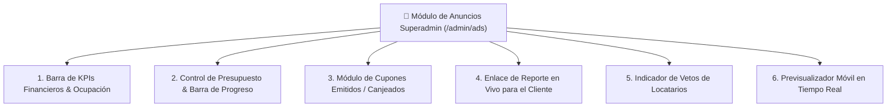

# 📢 SPEC-008: Mesa de Ayuda B2B, Veto Autónomo y Evolución de Anuncios Superadmin

## 1. Separación de Quejas y Veto Autónomo

### 1.1. Quejas de Comensales (100% Locatario)
* Las opiniones y quejas de 1 a 3 estrellas dejadas por los comensales en mesa van **directa y exclusivamente al Portal del Suscriptor (`/#/portal` ➔ Pestaña Quejas)**.
* **Invariante:** No se muestran como tareas operativas en el panel Superadmin para no saturar al administrador con temas de cocina o servicio de terceros.

### 1.2. Veto de Anunciante 100% Autónomo
* **Sin Intervención Humana:** El locatario no envía solicitudes de soporte para vetar un anunciante. Lo ejecuta con un clic directamente desde su propio panel de anuncios (`/#/portal`).
* El sistema aplica el bloqueo de 30 días en base de datos de forma inmediata y automática, controlando el cupón mensual de 1 veto gratis.

### 1.3. Mesa de Ayuda B2B en Superadmin (`/admin/soporte`)
* El ítem del menú lateral *"Buzón de Quejas"* se transforma en **Mesa de Ayuda / Soporte B2B**.
* Recibe únicamente solicitudes técnicas o administrativas de los dueños de locales:
  * Repuesto de placa o tag NFC dañado/despegado.
  * Cambios fiscales o dudas de facturación.
  * Solicitud de ampliación de sucursales o placas físicas.

---

## 2. Nuevas Capacidades para el Módulo de Anuncios Superadmin (`/admin/ads`)

Al analizar la vista actual de la Red de Publicidad Local, se especifican **6 nuevas herramientas de alto impacto** para convertirlo en un Centro de Control de Red de Medios (Ad Network Console):

---

### 2.1. Barra Superior de KPIs Financieros y Ocupación de Red
En la parte superior de la pantalla, antes del listado de anuncios, se añade un tablero de control con 4 tarjetas de resumen:
* **Ingresos Publicitarios del Mes:** Total facturado por concepto de pauta ($ MXN).
* **Ocupación de Inventario:** Mesas monetizables totales vs. mesas con pauta activa (ej. `48 Mesas Totales | 38 con Anuncios Activos (79% ocupación)`).
* **Impresiones Totales Acumuladas:** Volumen total de vistas servidas en sala durante el periodo.
* **Cupones & Leads Generados:** Total de prospectos entregados a los anunciantes.

---

### 2.2. Control de Presupuesto, Topes y Barra de Consumo
Hoy las tarjetas solo muestran vistas y clics infinitos. Se incorporan campos de gestión de pauta:
* **Presupuesto Contratado:** Monto pagado por el anunciante (ej. `$2,500 MXN`).
* **Modalidad de Campaña:**
  * *Vigencia por Tiempo:* Fecha inicio y fin con cuenta regresiva de días restantes.
  * *Bolsa de Impresiones:* Límite contratado (ej. 5,000 escaneos).
* **Barra Visual de Progreso:** Indicador porcentual de consumo de vistas con alertas automáticas:
  * 🟡 *Al 80%: Alerta de "Campaña próxima a agotarse - Contactar para renovación".*
  * 🔴 *Al 100%: Pausa automática para no regalar impresiones.*

---

### 2.3. Métricas de Conversión y Cupones en Cada Tarjeta
La fila de métricas de la tarjeta (que hoy muestra *Vistas, Clics, CTR*) se enriquece con:
* **Cupones Emitidos:** Comensales que tocaron *"Obtener Beneficio"*.
* **Cupones Canjeados:** Comensales que acudieron físicamente a pagar en el negocio del anunciante.
* **Tasa de Conversión a Venta:** Porcentaje de canjes sobre vistas.

---

### 2.4. Botón de Enlace de Reporte en Vivo (`Share Live Report`)
En el pie de cada tarjeta de anuncio:
* Botón: **`[ 🔗 Copiar Enlace de Reporte ]`**.
* Genera una URL pública segura con token (ej: `/#/reporte/ironfit-octubre`).
* **Propósito:** Enviársela por WhatsApp al dueño del negocio anunciante para que vea sus gráficas de rendimiento en tiempo real sin requerir contraseña ni ver datos de otros clientes.

---

### 2.5. Indicador de Vetos por Locatario (Monitoreo de Fricción)
* En cada tarjeta se añade un badge discreto:
  * `🟢 0 vetos` (Aceptado en toda la red).
  * `⚠️ Vetado en 2 locales` (Al pasar el cursor, muestra cuáles restaurantes lo bloquearon y por qué, permitiendo al Superadmin entender si el anuncio causa conflicto).

---

### 2.6. Previsualizador Móvil en Tiempo Real (Live Mobile Mockup)
* Junto al botón de editar, se añade un botón de *"Previsualizar"* (`Eye`).
* Abre un modal con el marco de un iPhone mostrando exactamente cómo luce el banner integrado al pie de la pantalla de calificación del restaurante.

---

## 3. Estado de Aprobación & Registro

* **Estado:** `PREAPROBADO` (Aprobado formalmente por Mickey).
* **Siguiente Paso:** Listo para ser incorporado en la arquitectura visual del Superadmin.
