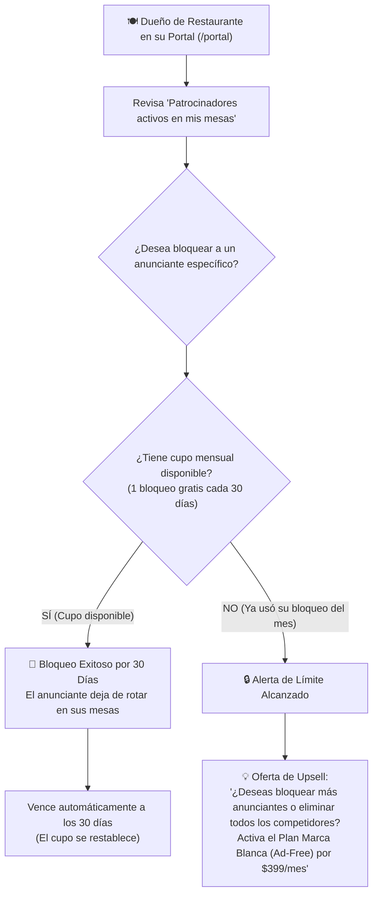

# 📢 SPEC-003: Red Publicitaria Local, Atribución de Ventas y Política de Veto

## 1. Resumen Ejecutivo & Modelo de Negocio

La **Red Publicitaria Local** es un motor de monetización secundaria basado en los comensales sentados en mesas con tags NFC y códigos QR. 

* **Inventario Publicitario:** Todas las mesas de los restaurantes afiliados con suscripción estándar (`is_ad_free = false`).
* **Inventario Limpio:** Si un restaurante contrata el módulo **Marca Blanca (Ad-Free)**, sus mesas quedan 100% libres de publicidad de terceros.
* **Política de Red Abierta:** No existe bloqueo algorítmico automático de giros comerciales ni de negocios gastronómicos. El inventario está disponible para cualquier comercio local que pague por la pauta.

---

## 2. Formatos de Entrega (Placements)

1. **Card Integrada / Banner Inferior (`bottom_banner`):**
   * Tarjeta con diseño nativo integrada debajo del widget de calificación por estrellas o al pie del Linktree ([`AdBanner.tsx`](file:///c:/Users/Mickey/Documents/DEV/Google%20Reseñas/src/components/client/AdBanner.tsx)).
   * Incluye fotografía de la oferta, nombre del anunciante, distintivo *"Espacio Patrocinado"* y botón de acción (CTA).
2. **Pantalla Completa de Bienvenida / Interstitial (`interstitial`):**
   * Transición de 2 a 3 segundos con banner a pantalla completa y botón *"Continuar a Calificar / Omitir"*. Diseñado para campañas de alto impacto o eventos de temporada.

---

## 3. Algoritmo de Rotación y Segmentación

* **Rotación Equilibrada:** Muestreo uniforme o round-robin entre todas las campañas activas asignadas a la sucursal.
* **Niveles de Segmentación:**
  * `target_type: 'all'`: Se distribuye en toda la red de locales activos.
  * `target_type: 'specific_restaurants'`: Se pauta en restaurantes específicos o dentro de un radio geográfico determinado.
  * `target_type: 'specific_tags'`: Se asigna exclusivamente a ciertas mesas físicas (ej. Barra o Terraza).

---

## 4. Política de Veto Manual & Palanca de Monetización (Ad-Free Upsell)

Para proteger los intereses comerciales del restaurante sin restringir innecesariamente la venta de anuncios, se establece la siguiente regla operativa:

### 4.1. Reglas Operativas de Bloqueo
1. **Cupo Gratuito Limitado:** Cada restaurante tiene derecho a vetar **1 único anunciante por mes** sin costo adicional.
2. **Vigencia Temporal (30 Días):** El bloqueo tiene una duración exacta de **30 días naturales**. Al término de este plazo, el veto expira automáticamente y el anunciante vuelve a ser elegible para rotar en ese local, a menos que el dueño utilice su nuevo cupo mensual para renovarlo.
3. **Mecanismo de Conversión a Plan Ad-Free:**
   * Si el dueño del restaurante intenta bloquear un 2º anunciante dentro del mismo periodo de 30 días, la acción es denegada.
   * La interfaz muestra un modal de actualización comercial:
     > *"Has alcanzado tu límite de 1 bloqueo gratuito este mes. Si no deseas que ningún competidor o tercero aparezca en tus mesas, actualiza hoy al **Plan Marca Blanca (Ad-Free)** y mantén tus mesas 100% limpias."*

---

## 5. Control de Vigencia y Finalización de Campañas

* **Periodo de Pauta:** Fecha de inicio y fin (`starts_at`, `ends_at`).
* **Tope de Impresiones (`max_impressions`):** Límite contratado. La campaña se pausa automáticamente al cumplir el tope o alcanzar la fecha límite, lo que ocurra primero.

---

## 6. Atribución de Ventas de Bucle Cerrado (Closed-Loop Attribution)

Para garantizar al anunciante que sus impresiones se traducen en facturación real, la plataforma incorpora 3 métodos de atribución:

### 6.1. Click-to-WhatsApp con Token de Mesa
El banner abre el WhatsApp del anunciante con un mensaje pre-configurado y código de trazabilidad:
> *"¡Hola [Nombre del Anunciante]! 👋 Vi su promoción en la mesa de [Restaurante] (Código: **PROMO-MESA**). Deseo aprovechar la oferta."*

### 6.2. Voucher Digital con Código de Canje Único
* Al tocar el banner, se emite un cupón digital con código alfanumérico (ej: `VOUCHER-491`).
* El anunciante dispone de una URL de validación rápida (`/#/canjear`) para que su personal en recepción confirme el código al momento del cobro.

### 6.3. Enlaces con Parámetros UTM
Para compras o reservas en línea, el sistema inyecta variables analíticas:
`?utm_source=nfc_reviews&utm_medium=table_tag&utm_campaign=[campaña]&promo=[codigo]`

---

## 7. Reportes en Vivo para el Anunciante (`/report/:token`)

Cada campaña genera un enlace público seguro en tiempo real con las siguientes métricas:
* Total de Impresiones servidas en mesa.
* Total de Clics e interacciones efectivas.
* Tasa de Clics (CTR = Clics / Impresiones).
* Canjes o conversaciones registradas.
* Cálculo visual de Retorno de Inversión (ROI Estimado).

---

## 8. Registro de Cambios y Decisiones (ADR)

* **2026-10-29 (Mickey):**
  * **Descartada:** La regla automática global de exclusión gastronómica.
  * **Aprobada:** Política de veto manual por restaurante con límite de 1 anunciante gratuito por mes (vigencia de 30 días) y disparador de upsell hacia el Plan Marca Blanca (Ad-Free) para bloqueos adicionales.
