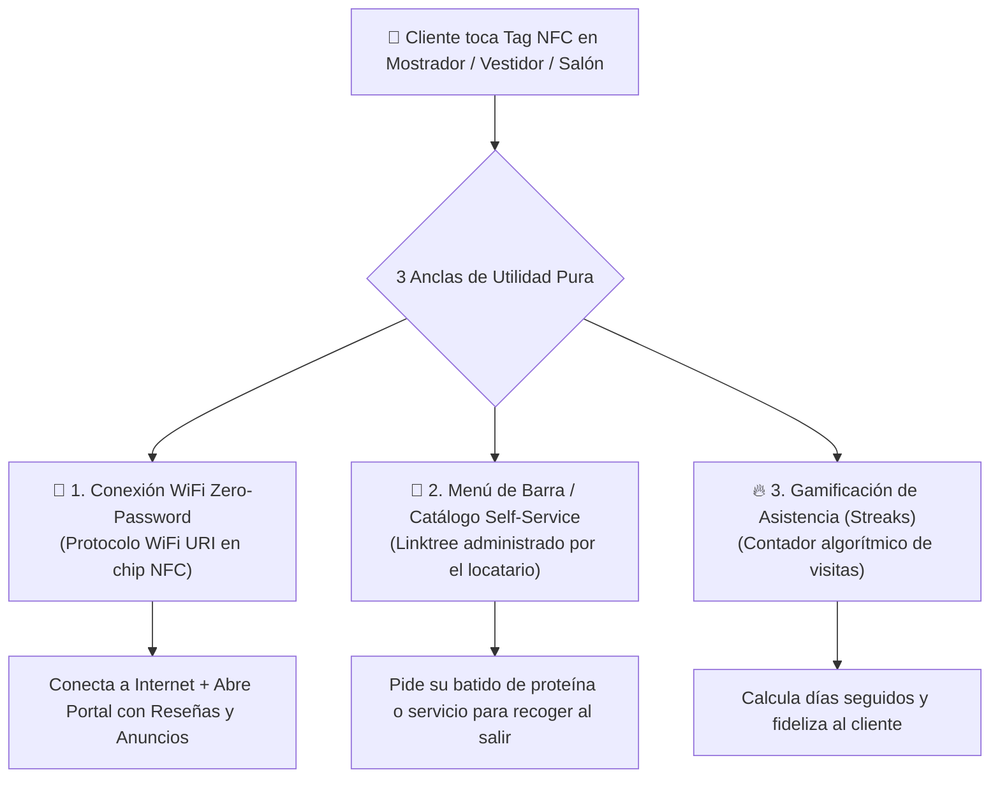
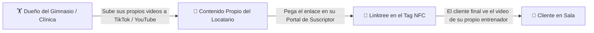

# ⚡ SPEC-007: Anclas de Utilidad Multi-Giro y Modelo Self-Service de Contenido

## 1. Resumen Ejecutivo & Invariante de Operación

A diferencia de un restaurante donde el comensal permanece sentado en una mesa, los comercios de flujo rápido (gimnasios, clínicas, barberías, spas, talleres) requieren **Anclas de Utilidad Inmediata** para que los clientes escaneen los tags NFC de forma recurrente sin intervención del personal.

### 🚫 Regla Operativa Estricta (Invariante de Negocio):
> **La plataforma de Mickey provee infraestructura tecnológica pura, NO es una agencia de creación de contenido.**  
> Bajo ninguna circunstancia el equipo central de la plataforma producirá videos de rutinas de entrenamiento, tutoriales de técnica de pesas ni infografías de cepillado dental. Cualquier contenido educativo o multimedia debe ser generado y cargado de manera **100% autogestiva (Self-Service)** por el propio dueño del local (locatario) a través de su Portal de Suscriptor.

---

## 2. Las 3 Anclas de Utilidad de Infraestructura Autónoma (Cero Creación de Contenido)

Estas herramientas funcionan de manera automatizada a nivel de software y protocolo de red, garantizando alto volumen de escaneos sin demandar tiempo operativo:

---

### 2.1. Conexión WiFi Automática en 1 Toque (Zero-Password)
* **El Problema:** Clientes con manos ocupadas, señal celular débil en sótanos o vestidores y contraseñas complicadas.
* **Solución Técnica:**
  * El tag físico en el local se programa con el estándar `WIFI:S:<SSID>;T:<WPA|WEP>;P:<PASSWORD>;;`.
  * Al acercar el celular, el sistema operativo (iOS o Android) se conecta a la red Wi-Fi del establecimiento en 1 segundo y acto seguido abre el resolvedor web (`/r/:tagCode`).
* **Configuración:** El locatario ingresa su red y contraseña una sola vez desde su portal (`/portal` ➔ *Mi Cuenta*).

---

### 2.2. Catálogo / Menú de Productos Self-Service (Click & Collect)
* **El Problema:** El cliente tiene prisa y no quiere hacer fila en mostrador para comprar un producto (ej. batido de proteína al salir del gym, cera para cabello en barbería, enjuague en clínica).
* **Solución Técnica:**
  * Se apoya directamente en el módulo **Linktree / Enlaces** que ya existe en el portal.
  * El locatario da de alta sus botones: *"Pide tu Proteína para la Salida"*, *"Agenda tu Próxima Cita"*, *"Ver Paquetes de Blanqueamiento"*.
  * Al tocar el enlace, se abre WhatsApp del mostrador con el pedido pre-llenado.

---

### 2.3. Gamificación de Asistencia & Fidelización (Streaks / Racha)
* **El Problema:** El cliente no tiene incentivo personal para escanear al salir.
* **Solución Técnica:**
  * Al tocar el tag de salida o torniquete, la plataforma registra un `check-in` anónimo o vinculado a su Pasaporte Web:
    > *"¡Entrenamiento #14 del mes! Estás a 2 visitas de desbloquear tu café de cortesía."*
  * El locatario define en su portal la meta (ej. 12 visitas al mes) y el premio que él mismo entregará en mostrador.

---

## 3. Modelo Self-Service para Contenido Educativo del Locatario

Si un gimnasio, estética o clínica desea proyectar videos de ejercicios, tips de técnica o consejos de salud:

1. **Autonomía Total:** El locatario graba a sus propios entrenadores, fisioterapeutas o dentistas y sube el contenido a su canal de YouTube Shorts, Instagram Reels o TikTok.
2. **Embebido en el Linktree:** En su panel de control ([`PortalDashboardPage.tsx`](file:///c:/Users/Mickey/Documents/DEV/Google%20Reseñas/src/pages/portal/PortalDashboardPage.tsx)), el locatario agrega un enlace tipo video:
   * Título: *"¿Dudas de postura? Mira la técnica correcta con nuestro Coach Alex"*.
   * URL: Enlace al video de su autoría.
3. **Rol de la Plataforma:** Proveer el reproductor responsivo sin costo de producción ni mantenimiento editorial para Mickey.

---

## 4. Matriz de Anclas de Utilidad por Giro Comercial

| Giro Comercial | Ubicación Física del Tag | Ancla de Utilidad Principal | Contenido Self-Service (Opcional del Locatario) |
| :--- | :--- | :--- | :--- |
| **Gimnasio / Box / Yoga** | Entrada, Vestidores, Torniquete | WiFi Instantáneo + Racha de Asistencia + Pre-orden de Proteína | Reels de rutinas grabados por sus coaches |
| **Clínica Dental / Médica** | Sala de Espera / Mostrador | WiFi para Pacientes + Agendar Próxima Consulta | Video propio del doctor sobre cuidados post-operatorios |
| **Barbería / Salón de Belleza** | Marco del Espejo en Sillón | WiFi + Selección de Playlist / Música + Calificar al Barbero | Catálogo de cortes y tintes propios |
| **Taller Mecánico / Car Wash** | Sala de Clientes / Mostrador | WiFi + Estatus de Reparación vía WhatsApp | Tips de mantenimiento del mecánico |

---

## 5. Estado de Aprobación & Registro

* **Estado:** `PREAPROBADO` (Incorporado formalmente con el candado estricto de cero creación de contenido centralizado).
* **Impacto en el Código:** No requiere dependencias externas; se apoya en los módulos existentes de Linktree, WiFi URI y contadores de escaneo.
