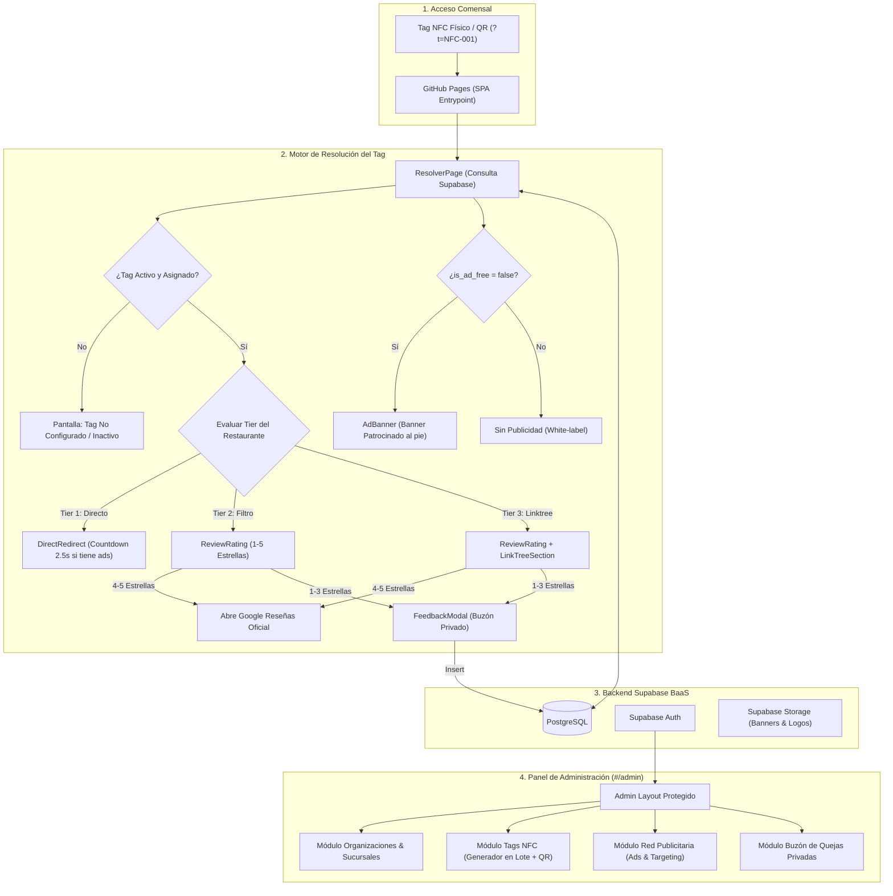

# Plan Técnico de Implementación: Plataforma NFC Google Reseñas & Red Publicitaria Local

**Archivo:** `tasks/plan.md`  
**Estado:** Listo para revisión  
**Referencia:** [SPEC.md](file:///c:/Users/Mickey/Documents/DEV/Google%20Reseñas/docs/SPEC.md) | [nfc-google-reviews.md](file:///c:/Users/Mickey/Documents/DEV/Google%20Reseñas/docs/intent/nfc-google-reviews.md)  

---

## 1. Arquitectura y Componentes Principales

---

## 2. Orden de Implementación y Fases

La construcción se realizará en 5 fases secuenciales para garantizar que cada pieza sea probada y funcional antes de depender de la siguiente:

### Fase 1: Cimientos, Base de Datos y Scaffolding
- Inicialización del proyecto con Vite + React 18 + TypeScript + Tailwind CSS.
- Configuración de dependencias: `lucide-react`, `react-router-dom`, `@supabase/supabase-js`, `qrcode.react`.
- Configuración de base path en `vite.config.ts` y script de redirección limpia para GitHub Pages.
- Creación del script SQL (`supabase/schema.sql` y `supabase/seed.sql`) con tablas `organizations`, `restaurants`, `tags`, `ads`, `feedback`, `tag_scans` y sus políticas RLS.
- Cliente de Supabase (`src/lib/supabase.ts`) y variables de entorno (`.env.example`).

### Fase 2: Experiencia del Comensal (NFC Resolver & Public Pages)
- Sistema de enrutamiento con lectura de query params (`?t=NFC-xxx`).
- Pantalla de estado de error/inactivo ("Tag en proceso de activación").
- Componente `AdBanner` (renderizado de anuncios patrocinados segmentados por tag o restaurante).
- Componente `DirectRedirect` (Tier 1: pantalla de 2.5s con anuncio o salto instantáneo).
- Componente `ReviewRating` (Tier 2: estrellas interactivas con redirección inteligente a Google).
- Componente `FeedbackModal` (Captura de quejas de 1-3 estrellas con persistencia en Supabase).
- Componente `LinkTreeSection` (Tier 3: botones de menú, redes sociales, Wi-Fi y WhatsApp).

### Fase 3: Autenticación y Shell del Panel de Administración
- Configuración de rutas administrativas (`#/admin/login`, `#/admin/dashboard`).
- Guardián de autenticación `AdminAuthGuard` con Supabase Auth.
- Layout administrativo responsivo con barra de navegación móvil y de escritorio.
- Dashboard general con tarjetas de métricas (Restaurantes activos, Tags totales, Quejas recibidas, Anuncios en circulación).

### Fase 4: Módulos de Gestión Administrativa (CRUD)
- **Restaurantes / Sucursales:** Alta, edición, selección de Tier (1, 2, 3), switch de ad-free, color de marca, enlaces de Linktree, teléfono de contacto.
- **Tags NFC:** Creación masiva (ej. `NFC-001` a `NFC-050`), asignación a restaurante y mesa, previsualización de QR y descarga de imagen para impresión.
- **Red de Anuncios:** Creación de campañas, subida/enlace de banner, selección de destino y segmentación (todos los locales, sucursales específicas o tags específicos).
- **Buzón de Quejas:** Listado filtrable de comentarios de 1-3 estrellas con datos del cliente y estado de atención.

### Fase 5: Despliegue en GitHub Pages y Verificación Integral
- Configuración del flujo de GitHub Actions (`.github/workflows/deploy.yml`).
- Pruebas de compatibilidad móvil en iOS y Android.
- Verificación de los criterios de aceptación (SC-01 a SC-08).
- Guía operativa para el usuario: grabación de stickers NFC físicos y puesta en marcha con clientes.

---

## 3. Riesgos y Estrategias de Mitigación

| Riesgo Técnico | Impacto | Estrategia de Mitigación |
|---|---|---|
| **Recarga con error 404 en GitHub Pages** | Alto | Uso estricto de `HashRouter` (`#/admin`, `#/t/...`) combinado con normalizador en `index.html` para aceptar URLs limpias `?t=NFC-001`. |
| **Tiempo de respuesta lento en redes móviles 4G** | Medio | Bundle JS ultra liviano (< 150 KB gzip), sin librerías pesadas, y consultas directas con índices optimizados en Supabase. |
| **Exposición de claves de Supabase** | Crítico | Se utiliza únicamente la clave pública `anon` en el frontend, blindando la base de datos con Row Level Security (RLS) estricta en PostgreSQL. |
| **Incompatibilidad de enlaces de Google Reseñas en móviles** | Medio | Formato de URL estandarizado `https://search.google.com/local/writereview?placeid=...` que abre directamente la app nativa de Google Maps tanto en iOS como en Android. |

---

## 4. Puntos de Verificación (Checkpoints)

- **Checkpoint 1:** Proyecto inicializado, compila con `npm run build` y el script SQL corre sin errores en Supabase.
- **Checkpoint 2:** Al ingresar a `?t=NFC-DEMO-T2`, se visualiza la marca, las 5 estrellas abren Google, y 2 estrellas abren el modal de feedback y guardan la queja en la base de datos.
- **Checkpoint 3:** El banner de publicidad solo se muestra si el restaurante no tiene `is_ad_free = true` y respeta la segmentación por tag.
- **Checkpoint 4:** Panel de control funcional, permite crear un restaurante, asociarle tags y ver el feedback recibido.
- **Checkpoint 5:** Despliegue automático exitoso en GitHub Pages.

